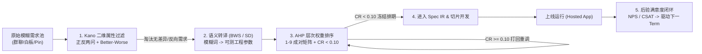

# SDLC-Studio v4.0 架构演进与全面开发规格说明书（Dev Spec）

> **文档状态**：Draft for Approval（等待用户 `"开工"` 指令后进入分阶段实现）
> **目标仓库**：[Wang-auspicious/SDLC-studio](https://github.com/Wang-auspicious/SDLC-studio)（当前基线 `v3.1` @ `23820a7`，本地工作区：[Software-factory](file:///d:/Desktop/Courses_27/SE/Software-factory)）
> **产品定位**：面向 ToB 多人类工程师 × 多智能体团队协同的全生命周期软件工程控制面与协作工作台（**Solo + Team IDE × Raft 式意图共识 × Master Agent 全局编排 × 独立审校签收 × 托管应用运维与组织记忆**），绝非泛化聊天机器人或通用编排玩具。

---

## 0. 调研资产与完整溯源索引（全部可点击链接）

本开发规格基于以下 5 类一手输入资产、视觉界面截图、大厂工程体系调研与 9 个本地克隆仓库源码级拆解整合而成：

### 0.1 目标仓库与历史架构文档

| 资产名称 | 说明 | 链接 / 路径 |
| :--- | :--- | :--- |
| 目标开源仓库 | SDLC-studio GitHub 远端主仓 | https://github.com/Wang-auspicious/SDLC-studio |
| 本地工作区 | 当前工程根目录（v3.1 已验证绿灯 `10/10` + `35/35`） | [Software-factory](file:///d:/Desktop/Courses_27/SE/Software-factory) |
| 历史架构建议 A | 《ForgeOps SDD 多仓软件工厂架构设计与工程细节说明》 | [media_1795252242866_05b3ce37.md](file:///C:/Users/zjz65/.gemini/antigravity/brain/51452a25-2c02-471b-8edb-6156e06d5c18/.user_uploaded/media_1795252242866_05b3ce37.md) |
| 历史架构建议 B | 《SDD 多仓软件工厂架构演进与深水区工程设计》 | [media_1795252246818_f2dc80d8.md](file:///C:/Users/zjz65/.gemini/antigravity/brain/51452a25-2c02-471b-8edb-6156e06d5c18/.user_uploaded/media_1795252246818_f2dc80d8.md) |
| 前序 GitHub 5 仓拆解 | `paseo` / `vibe-kanban` / `paradev` / `agent-orchestrator` / `multica` 首轮对比报告 | [github_orchestrator_teardown.md](file:///C:/Users/zjz65/.gemini/antigravity/brain/51452a25-2c02-471b-8edb-6156e06d5c18/github_orchestrator_teardown.md) |

### 0.2 用户输入的 6 篇深度思想文章与同业架构师对话

| # | 文章/笔记标题 | 核心可落地工程思想 | 本地 Markdown 与原始链接 |
| :-: | :--- | :--- | :--- |
| 1 | openJiuwen 首发 AgentOS「Harnessless」开发范式（机器之心） | 反对「旧 UI 旁硬贴聊天框」；提出 Gateway + AppMarket「开发发布 -> 托管卡片启停与监控 -> 点击编排再迭代」全生命周期闭环、`SwarmFlow` 多人多 Agent 状态机编排、REA 能力检测、Harness 自演化（RSI） | [本地笔记](file:///C:/Users/zjz65/Documents/Obsidian%20Vault/笔记同步助手/2026-11-18/openJiuwen首发AgentOS「Harnessless」开发范式：不用自建Harness，让Agent原生应用触手可及.md) · [微信原文](https://mp.weixin.qq.com/s?__biz=MzA3MzI4MjgzMw==&mid=2651075119&idx=2&sn=3c605eec20f5342d9385a5f813e17ac&chksm=85a3d8de3edc84871c1eeab5172e7f4b33407868d0fdfd75a988d86c95466581d8f5dab0fbf1&mpshare=1&scene=1&srcid=1119MMdrpN30NlxkE4kFVKt7&sharer_shareinfo=6c62106ba33414d0638c63fc7d4d04f3&sharer_shareinfo_first=6c62106ba33414d0638c63fc7d4d04f3#rd) |
| 2 | Agent 多人共用为何会失控？来自 Ankole 的 Business Agent 架构设计（机器之心） | 揭示团队共用 Personal Agent 的 4 大崩坏（认知分叉、上下文越权泄露、状态撕裂、高频轮询算力税与误差复利 $1-0.99^{288} \approx 94.5\%$）；给出快/慢路径分离、动态权限交集签名写回、Receipt 客观事实 vs 带校准作者评分的主观判断、`AskUser` 审批卡片 | [本地笔记](file:///C:/Users/zjz65/Documents/Obsidian%20Vault/笔记同步助手/2026-11-18/Agent多人共用为何会失控？来自Ankole的Business%20Agent架构设计分享.md) · [微信原文](https://mp.weixin.qq.com/s?__biz=MzA3MzI4MjgzMw==&mid=2651075119&idx=1&sn=87c3aecd0cd20bbd7c0957c8e131d71c&chksm=85c051a778728feefad9616ce56222616734a3d6e35655e0491a3d2a80a9f6d6fee3e2f346cd&mpshare=1&scene=1&srcid=1119bSas7eYYyO7NZkvuN01z&sharer_shareinfo=6b620ab8502a83503299c3b1ecf54a8f&sharer_shareinfo_first=6b620ab8502a83503299c3b1ecf54a8f#rd) |
| 3 | 2027 年的 Agent 平台：所有软件都会沦为数据库（winkrun / John Suh） | **Conversation（对话主线）vs Agent Session（执行现场）严格分离**；Focused Approval Inbox 聚合人工最后一公里裁决（同时作为 RL 偏好数据）；`N Agents × M Checkpointed Sandboxes`；共享 POSIX/`git`/`jj` 分权协作；`memory_log.md` 追加日志 + `memory_current.md` 可分叉状态视图 | [本地笔记](file:///C:/Users/zjz65/Documents/Obsidian%20Vault/笔记同步助手/2026-11-22/2027年的Agent平台：所有软件都会沦为数据库.md) · [微信原文](https://mp.weixin.qq.com/s?__biz=MzA5MTIxNTY4MQ==&mid=2461162044&idx=1&sn=59ebd86f214b88b7ab4d287030c0da96&chksm=86225db68ca4073c510b141c0d0fc2f530f25ee0b2fb32062406124ddd910a22d151bd0a787d&mpshare=1&scene=1&srcid=1123XnAcF9P8b9nDmBtVX4YX&sharer_shareinfo=ced233f096b699fd57919d637e0cf39d&sharer_shareinfo_first=ced233f096b699fd57919d637e0cf39d#rd) |
| 4 | 设计研究知识｜需求分类于权重量表（YRJustMeet） | 上游需求量化漏斗：1) **Kano 模型**（正反两问 + 四象限/五分类 + `Better-Worse` SI/DS 系数）；2) **BWS / 语义差异法 / 感性工学**（把模糊形容词转译为可编码工程参数）；3) **AHP 层次分析法**（1–9 成对比较矩阵计算权重与一致性比率 $CR = CI/RI < 0.10$ 强校验）；4) 严格区分**上线后 `NPS/CSAT`** 仅用于后验评价，禁用于前期需求准入 | [本地笔记](file:///C:/Users/zjz65/Documents/Obsidian%20Vault/笔记同步助手/2026-11-23/设计研究知识｜需求分类于权重量表.md) · [小红书原文](https://www.xiaohongshu.com/discovery/item/6afdab91000000001802eab8?app_platform=android&ignoreEngage=true&app_version=9.23.0&share_from_user_hidden=true&xsec_source=app_share&type=normal&xsec_token=CBPo10WGoq3DwwkNsaq9zDAXwrqBj_VtIwD3BGCT_7pGs%3D&author_share=1&xhsshare=&shareRedId=OD5HMzU7PUw2NzUyOTgwNjk0OTdIRks8&apptime=1795482112&share_id=c294809a841f4218aff61520681e8866&share_channel=wechat) |
| 5 | Anthropic 上线 Claude Ship 功能（jojo / AGI 知路） | 下游三体解耦闭环：`Code Review`（Fast/Standard/Deep 三档 + 多智能体交叉去误报 + 项目规则）+ `PR Steward`（只负责修 CI / 冲突 / 评论且附带回滚说明，**严禁自批自合**，`@claude` / `@claude stop`）+ `Claude Approvals`（策略文件 + Owner 路由 + **Shadow Observation Mode 影子观察期**） | [本地笔记](file:///C:/Users/zjz65/Documents/Obsidian%20Vault/笔记同步助手/2026-11-23/Anthropic上线Claude%20Ship功能：AI一站式搞定代码评审、缺陷修复、自动审批.md) · [微信原文](https://mp.weixin.qq.com/s?__biz=Mzk2NDQ4MTQ0Nw==&mid=2247493090&idx=1&sn=ed5687b0d996c8c6869a837bf935a38&chksm=c54b93453adb91417cbe87f8d0577ec8516080c7fd1d07b40077025dc8f877f2a89d9ec71205&mpshare=1&scene=1&srcid=1124uufKGdcjh7xYPfBcqjNW&sharer_shareinfo=4f035f6a722908abf61b8b3306651075&sharer_shareinfo_first=7c02f5d0d996c8c6869a845c7b66558a#rd) |
| 6 | 同业大佬讨论实录《同步助手_2026-11-23》 | 指出 **DAG 的核心工程价值在于云端/后台 Agent 失败时的断点续跑**；提出 `自然语言意图 -> Spec DSL（需求/决策/伪代码级输入输出边界）-> 知识图谱 RAG -> Agent 上下文 -> 代码与前端/后端/数据/视觉验证 -> 理解图谱`。重点强调 **Answer-in-HTML**（HTML 承载验证报告与视觉反馈比纯文本更省 Token 且信息密度高），Git 退居底层无感存档 | [同步助手_2026-11-23.md](file:///C:/Users/zjz65/Documents/Obsidian%20Vault/笔记同步助手/2026-11-23/同步助手_2026-11-23.md) |

### 0.3 用户提供的 4 张协作 UI 参考截图

| # | 对应产品 / 画面特征 | 核心交互范式 | 截图文件链接 |
| :-: | :--- | :--- | :--- |
| 1 | **Relay**（多维证据径向共识脑图） | 左栏 Issue 概览 + 关联 PR + 相关代码行；中栏以议题为中心展开 `FOUND / CHECKED / ASKED / ADVISED / APPROVED` 类型化卡片脑图；右栏共享人机讨论 + `@relay suggests` 下一步列表 | [Relay 截图](file:///C:/Users/zjz65/.gemini/antigravity/brain/51452a25-2c02-471b-8edb-6156e06d5c18/.user_uploaded/media_1795483945827_2000544f.jpg) |
| 2 | **Cookout**（多轮拷问 Grilling 线程） | 左栏 `Inbox / People & agents / Channels`；中栏 `#cookout` 频道流；右栏 `Thread #cookout` 由 Agent 自动发起 `Round 1 Q1/Q2/Q3` 结构化拷问，每题预设默认 `Yes.` 建议，支持线程 `Resolve / Reopen` | [Cookout 截图](file:///C:/Users/zjz65/.gemini/antigravity/brain/51452a25-2c02-471b-8edb-6156e06d5c18/.user_uploaded/media_1795483951732_5be7ba05.jpg) |
| 3 | **Buzz**（Solo/Team + 结构化决策卡 + 白板） | 左栏 `All | Solo | Team`、`Catch-up`、`Channels` 与 Agent DM 平等并列；中栏 Agent 返回极高信噪比决策卡（`Conclusion / Evidence / Recommendation / Risk / Decision needed / Action needed`）；右栏实时联动 `Board`（Excalidraw 画板）与 `Doc` | [Buzz 截图](file:///C:/Users/zjz65/.gemini/antigravity/brain/51452a25-2c02-471b-8edb-6156e06d5c18/.user_uploaded/media_1795483967700_f628f596.jpg) |
| 4 | **AGY + Ryugi Artifacts**（桌面主对话 × 内嵌白板Pin批注） | 左栏项目/对话列表；中栏主 Agent 连续汇报与结构校验摘要（`Check: CLEAN` + 三块内容导读）；右栏本地 Excalidraw 白板（`scene.excalidraw`），用户在节点旁钉入数字批注Pin，状态显示 `Waiting on Agent` 并带 `Ask the agent` 直达回流 | [Ryugi 截图](file:///C:/Users/zjz65/.gemini/antigravity/brain/51452a25-2c02-471b-8edb-6156e06d5c18/.user_uploaded/media_1795483996628_361a6900.jpg) |

### 0.4 本地克隆的 9 个参考开源仓库与许可证隔离边界

> [!CAUTION]
> **Clean-Room 知识产权边界约束**：经核查，本批次新克隆的 4 个目标仓中，`block/buzz`、`block/buzz-app`、`AgentBull/open-ankole` 为 **Apache-2.0** 协议；而 `Innei/ryugi` 为 **Ryugi License 1.1**（`ryugi-artifacts` CLI/服务端为 `UNLICENSED` 闭源商业组件，且 `Ryugi License 1.1` 限制 Restricted Parties 将其 Skills/Hook 打包进商业产品或市场）。因此 **SDLC-Studio 对 Ryugi 仅吸收公开可见的产品交互范式与架构思想，严禁复制或引入 Ryugi 的任何源码、Skill 文件或 Hook 脚本；所有能力必须自研实现**。

| # | GitHub 仓库 | 许可证 | 本地浅克隆镜像路径 | 核心吸收点 / 舍弃点 |
| :-: | :--- | :--- | :--- | :--- |
| 1 | [getpaseo/paseo](https://github.com/getpaseo/paseo) | — | [paseo](file:///d:/Desktop/Courses_27/SE/Software-factory/.isolated/ref-repos/paseo) | **吸收**：Agent-to-Agent 控制工具原语（`create_workspace`、`create_agent`、`send_agent_prompt`、`get_agent_status`）、Daemon 解耦进程；**舍弃**：通用无流程限制的工作区视图 |
| 2 | [OrchestratorInc/agent-orchestrator](https://github.com/OrchestratorInc/agent-orchestrator) | — | [agent-orchestrator](file:///d:/Desktop/Courses_27/SE/Software-factory/.isolated/ref-repos/agent-orchestrator) | **吸收**：`Observe -> Update -> Derive` 架构、选文件夹自动 `prepare_git` 零表单建项目、划词/Diff 框选直发 Agent（`ArtifactSelectionAsk` / `DiffSelectionMenu`）、7 Tab `SessionInspector` 折叠式工程详情；**舍弃**：纯单兵视角 |
| 3 | [ParadevAI/Paradev](https://github.com/ParadevAI/Paradev) | — | [paradev](file:///d:/Desktop/Courses_27/SE/Software-factory/.isolated/ref-repos/paradev) | **吸收**：Diff 行级评论 + 应用内浏览器点击选元素反哺编码 Agent |
| 4 | [BloopAI/vibe-kanban](https://github.com/BloopAI/vibe-kanban) | — | [vibe-kanban](file:///d:/Desktop/Courses_27/SE/Software-factory/.isolated/ref-repos/vibe-kanban) | **吸收**：`ClickedElementsProvider` 视觉预览拾取回流、`CommentWidgetLine` 行内审阅卡片；**舍弃**：看板主视图（对标同业实录，看板不适合复杂断点恢复） |
| 5 | [multica-ai/multica](https://github.com/multica-ai/multica) | — | [multica](file:///d:/Desktop/Courses_27/SE/Software-factory/.isolated/ref-repos/multica) | **吸收**：`chat-page`「免填工单直接聊」入口与 CLI/Daemon 机制；**舍弃**：泛化通用 Squads 工单流 |
| 6 | [Innei/ryugi](https://github.com/Innei/ryugi) | **Ryugi License 1.1**（禁止复用源码/Skills） | [ryugi](file:///d:/Desktop/Courses_27/SE/Software-factory/.isolated/ref-repos/ryugi) | **仅借鉴思想**：`doc-rounds`（已理解/已敲定/Round-N 结构化问答预设默认项）、`written-design` 前置 `Builder Check` 三堆分诊、`executing-specs` 抗压缩 `Rulings` 账本与全新上下文 Reviewer；**严禁复制源码** |
| 7 | [block/buzz](https://github.com/block/buzz) | **Apache-2.0** | [buzz](file:///d:/Desktop/Courses_27/SE/Software-factory/.isolated/ref-repos/buzz) | **吸收**：`Branches as Channels`（特性分支即协作房间）、3 层治理（组织底线 / 仓库规则 / 变更证据）、Agent 权限不得超越所属 Owner 且 Owner 代理不得充当独立人审、受众绑定代理（$A(d) \subseteq R(x)$，$R(f(x,y))=R(x)\cap R(y)$）、`Verb-Object-Outcome` 活动流原则 |
| 8 | [block/buzz-app](https://github.com/block/buzz-app) | **Apache-2.0** | [buzz-app](file:///d:/Desktop/Courses_27/SE/Software-factory/.isolated/ref-repos/buzz-app) | **吸收**：`Solo | Team` + `ConvertToChannel` 单兵无缝转团队、`Catch-up` 断点追赶、`decisions_ask` 结构化决策工具、`docs` 乐观锁协同修订（`doc_get/doc_set` + revision 冲突保护）、`changesets` 基于临时 Git 索引的每回合 `git write-tree` 非侵入式变更快照 |
| 9 | [AgentBull/open-ankole](https://github.com/AgentBull/open-ankole) | **Apache-2.0** | [open-ankole](file:///d:/Desktop/Courses_27/SE/Software-factory/.isolated/ref-repos/open-ankole) | **吸收**：Virtual Actor 邮箱 + `RuntimeFabric` 控制面/Worker 职责分离、`BrainV3` 双时态 `Facts`（0.95 余弦去重/过期链）vs 可校准 `Takes`、`knowledge + disclosure` 双重边界与行内越权剔除、`workflow` 有界扇出 + `sleep/wake` 机制、`proposal-review` 审校对齐纪律 |

---

## 1. 产品北极星与大厂协作第一性原理（Pre-AI vs Agent 时代）

### 1.1 Google 等顶级大厂的协作不变量（Pre-AI 人工时代如何不乱）

在单人编码工具以外，Google 等工程组织在纯人工时代之所以能支撑上万名工程师在一个 Monorepo / 庞大微服务群中高频协同而不崩塌，核心依赖**五项刚性机制**：

1. **先设计文档（Design Doc），后动代码**：跨模块改动必须经过轻量/正式的 `Design Doc`（Target, Non-Goals, Context, Detailed Design, Alternatives Considered, Cross-cutting Concerns），在行内批注中暴露分歧并定案，再分解为变更集。
2. **明确的所有权拓扑（`OWNERS` 文件树）**：目录层级自带 `OWNERS` / Readability 门槛；无人能「盲改他人领地后悄悄合入」，跨区变更必须拿到对应模块 Owner 签收。
3. **原子变更集与全知检索（Atomic CL + `Code Search`）**：每一次提交对应清晰单一的意图闭环，并通过全局语义/交叉引用搜索（`Code Search`）消弭「我不知道某处已被别人改过」的盲区。
4. **评审与自动化静默门禁合一（`Critique` + `Tricorder`）**：静态分析/测试/格式/安全问题由机器人（Tricorder）自动标出并给出 `Please fix` 一键修复建议；人类评审员在 `Critique` 中只关心架构边界、语义正确性与可读性；通过 `LGTM` + Owner 批准即自动进合入队列（TAP / Submit Queue）。
5. **共享认知基底（代码即文档 + 单一事实源）**：没有割裂的口头传话；决策永远锚定到文档段落、CL 行号与 Postmortem 复盘记录。

### 1.2 进入 Agent 时代后的三大系统性新崩溃（为什么传统单兵 AI 工具做 ToB 团队会失控）

当多个工程师同时各自带着个人 Coding Agent 协同开发同一套软件时，会爆发四重个人助手时代不存在的事故（综合 Ankole 与 Buzz 实证分析）：

1. **认知分叉与幻觉共振（Cognitive Bifurcation & Consensus Drift）**：工程师 A 的 Agent 读了半截需求文档在改接口字段，工程师 B 的 Agent 按昨天的理解重构了调用方；没有全团队共享的「结构化 Spec IR + 类型化决策日志」，10 分钟内就会产生不可调和的架构冲突。
2. **上下文越权污染（Context Leak / Confused Deputy）**：工程师 A 的 Agent 在私聊或安全评审房间读到了密钥拓扑、客户 SLA 罚则或核心财务规则，转身被同事 B 在公开需求群 `@` 一下，就顺手把受限上下文泄露进公开频道、提交描述或统一 RAG 记忆库（违反 $A(d) \subseteq R(x)$）。
3. **高频轮询算力税与误差复利雪崩**：如果让多个自主 Agent 在缺乏确定性控制面的情况下依靠定时唤醒互相沟通，即便单次判断准确率高达 $99\%$，每日 288 轮 5 分钟级交互的累计系统不失控概率也只有 $0.99^{288} \approx 5.5\%$，意味着 **出错/失控率高达 $94.5\%$**。同时多个 Agent 争抢同一目录写文件会导致 Git 索引损坏（State Split）。
4. **评审洪泛与「自己批自己」的假闭环（Review Flooding & Self-Approval）**：Agent 生成代码极快、Diff 极长，如果把未经预审、未配机器证据的原始 Diff 直接推给人看，人类评审会瞬间疲劳麻木；如果允许生成代码的同一 Agent 上下文直接宣布「Verified & Approved」，则等同于考生兼任阅卷老师。

### 1.3 SDLC-Studio 的明确产品边界

- **我们是什么**：专精于 **ToB 多人 × 多智能体软件研发全流程** 的原生桌面协作控制面与共创工作台，覆盖：
  `阶段 1：群组意图构思与量化共识 (Raft + Kano/AHP + Board↔Spec IR)` $\rightarrow$ `阶段 2：主 Agent 统筹编排与 Worktree 并行构建 (Master Agent + Workers + Breakpoint DAG)` $\rightarrow$ `阶段 3：独立审校、自修管家与策略审批 (Claude Ship 3-Agent + Answer-in-HTML + Pass/Reject)` $\rightarrow$ `阶段 4：托管应用启停运维与分权组织记忆 (Hosted App Card + PBAC Org Brain + Post-Launch NPS/CSAT)`。
- **我们不是什么**：不做 Orca / Multica 那类抽象的通用「随便拉几个 Agent 聊天的工单看板」，也不做把聊天窗口硬塞在旧式多标签表单旁的「14 页配置后台」。

### 1.4 三层角色拓扑与三大致命陷阱红线

```
┌──────────────────────────────────────────────────────────────────────┐
│ 第 1 层：人类团队 (Human Principals & Module OWNERS)                  │
│ 职责：提出原始意图 / 回答结构化拷问 / 对交互界面拍板 / 行权审批 & 接管  │
├──────────────────────────────────────────────────────────────────────┤
│ 第 2 层：个人统筹主智能体 (Personal Master Agent — 用户唯一常驻主控台) │
│ 职责：对外协调同行与团队群；对内承接全局任务；把技术细节/Worker/DAG    │
│       /Worktree 收口到自己身后；绝不让用户在 20 个表单与终端之间跳转    │
├──────────────────────────────────────────────────────────────────────┤
│ 第 3 层：团队共享功能 Agent 与独立审校体 (Team Functional & Critic Agents) │
│ • 无长期私钥、按频道受众严格隔离 (R = 交集)、在专属 Worktree 沙盒工作  │
│ • Spec Critic / Code Reviewer / PR Steward / Policy Approver 三权分立  │
└──────────────────────────────────────────────────────────────────────┘
```

> [!WARNING]
> **开发过程严防三大致命陷阱**：
> 1. **白板形式大于实际（Whiteboard Theater）**：严禁做出一个与 Spec 脱节的炫酷画板。画板上的每一个框、每一条连线、每一个 Pin 批注，必须有双向绑定的 `Spec Node ID`；未锚定到 `Spec IR` 的草图禁止触发下游建仓与写码。
> 2. **把 DAG 和表单推到主前台（Foreground Control-Plane Bloat）**：用户厌恶逐格填需求与盯看静态 DAG 节点图。DAG 退居「Worker 断点恢复与持久化检查点引擎」，前台用户只面对**自然语言对话主线 + 结构化卡片 + 即点即用的工作画板/Doc/Diff/HTML 预览**。
> 3. **个人助手直接裸连共享库（Direct Shared-Brain Bypass）**：个人 Master Agent 绝不能拿着某个高权限员工的个人身份在群聊代写受限记忆或免检合并代码；一切跨人/跨房写入必须经由控制面的受众交集校验、签名通道与不可自批规则。

---

## 2. 4 款参考 UI、Google 内部系统与 9 个开源仓代码级拆解

### 2.1 四款参考 UI 与 Google 内部工具横向对标与取舍

| 对标系统 | 核心界面结构与交互机制 | SDLC-Studio v4 吸收落点 | 明确舍弃 / 规避项 |
| :--- | :--- | :--- | :--- |
| **Google 内部工程链**（`Design Doc` + `Code Search` + `Cider` + `Critique/Tricorder`） | 四套高精专业 Web 工具协同：`Design Doc` 做提案评议；`Code Search` 全局交叉引用；`Cider` 云 IDE 编码；`Critique + Tricorder` 自动机检+人工 LGTM+Submit Queue | 在**单一 Electron 桌面窗体**内融合四者闭环：`Spec IR` 对标 Design Doc，`Memory Graph + Probe` 对标 Code Search，`Code & Diff` 内置看代码/行级评论避免切去 VS Code，`Verify & Policy Gate` 对标 Critique + Tricorder | 禁止做成 Google 式互相跳转的 4 个独立 Web Tab，也禁止暴露内部基建的复杂配置项 |
| **Relay**（图 1） | 暗色三栏：左栏 Issue 元信息+关联 PR+关联代码行；中栏以议题为锚点的径向共识脑图（`FOUND` / `CHECKED` / `ASKED` / `ADVISED` / `APPROVED`）；右栏协同聊天+@relay 下一步推荐 | **吸收「类型化证据节点」语义**：在共识构思与排障视图中，每条发言或调查结论都带强类型标签（发现事实 / 已验证 / 待决策 / 建议 / 已批准）且反向锚定代码行号或 Spec 节点；保留右栏主协调对话 | 不采用 Relay 暗色霓虹配色（严守用户钦定的 **v2.2 浅色衬线体系**）；不做无休止蔓延的纯发散脑图，必须可收敛回 `Spec IR` |
| **Cookout**（图 2） | 左栏 Channels/Inbox/People & agents；中栏 `#cookout` 对话流；右栏 `Thread #cookout` 由 Agent 一次抛出一组 `Round 1 Q1/Q2/Q3` 拷问，带默认值 `Yes.`，支持 `Resolve / Reopen` | **吸收「结构化 Round 拷问 (Grilling) + 默认建议 + 线程 Resolve/Reopen」**：Master Agent 或 Spec Critic 拒绝模糊追问，直接给出含默认推荐选项的 Q1..Qn 结构化题组，用户只需纠偏例外项 | 不做独立 Discord/Slack 闲聊社区外壳；每次拷问必须与当前 `Mission / Spec Section` 绑定，且能一键 Resolve 并写入 `Settled` |
| **Buzz**（图 3 + 源码 `block/buzz`, `block/buzz-app`） | 左栏 `All \| Solo \| Team` + `Catch-up`；中栏 Agent 高信噪比 6 段决策卡（`Conclusion / Evidence / Recommendation / Risk / Decision needed / Action needed`）；右栏 `Board`（画板）与 `Doc` 并排；`Branches as Channels` 与临时索引 Turn Diff | **深度吸收 5 大模块**：1) `Solo \| Team` 模式与一键转团队频道；2) 6 段式强结构化决策卡；3) `Catch-up` 错峰追赶视图；4) **Turn-level `git write-tree` 非侵入式变更快照**；5) **受众交集信息流控制与权限不得超越 Owner 规则** | 不照搬 Nostr 密钥体系作为唯一前置门槛——本地桌面采用 zero-setup 零门槛启动（选目录即用），团队版再平滑映射到 Principal/Key 鉴权 |
| **Ryugi**（图 4 + `Innei/ryugi` 模式借鉴） | 左栏会话列表；中栏主 Agent 对话（明确展示 `Check: CLEAN` + 分块导读）；右栏本地浏览器/白板（`scene.excalidraw`），用户在图块钉入数字 Pin 批注（`Waiting on Agent`）+ `Ask the agent` 回流；支持 `<ask>` 文档回合收敛与抗压缩 `Rulings` 账本 | **借鉴产品体验范式**：1) 画板/文档上的 **数字 Pin 批注 + `Waiting on Agent` -> `Waiting on You` 状态流**；2) `What I understand so far / Settled / Round-N` 回合制文档收敛；3) 交付前 `Builder Check` 三堆分诊（已答 / 小事自作主张标出 / 大事问人）；4) **仅自研重构思想，零复用 Ryugi 代码或 Skill 文本（遵循 Ryugi License 1.1 合规红线）** | 严禁复制 `.ryugi/` 格式或嵌入 `ryugi-artifacts` 闭源包；同时解决 Ryugi 偏向“单兵 Claude Code 外挂本地网页”的局限，原生集成进 Electron 与团队多人共识 |

### 2.2 其余核心参考仓关键底层机制对照

- **`open-ankole`（Apache-2.0）**：提供团队级 Harness 的硬核底座思想——① `Virtual Actor + 邮箱 + Control Plane/Worker 分离`（控制面管 Postgres 事实与鉴权，Worker 管工作区与工具）；② **`BrainV3` 双层记忆**：双时态客观事实 `Facts`（0.95 余弦去重与 `superseded_by` 过期链）严格区别于可随结果事后打分校准的主观判断 `Takes`；③ **双边界访问控制**：`Knowledge boundary`（检索可见性预过滤）+ `Disclosure boundary`（群聊回复时按“仅提问者” vs “全体在场成员严格交集”剔除 `audience` 受限块）；④ `Workflow` 有界扇出 + `sleep/wake` 事件唤醒（免除高成本空轮询）。
- **`agent-orchestrator` & `paseo` & `vibe-kanban` & `paradev` & `multica`**：补齐了面向真实编码桌面的「手脚层」细节——① 选中项目目录自动探测环境并执行 `git init` / 基线提交（消除建仓表单摩擦）；② `SessionInspector` 按需展开底层工具调用/Terminal 现场（落实 `Conversation ≠ Agent Session`）；③ **Visual Clicked-Element + Diff Line Selection** 把浏览器预览区 DOM 节点与代码 Diff 行选区直接回传给 Master Agent 触发定向修改；④ `paseo-tools` 式的主 Agent 控制工具集（创建工作树、派生执行 Worker、查询状态、发指令、收口产出）。

### 2.3 关于「白板（Whiteboard）」的清醒定位：形式服从 `Spec IR`

针对用户指出的「*白板不错，但白板形式大于实际，必须同时落地到 Doc 里*」的核心痛点，SDLC-Studio v4 确立一条**不可妥协的铁律**：

> **白板绝不是游离于文档和代码之外的“涂鸦图片”，而是结构化 `Spec IR`（领域模型、架构拓扑、状态流转、伪代码级 I/O 边界契约）的可视化双向投影视图。**

具体约束机制如下：
1. **双向同源（Single Source of Truth）**：用户在右侧 `Board` 画出一个模块框并连线、或贴上一枚数字批注 Pin（如 Pin `#1`：「这里加限流和降级开关？」），底层立刻将该图元注册进 `Spec IR` 节点表（绑定 `board_node_id <-> spec_section_id`），并在右侧 `Spec IR` Tab 生成或高亮对应条目与伪代码契约骨架；反之，在 `Spec IR` 修改接口边界或模块依赖时，画板自动重排/高亮增量 Diff 节点。
2. **形式必须收敛为契约（No Orphaned Sketch）**：在构思结束进入编码前，系统执行静态一致性校验——**任何未被 `Spec IR` 吸收、未解答的 Pin 批注（`status = waiting_on_human` 或 `unanchored` 草图），都会以红/琥珀标高亮提醒并阻断一键开工**，彻底杜绝「画板很热闹、落到需求文档全是空白」的形式主义。

---

## 3. 类 Raft 多人 × 多 Agent 群组意图构思与共识协议

### 3.1 为什么上游意图构思必须使用「类 Raft 共识」而非普通群聊？

普通多人群聊 + AI 往往陷入「谁最后发言谁算数」「Agent 两边讨好、越聊越散」「关键决策淹没在历史消息里」。SDLC-Studio v4 将上游群组意图构思严谨建模为**可审计、带任期（Term）、支持异议提交与量化仲裁的类 Raft 共识协议（Intent Consensus Log）**：

| Raft 分布式共识概念 | 在 SDLC-Studio 上游构思中的工程映射 |
| :--- | :--- |
| **Term（任期 / 轮次）** | `Discussion Term T`（如 `Term 1: 目标与范围边界` $\rightarrow$ `Term 2: 领域模型与边界契约` $\rightarrow$ `Term 3: UI/交互与验收门禁`）。每次需求大变更触发 `Term++`，所有旧 Term 的过时提案自动标为 `Superseded` |
| **Leader（当前轮次收敛主理人）** | **人类发起者 / 指定 PM Owner 担任 Final Authority，Master Agent 担任 Facilitation Proposer（主理提案官）**。同一时刻只有一个主理协调流收口日志，避免多个 Agent 七嘴八舌各自改稿 |
| **Followers（团队参与者 × 专职评审 Agent）** | 同项目 HUMAN 工程师（后端、前端、QA、安全）、以及团队功能 Agent（`Spec Critic` 质疑者、`Arch Prober` 仓库现状探针、`UX Modeler`）以平等成员身份向共识日志追加带类型条目 |
| **Append-Only Log Entries（只追加共识日志）** | 每条记录带 `(term, log_index, author_principal, entry_type, spec_anchor_id, payload, evidence_ref)`。`entry_type` 复用强化型枚举：`INTENT`（原始诉求）、`FOUND`（代码/事实核查证据）、`ASKED`（结构化 Round 拷问 `Q1..Qn`）、`ADVISED`（带 Default 选项的方案建议）、`KANOSCORE`（Kano 归因）、`AHP_WEIGHT`（AHP 权重）、`RULING`（拍板裁定）、`DISSENT`（阻断式反对票） |
| **Quorum Commit（法定多数与 Owner 一票否决提交）** | 当某项提议集齐：① 相关模块 **`OWNERS` 全部人类签名同意**（或超过法定 Quorum 人数阈值 + 无未解决 `DISSENT`），且 ② **独立 `Spec Critic` 的 `Builder Check` 三堆分诊无阻断项**，该组 Log Entries 才被标记为 `COMMITTED`，原子写入不可变的 **`Settled Decisions` & `Approved Spec Baseline`** |
| **Split-Brain & Reconcile（脑裂预防与冲突重同步）** | 若某人在代码库直接改了核心接口或提出了越界新需求，系统自动递增 Term 并在对话流顶部弹出「上游契约漂移重同步卡（Re-sync Gate）」，由 Master Agent 给出影响面最小修正案，避免人在不知情下沿旧 Spec 施工 |

### 3.2 结构化拷问与回合收敛流程（吸收 Cookout + Ryugi + Buzz 精华）

1. **首回合零废话回放（Playback + Probing）**：用户无论选择 `Solo` 单人启动，还是在 `Team` 群组 `@MasterAgent` 丢进一句模糊想法（或拖拽入文件夹/已有文档），Master Agent **先静默读代码与组织记忆（`Look before you ask`）**——绝不询问代码库里一眼能查到的技术栈、目录结构或既有 API！随后输出首版结构化卡片：
   - **`What I understand so far`（当前理解回放）**：严格区分 `已确认来自用户/团队 (Confirmed)` 与 `Agent 推测默认值 (Assumed — 点击可改)`；
   - **`Round 1 Grilling`（5–7 项无依赖核心分叉拷问）**：第一题永远是决定其余分支是否存在的 **Fork Question（总开关题）**；每一题均参照 Cookout/Ryugi 格式自带 `Recommended` 预设答案与一句话依据（最多允许 2 个只能由人类回答的开放问题，如商业优先级、底线红线）；
   - **`Board` 同步起草**：若涉及多模块交互或 UI 流转，自动生成初版结构化图谱投影到右侧 `Board`，并标注待确认框。
2. **针尖交互式反馈**：团队成员既可直接在 `Thread / Card` 点选预设推荐（不选则明确标记「按推荐默认采纳并公示」），也可在 `Board` 画布直接圈节点或插 Pin 批注（状态 `Waiting on Agent`），或者在 `Spec IR` 行内选中某句话点评。每提交一轮，Master Agent 实时收口并推送精简变更摘要：**「本轮已锁定 4 项进入 Settled，裁剪 2 个冗余问题，剩余 2 项待定（CR = 0.04 已通过）」**。

### 3.3 需求量化过滤与权重量表管道（严格落地 Kano + BWS + AHP + 后验 NPS/CSAT）

针对用户引入的《设计研究知识｜需求分类于权重量表》一文，SDLC-Studio v4 将多维度需求分诊彻底自动化与数学化，取代过去 `v3.1` 纯拍脑袋的「简单/标准/复杂」三分法，防止需求范围蔓延（Scope Creep）：



具体数学与工程实现规范（复用于 `src/core/requirement-quantizer.ts` 及 `hama-engine.ts`）：

1. **第 1 步：Kano 模型定性过滤与优先级基线**
   - 对每一候选需求子项，由 Master Agent 为相关干系人/模拟角色生成**正向问（「具备该功能你感觉如何」）**与**反向问（「不具备该功能你感觉如何」）**五级量表矩阵，归入 **M（必备型 Must-be）/ O（期望型 One-dimensional）/ A（魅力型 Attractive）/ I（无差异型 Indifferent）/ R（反向型 Reverse）**；
   - 计算每个需求项的 **Better-Worse（满意/不满意影响系数）**：
     $$SI = \frac{A + O}{A + O + M + I}, \qquad DSI = -1 \times \frac{O + M}{A + O + M + I}$$
   - **硬性准入门禁**：`R`（反向需求）直接剔除并记录拒绝理由；`I`（无差异需求）默认移入 Backlog 不进本轮交付；所有 `M`（$|DSI|$ 极高）强制作为本轮 P0 阻断门禁；`O` 与高 `SI` 的 `A` 类需求进入下一步权重竞争。
2. **第 2 步：BWS（最优-最劣量表）与语义差异法（Semantic Differential / Kansei）参数化转译**
   - 当用户/干系人提出模糊感性词（「页面要更专业克制」「检索要秒出」「协同不要打扰人」）时，Master Agent 不允许直接在 Spec 里照抄形容词，而是自动触发 **语义差异对照卡 + 最优-最劣二选极值投票（Best-Worst Scaling）**，强制将其映射为**可验证的定量边界与伪代码断言**：
     - 例：「更专业克制」$\rightarrow$ 遵循 v2.2 浅色衬线 Token + 单屏信息密度阈值 + 零糖果渐变；
     - 例：「不要打扰人」$\rightarrow$ `zero-notification default`（仅审批卡/异常升级唤醒，过程事件折叠）。
3. **第 3 步：AHP（层次分析法）多目标加权与一致性强校验（$CR < 0.10$）**
   - 在有限工时/Token 预算与冲突目标（如「首期上线速度」vs「多租户强权限隔离」vs「界面极简」）下，针对留存的候选特性集构建 $n \times n$ 正互反判断矩阵 $A = (a_{ij})$（$a_{ij} \in \{1..9, 1/2..1/9\}$），求解特征向量归一化权重 $w$ 与最大特征根 $\lambda_{\max}$；
   - **强制一致性检验（Consistency Gate）**：计算
     $$CI = \frac{\lambda_{\max} - n}{n - 1}, \qquad CR = \frac{CI}{RI}$$
     其中 $RI$ 取标准 Saaty 随机一致性指标表（$n=1..9$ 对应 `[0, 0, 0.58, 0.90, 1.12, 1.24, 1.32, 1.41, 1.45]`）。
   - **拒绝拍脑门与自相矛盾**：当多人投票汇总或人类排序导致 $CR \ge 0.10$ 时（说明出现 A 比 B 重要、B 比 C 重要、C 又比 A 重要的逻辑自相矛盾），系统自动标红定位矛盾最大的成对项（最大残差元 $(i,j)$）弹回对话流请求澄清，**直到 $CR < 0.10$ 方可生成最终研发优先级序列与任务切片配额**！
4. **第 4 步：严格的阶段隔离——NPS / CSAT 仅作后验验收，严禁用于前期构思**
   - 代码约束层面强制规定：`NPS`（净推荐值 $\%(9\text{-}10\text{分}) - \%(0\text{-}6\text{分})$）与 `CSAT` 仅在阶段 4 **产品上线交付给终端用户 / AppMarket 运行态** 后才挂载采集，并自动回灌入下一轮 `Term` 的 `Intent` 输入与 `Takes` 校准，绝不混淆至阶段 1 需求排序公式中。

### 3.4 Spec IR 标准化中间表示（打通自然语言 $\leftrightarrow$ 白板 $\leftrightarrow$ 代码 RAG $\leftrightarrow$ 验收闭环）

结合同业架构师《同步助手_2026-11-23.md》的方案，SDLC-Studio 的 Spec 收敛产物绝不仅是给人类看的散文 Markdown，而是一份**双态同源结构（Human-Readable Spec Doc + Machine-Checkable `Spec IR` JSON/DSL）**：

```typescript
export interface SpecIRContract {
  readonly specId: string;
  readonly term: number;
  readonly status: 'draft' | 'grilling' | 'builder_checked' | 'committed' | 'superseded';
  readonly goals: readonly string[];
  readonly nonGoals: readonly string[];         // 显式边界防蔓延
  readonly kanoSummary: readonly {
    readonly reqId: string;
    readonly kanoClass: 'M' | 'O' | 'A' | 'I' | 'R';
    readonly betterSI: number;
    readonly worseDSI: number;
    readonly ahpWeight: number;                 // 已通过 CR < 0.10 校验
  }[];
  readonly ubiquitousTerms: readonly string[];  // DDD 统一语言锚点（复用 src/core/ddd.ts）
  readonly modules: readonly {
    readonly moduleId: string;
    readonly boardNodeId?: string;              // 与右侧 Board 图元双向绑定！
    readonly ownerPrincipalIds: readonly string[];
    readonly boundaryPseudocode: string;        // 关键：伪代码级输入/输出/不变量边界契约
    readonly allowedPaths: readonly string[];
    readonly verificationChecks: readonly string[]; // 可机测断言命令 / E2E 场景
  }[];
  readonly settledDecisions: readonly {
    readonly decisionId: string;
    readonly origin: 'human' | 'agent_assumed_accepted' | 'consensus_quorum';
    readonly logSeq: number;                    // 指向 Raft 共识日志不可变序号
    readonly summary: string;
  }[];
  readonly openPins: readonly {
    readonly pinId: string;
    readonly anchorType: 'board_node' | 'spec_line' | 'diff_line' | 'preview_dom';
    readonly status: 'waiting_on_agent' | 'waiting_on_human' | 'resolved';
  }[];
}
```

### 3.5 出发前独立审查：`Builder Check` 三堆分诊门禁（借鉴 Ryugi 模式自研实现）

在 `Term` 达到法定批准、即将切分代码任务前，系统自动派生一个**完全干净上下文（不携带构思过程私聊噪音）的 `Spec Critic` 审计任务**，仅读取该 `Spec IR + Doc` 与目标仓库探针报告，回答一个核心问题：**「如果一个优秀工程师不能再找作者私聊，他现在就按这份 Spec 写代码，哪里还会被迫猜且猜错会出大事？」**。系统将其反馈自动分拣为三堆（3-Pile Triage）：
1. **已在上下文或代码库中解决（Auto-Resolved by Probe）**：系统自动补全证据锚点写入 Spec，不打扰人；
2. **局部工程细节（Minor Agent Rulings）**：系统自主定案并显式标灰标注为 `[Agent Call]`（如默认分页大小、错误码格式），保留人工一行纠偏权；
3. **仅人类主理人能拍板的本质歧义（Blocking Human Decisions）**：打包成最后一轮精简确认卡推到中央对话流；确认后，`OWNERS` 点击批准，**Spec Baseline 正式冻结上锁**。

---

## 4. 统一桌面端 GUI 架构（严守 v2.2 浅色衬线设计体系）

### 4.1 视觉规范不可变底线（延续 `renderer/src/styles/theme.css` v2.2 Token）

明确遵循用户此前指令：**绝不使用暗黑霓虹、大圆角堆叠或浓艳糖果渐变**，全站 100% 沿用并提纯现有的 **`ForgeOps v2.2 DirectUI Light Design System`**：
- **画布底色**：主背景 `--bg-page: #f8fafc`，卡片/工作区主白面 `--bg-surface: #ffffff`，次级灰阶面板 `--bg-muted: #f1f5f9`。
- **发丝线分隔**：摒弃厚阴影重边框，统一采用 `1px solid var(--border-hairline)`（`#e5e7eb`）与 `--border-card`（`#e2e8f0`）。
- **克制点缀色**：仅以极克制的 `--accent: #4f46e5`（Indigo 主操作/选中态）、`--green: #16a34a`（已共识/绿灯通过）、`--amber: #d97706`（待裁决/影子告警）、`--red: #dc2626`（不一致 `CR>=0.10` / 阻断失败）表达明确状态。
- **排印字体栈**：保留 `'Anthropic Serif'`, `'ForgeOps Han Serif'`, `'Source Han Serif SC'`, `'思源宋体'`, `Georgia, serif` 作为标题与高信息密度文档正文主体；代码、行号、Diff、SHA、状态码统一采用 `--font-mono`（`JetBrains Mono / Cascadia Code`），呈现「学术出版物 × 精密工程仪」般的克制高级感。

### 4.2 告别 14 个割裂页面与「半自动填表」：四区合一单窗桌面拓扑

v3.x 将 14 个导航路由与众多半自动表单散落各处，导致「新建仓库填一遍、填需求再选一遍、看 DAG 又切一页、改代码再跳去 VS Code」。v4.0 将 Google 的 `Design Doc + Code Search + Cider + Critique`、Buzz 的 `Solo | Team + 决策卡 + Catch-up`、Ryugi 的 `白板Pin批注` 与 openJiuwen 的 `托管应用卡` **全部收敛入一个四区自适应桌面主窗体**：

```
+----+----------------------+------------------------------------+--------------------------------------------------+
| 48 | 230px 上下文导航区    |        38% 中央：主协调对话流        |        右侧 52%：实时协同与检视工作台 (5 Tabs)      |
| px | (Solo | Team 切换)   |     (Conversation ≠ Session)       |  [Board] [Spec IR] [Code&Diff] [Verify] [Workers] |
+----+----------------------+------------------------------------+--------------------------------------------------+
| [1]| [All | Solo | Team ] | 顶部 Context Pill: #feat-auth-pkce  | ┌──────────────────────────────────────────────┐ |
| 个人|                      | Term 2 · 4 Owners · MasterAgent    | │ Tab栏 + 版本锁 Revision: v4 + 一键 Sync 按钮   │ |
|    | 📥 Catch-up 未读 (3) | ────────────────────────────────── │ ├──────────────────────────────────────────────┤ |
| [2]| 🔔 待你拍板 Inbox (2)| 👤 @MasterAgent 梳理用户态刷新边界  | │                                              │ |
| 团队|                      |    并把认证流画到右侧白板。          │ │  • Tab 1 [Board]: Excalidraw 架构图 + 数字Pin │ |
|    | ─── 项目/工作区 ───── │                                    │ │    批注 [1 Waiting on Agent] + [Ask Agent]    │ |
| [3]| 📁 SDLC-studio [auto]| 🤖 MasterAgent · 已同步 Board & IR │ │                                              │ |
| 应用|   #一般共识           │  ┌──────────────────────────────┐  │ │  • Tab 2 [Spec IR]: 回放/Settled/Round-N 拷问 │ |
|    |   #feat-spec-consensus│  │ Conclusion: 已完成库探针并更新 │  │ │    + Kano/AHP 权重表 (CR=0.04) + 伪代码契约   │ |
| [4]|   #fix-ui-flow (PR)  │  │ Evidence: auth.ts:42, schema:3 │  │ │                                              │ |
| 记忆|                      │  │ Recommendation: 采纳方案 B     │  │ │  • Tab 3 [Code & Diff]: 内嵌源码阅读/因果Diff │ |
|    | ─── 团队成员与代理 ─── │  │ Risk: Low (影子验证通过)        │  │ │    + 划词直发 Agent (不用频繁切回 VS Code!)   │ |
| [5]| ● 张工 (Owner)       │  │ Decision needed: Round 2 (2题) │  │ │                                              │ |
| 设置| ● 李工 (Sec Reviewer)│  │   [✓ 按推荐采纳] [在Spec查看]   │  │ │  • Tab 4 [Verify & HTML]: Answer-in-HTML    │ |
|    | ◈ MasterAgent [我]   │  └──────────────────────────────┘  │ │    校验报告 + 实时预览拾取DOM + Ship 审批卡   │ |
|    | ◇ SpecCritic [只读]  │                                    │ │                                              │ |
|    | ◇ PRSteward [无合权] │ ▶ 已完成 3 个后台切片 (展开查看现场) │ │  • Tab 5 [Workers & Breakpoint DAG]: 退居二级│ |
|    |                      | ────────────────────────────────── │ │    检查点/槽位/失败恢复抽屉(平时折叠零干扰)     │ |
|    | [+ 选文件夹直接开干]  | [@提及或输入指令 · ⌘Enter 发送 ]   | └──────────────────────────────────────────────┘ |
+----+----------------------+------------------------------------+--------------------------------------------------+
```

### 4.3 关键用户体验痛点精准爆破（逐项消除用户吐槽）

1. **零表单接入现有仓库或新建项目（Zero-Form Onboarding）**
   - 借鉴 `agent-orchestrator` `CreateProjectFlow`：用户只需点击左下角 `[+ 选文件夹直接开干]` 选中本地目录（哪怕里面连 `.git` 都没有），系统在 **3 秒内后台静默全自动完成**：
     1) 调用 `codebase-probe.ts` + `repo-scanner.ts` 识别语言/构建脚本/测试命令/Monorepo 边界；
     2) 若非 Git 仓自动生成 `.gitignore`、`git init` 与干净初始 Commit（不弹窗逼人手填分支名、Hub 名和仓库字段）；
     3) 将首屏上下文直接切入与 `Master Agent` 的对话：「*我已扫描完 `D:\...\my-app`（TypeScript + Vite，检测到 `npm test`）。你想让我先帮你建什么功能，或者修什么问题？*」
2. **对话主线与执行现场彻底解耦（`Conversation ≠ Agent Session`）**
   - 中央主屏只展示人、队友与 `Master Agent` 的自然交流、Buzz 风格的 **6 段式高精度决策卡**（Conclusion / Evidence / Recommendation / Risk / Decision needed / Action needed），以及来自 Cookout/Ryugi 的 **Round-N 拷问确认卡**。
   - **过程零噪音收敛（`Verb - Object - Outcome`）**：当后台 4 个 Worker 在独立 Git Worktree 跑测试或改 18 个文件时，中央主屏只显示一条原位刷新的进度卡片（如 `Worker Pool · 3/4 任务绿灯，正在校验 API 边界 [展开 Session 现场]`），点开才通过折叠抽屉/第 5 Tab 展示 `stdout`、工具调用链与单节点检查点。
3. **消除与 VS Code 的割裂感：内嵌 `Code & Diff` + 划词即改**
   - 借鉴 `agent-orchestrator`（`DiffSelectionMenu` / `ArtifactSelectionAsk`）、`paradev` 与 `vibe-kanban`（`ClickedElementsProvider`）：
     - 在右侧 Tab 3 `Code & Diff` 中原生集成按变更文件树浏览的源码阅读器（轻量集成文件大纲 + 语法高亮 + 因果关联高亮 `CausalDiff`）；
     - 选中任意代码块或 Diff 块即浮出 **`Ask Master Agent` / `标定为 Bug Pin`**；
     - 在右侧 Tab 4 `Verify & Preview` 的内置应用预览窗口中直接点击 UI 组件（记录 DOM 选择器与视觉位置）或批注 HTML 验证页，一键回流给 Master Agent 修复，彻底终结「IDE 切浏览器切 VS Code 手工复制文件路径」的割裂体验。
4. **`Catch-up` 错峰追赶与 `Solo -> Team` 无缝升级**
   - 借鉴 `buzz-app` 的 `Solo | Team` + `ConvertToChannel` 与 `catch-up.ts`：开发者可先在 `Solo` 私密空间和自己的 `Master Agent` 起草原型、做 2 轮白板验证；满意后点击右上角 **`[转为 Team 共识房间]`**，自选脱敏范围或按规则剔除个人隐私段落（Ankole Disclosure Boundary），一键发布到团队公共频道供队友与功能 Agent 加入继续 Raft 议程。早上上班打开 **`Catch-up`**，AI 自动把昨夜未读的 Consensus 提交、CI 修复记录与需你拍板的审批卡压缩为 1 分钟速览。

---

## 5. 全链路四阶段 Engineering Workflow 与 v3.1 后端引擎复用映射

本节设计兼顾「彻底跑通端到端完整工程流」与「零浪费复用 v3.1 已验证通过的底层安全引擎」，不推倒重来已经过 10/10 门禁与 35/35 一致性测试的内核模块。

### 5.1 全链路四阶段闭环规范

```
[阶段 1: 群组意图构思与量化共识]
  选目录(零表单探针) -> Solo/Team 讨论 + Board ↔ Spec IR 双向投影
  -> Round-N Grilling + Kano(Better-Worse) + BWS + AHP(CR < 0.10)
  -> Spec Critic Builder Check -> OWNERS Quorum Commit 冻结基线
          │
          ▼
[阶段 2: 主 Agent 统筹编排与并行构建]
  Master Agent 调用 Spec Compiler 切片 -> 为每个并行分支建独立 Worktree + #branch 房间
  -> 调度后台 Workers 严格执行 TDD / 伪代码契约实现 + 每回合 git write-tree 变更快照
  -> Rulings 抗压缩账本持久化决策 (Twin-Graph DAG 仅作后台断点/失败恢复引擎)
          │
          ▼
[阶段 3: 独立审校、自修管家与策略签收 (Claude Ship 模式)]
  Code Review Agent (Fast/Standard/Deep 三档 + 多视角去误报)
  -> PR Steward 自动修复 CI/Review/冲突并附回滚说明 (严禁自批自合!)
  -> Policy Approver (PATH OWNERS + 风险分类器 + Shadow 影子模式试跑后再切拦截)
  -> 生成 Answer-in-HTML 交互式验收报告 + 预览对照 -> 人类 Pass/Reject
          │
          ▼
[阶段 4: 托管应用运维与分权组织记忆 (Harnessless + Org Brain)]
  发布为 AppMarket 托管卡片 (一键启停/CPU内存观测/回流"二期编排升级")
  -> 真实环境 NPS/CSAT + 运行遥测自动回流 BrainV3
  -> 双边界记忆沉淀: Facts(收据可验/去重过期) vs Takes(作者+准确率权重校准)
  -> 快/慢路径演化 (高频成熟动作下沉为确定性脚本，异常再唤醒 LLM)
```

### 5.2 阶段详细工程要求

#### 阶段 1：上游意图共识（详情见第 3 章）
- **Branch-as-Channel 初始化**：基线一经冻结，Master Agent 为该 Mission/Epic 创建主频道（以及各并行子任务 Worktree 专属 `#branch` 讨论流），人机协作、变更与测试证据永不脱离上下文。

#### 阶段 2：Master Agent 统筹编排与抗失忆并行开发
- **Master Agent 全局代理制**：用户只需与自己的 `Master Agent` 对话（`@master` 或主输入框）。Master Agent 内部拥有受控编排工具箱（见 6.2 节）：派生/休眠/唤醒 Worker、切分独立 Git Worktree、合并跨仓库契约。
- **Twin-Graph DAG 的精准降格**：保留 `v3.1` 极其稳健的 `twin-graph.ts`（前向可执行计算、Phase Barrier 失败回卷、Ghost Node 临时变更插桩），但 **在 UI 与交互上退居「断点恢复与并发资源管理底座」**——一旦后台 Agent 运行 30 分钟后因 API 超时或某仓单测崩坏而中断，系统精确从最后一个绿灯 `Checkpoint` + 工作树快照续跑，而不是像纯看板一样从头返工。
- **Turn-Level 变更快照 & 抗压缩 `Rulings` 账本**：借鉴 `buzz-app/src/bundled/changesets` 与 `ryugi/executing-specs`——Worker 每次模型 Turn 前后各写一次独立临时 Git 索引树（`GIT_INDEX_FILE` + `git write-tree`），不污染用户当前 Git 暂存区；同时每当遇到 Spec 未写明的细节判断，强制追加 `Ruling: <决策> — <理由> — <误判代价>` 到结构化账本表，跨 256K 上下文压缩绝不重复踩坑或遗忘先前决策。

#### 阶段 3：Claude Ship 三权分立审校 + `Answer-in-HTML` 验收集成
严格落实 `Anthropic Claude Ship` 架构与同业实录 `Answer-in-HTML`：
1. **三体职责绝对隔离（禁止同体自批）**：
   - **`Code Reviewer`（多级审查）**：依据变更影响面与 AHP 风险等级自动选取 **Fast / Standard / Deep** 三档深度；采用多视角（安全/并发/契约一致性）独立复核交叉过滤，误报不扰民。
   - **`PR Steward`（修复管家）**：自动接管审校意见与 CI 红灯修复、解决合并冲突、维护测试覆盖率，并在卡片附带一键可验证的 **回滚说明（Rollback Recipe）**。**硬门禁：`PR Steward` 与写入代码的工作代理（及其 Owner 所挂名代理）在代码权限上物理禁止对自己参与 Push 的变更签发 `Human/Owner Approval`**。
   - **`Policy Approvals + Shadow Observation Mode`（策略自动审批与影子期）**：按路径匹配 `OWNERS` 与变更分类器规则（如仅修改文档、非核心测试、已过严格沙盒的样板文件）执行策略放行；任何新启用的自动审批规则必须先经历 **Shadow Observation Mode**（仅后台记录“如果启用它会放行还是拦截 + 是否与人类最终决策一致”，不实际阻塞/合并），待误放率为 0 并经管理员升级为 `Enforced` 方可生效。
2. **`Answer-in-HTML` 单页富媒体交互验收集（替代冗长文本日志）**：
   - 每个切片或完整 Mission 完成后，系统调用自研报告渲染器生成**独立受沙盒保护的 HTML 验收简报**（可含可折叠测试矩阵、前后 UI 渲染截图对比、接口 Schema 实际返回样本、可调节参数滑块、以及未测盲区 `Unverified Gaps` 坦诚清单）。
   - 人类只在 Tab 4 看这页浓缩了 100% 证据的 HTML 页，点击 `Pass` 或直接选中截图问题点击 `Reject & Pin`，一次消耗极少 Token 即可完成终审。

#### 阶段 4：托管应用生命周期（`AppMarket`）+ 组织记忆与安全治理（`Ankole + Buzz`）
1. **托管应用卡片与二期螺旋升级（借鉴 `openJiuwen Harnessless`）**：
   - 当一个软件交付物编译通过并打包后，可在左栏 `[应用]` 页中生成一张**原生托管卡片（Managed App Card）**：内置 **启动 / 停止 / 重启按钮、真实端口/URL 打开、CPU / 内存 / 错误率实时观测、线上终端用户 NPS/CSAT 采集**。
   - **一键重回编排再迭代**：在已发布应用卡片上直接点击 **`[基于运行态进入 v2 迭代]`**，自动新建一个与线上运行日志和用户差评绑定的 `Term N+1` 共识房间，真正形成「开发 $\rightarrow$ 发布 $\rightarrow$ 运维 $\rightarrow$ 再升级」完整闭环。
2. **组织记忆双轴可信化（借鉴 `OpenAnkole BrainV3`）**：
   - 在已有 `v3.1` `HindsightEngine`（BM25 FTS5 + 向量 + 因果图谱 + Git 冲突对账）基础上，引入两项工业级升级：
     - **Facts（带收据客观事实）与 Takes（带校准主观判断）物理分离**：凡声称「架构如此、某测试已过、客户要求如此」的 Fact，必须挂载可执行收据指针（Commit SHA / Test Output Hash / Consensus Log Seq）；而技术选型预测、性能估算归入 `Takes`，记录作者与历史命中率校准分，不污染客观库。
     - **受众交集与双重披露门禁**：每条记忆记录携带 `audience_scope`（`world | channel:<id> | principal:<uid>`）。当群聊触发回忆检索时，先过用户个人可见边界，再对**当前房间全体在线人类与 Agent 的权限取交集（$R(f) = \bigcap R_i$）**，同时在共享记忆文档中物理剔除当前受众无权阅读的段落。
3. **快 / 慢路径自适应调度与事件唤醒**：
   - 对高频确定性运维/检查（CI 钩子、定时回归、文件改动巡检、端口健康探针），由确定性本地守护进程与事件监听器（**Fast Path，零 LLM Token**）完成；**仅当异常指纹触发或需要跨仓语义决策时，才通过邮箱事件精准唤醒对应 `Master Agent` 或 `Functional Agent`（Slow Path）**，彻底消灭 94.5% 高频空轮询失控与算力浪费。

### 5.3 现役 `SDLC-studio` v3.1 模块逐一复用映射表

> 以下所有文件路径与符号名称均经本地源码核查确认存在：

| 现有 v3.1 模块路径 | 已验证的现役核心能力 / 关键符号 | v4.0 中的演化与复用角色 |
| :--- | :--- | :--- |
| [src/core/codebase-probe.ts](file:///d:/Desktop/Courses_27/SE/Software-factory/src/core/codebase-probe.ts)<br>[src/sandbox/repo-scanner.ts](file:///d:/Desktop/Courses_27/SE/Software-factory/src/sandbox/repo-scanner.ts) | `readRecentGitCommits` 等仓库结构/环境探针 | 接入 **Zero-Form 选文件夹自动立项**：自动补齐 `.git` + 生成基线 + 给 Master Agent 喂第一手代码上下文 |
| [src/requirements/hama-engine.ts](file:///d:/Desktop/Courses_27/SE/Software-factory/src/requirements/hama-engine.ts)<br>[src/core/ddd.ts](file:///d:/Desktop/Courses_27/SE/Software-factory/src/core/ddd.ts) | `HamaEngine`、`detectTerminologyDrift`、`renderPrdMarkdown` | 升级为 **Raft 共识驱动引擎** + 内嵌 **Kano / BWS / AHP (`CR < 0.10`)** + **`Builder Check` 三堆分诊** |
| [src/core/spec-compiler.ts](file:///d:/Desktop/Courses_27/SE/Software-factory/src/core/spec-compiler.ts)<br>[src/core/spec-validator.ts](file:///d:/Desktop/Courses_27/SE/Software-factory/src/core/spec-validator.ts)<br>[src/core/impact-analyzer.ts](file:///d:/Desktop/Courses_27/SE/Software-factory/src/core/impact-analyzer.ts) | `compileBaselineToChangeBlueprints`、`validateCompiledMissionPlan`、`analyzeBaselineImpact` | 扩展支持从 **`Spec IR`（含 Board Node 锚点与伪代码 I/O 边界）** 编译产出切片蓝图及变更影响图 |
| [src/core/twin-graph.ts](file:///d:/Desktop/Courses_27/SE/Software-factory/src/core/twin-graph.ts)<br>[src/core/failure-guard.ts](file:///d:/Desktop/Courses_27/SE/Software-factory/src/core/failure-guard.ts)<br>[src/core/policy.ts](file:///d:/Desktop/Courses_27/SE/Software-factory/src/core/policy.ts)<br>[src/core/trial-simulator.ts](file:///d:/Desktop/Courses_27/SE/Software-factory/src/core/trial-simulator.ts) | `computeNextExecutableNodes`、`computePhaseBarrierRewindSet`、`spliceGhostNode`、`detectRetrySpin`、`canAutoAdvanceGate`、`simulateMissionTrial` | **完美保留作为后台断点恢复（Checkpoint & Resume）与重试熔断内核**；不再强迫用户在前台手动点选 |
| [src/engines/mission-orchestrator.ts](file:///d:/Desktop/Courses_27/SE/Software-factory/src/engines/mission-orchestrator.ts)<br>[src/engines/continuity.ts](file:///d:/Desktop/Courses_27/SE/Software-factory/src/engines/continuity.ts)<br>[src/engines/certifier.ts](file:///d:/Desktop/Courses_27/SE/Software-factory/src/engines/certifier.ts) | `MissionOrchestrator`、`ContinuityEngine`（`pauseForHumanTakeover`、`getTakeoverStatus`、`resumeFromHumanHandover`、`getCausalDiff`）、`CompletionCertifier` | `Master Agent` 控制工具层的唯一可靠状态机后端；接入 **Turn-level `git write-tree` 快照** 与 **Claude Ship 三权分立审校流水线** |
| [src/sandbox/git-worktree.ts](file:///d:/Desktop/Courses_27/SE/Software-factory/src/sandbox/git-worktree.ts)<br>[src/sandbox/worktree-lock.ts](file:///d:/Desktop/Courses_27/SE/Software-factory/src/sandbox/worktree-lock.ts)<br>[src/sandbox/process-runner.ts](file:///d:/Desktop/Courses_27/SE/Software-factory/src/sandbox/process-runner.ts) | Worktree 隔离、文件作用域并发锁、安全进程组终止 | 为多 Worker 并行编码 + Turn 快照 + `AppMarket` 托管应用进程提供物理隔离与防僵尸句柄保护 |
| [src/memory/hindsight-engine.ts](file:///d:/Desktop/Courses_27/SE/Software-factory/src/memory/hindsight-engine.ts)<br>[src/core/cognitive.ts](file:///d:/Desktop/Courses_27/SE/Software-factory/src/core/cognitive.ts) | `HindsightEngine`、`reconcileExternalGitChanges`、`resolveObservationConflict`、`buildRehydrationCapsule`、`computeRetentionScore` | 升级支持 **Facts vs Takes 区分**、**`audience_scope` 交集过滤与泄露拦截**、以及 **抗压缩 `Rulings` 注入** |
| [src/server/rooms-service.ts](file:///d:/Desktop/Courses_27/SE/Software-factory/src/server/rooms-service.ts)<br>[src/server/http-router.ts](file:///d:/Desktop/Courses_27/SE/Software-factory/src/server/http-router.ts)<br>[src/adapters/mcp-station.ts](file:///d:/Desktop/Courses_27/SE/Software-factory/src/adapters/mcp-station.ts) | `EngineeringRoomsService`、`ForgeHttpServer`、`IMcpStationServer` | 扩展为 `Solo \| Team` 统一房间总线、`Branches as Channels` 生命周期、`Master Agent` 工具接口与 `SSE` 增量流 |
| [src/store/schema.ts](file:///d:/Desktop/Courses_27/SE/Software-factory/src/store/schema.ts)<br>[src/electron/preload.ts](file:///d:/Desktop/Courses_27/SE/Software-factory/src/electron/preload.ts)<br>[renderer/src/styles/theme.css](file:///d:/Desktop/Courses_27/SE/Software-factory/renderer/src/styles/theme.css) | 30 张已有 SQLite 表、`window.forgeops` 沙盒桥、v2.2 Light Serif CSS Token | 以**纯增量迁移表**扩展共识日志/Pin/AHP/托管应用/影子审批数据；保留 `preload.ts` 安全沙盒与 `theme.css` 视觉骨血，重构前端 4 区统一布局 |

---

## 6. 增量数据库 Schema、Master Agent 工具目录、API/SSE/IPC 契约与分阶段施工计划

### 6.1 增量 SQLite 表结构（基于 `src/store/schema.ts` 纯增量追加）

保持已有 30 张表零破坏性兼容，新增以下核心表以承载 v4.0 协作控制面：

```sql
-- 1. 类 Raft 意图共识日志 (Intent Consensus Log)
CREATE TABLE IF NOT EXISTS consensus_log_entries (
  id TEXT PRIMARY KEY,
  mission_id TEXT NOT NULL,
  room_id TEXT NOT NULL,
  term INTEGER NOT NULL,
  log_seq INTEGER NOT NULL,
  author_principal_id TEXT NOT NULL,
  author_kind TEXT NOT NULL CHECK(author_kind IN ('human','master_agent','team_agent','critic_agent')),
  entry_type TEXT NOT NULL CHECK(entry_type IN ('intent','found','asked','advised','kano','ahp','ruling','dissent','commit')),
  spec_anchor_id TEXT,
  payload_json TEXT NOT NULL,
  evidence_receipt_json TEXT,
  commit_state TEXT NOT NULL DEFAULT 'proposed' CHECK(commit_state IN ('proposed','committed','superseded')),
  created_at TEXT NOT NULL,
  UNIQUE(mission_id, term, log_seq)
);

-- 2. 需求量化评估表 (Kano + BWS + AHP CR 校验)
CREATE TABLE IF NOT EXISTS requirement_quantizations (
  id TEXT PRIMARY KEY,
  mission_id TEXT NOT NULL,
  term INTEGER NOT NULL,
  req_item_id TEXT NOT NULL,
  kano_category TEXT NOT NULL CHECK(kano_category IN ('M','O','A','I','R')),
  better_si REAL NOT NULL,
  worse_dsi REAL NOT NULL,
  bws_params_json TEXT,
  ahp_weight REAL NOT NULL,
  ahp_cr REAL NOT NULL,                  -- 强制校验持久化：当 >= 0.10 时不可冻结基线
  updated_at TEXT NOT NULL
);

-- 3. 多表面锚定批注 Pin (Board / Spec IR / Diff / HTML Preview 共用)
CREATE TABLE IF NOT EXISTS artifact_pins (
  id TEXT PRIMARY KEY,
  mission_id TEXT NOT NULL,
  room_id TEXT NOT NULL,
  surface_type TEXT NOT NULL CHECK(surface_type IN ('board','spec_ir','code_diff','html_verify')),
  artifact_id TEXT NOT NULL,
  anchor_json TEXT NOT NULL,             -- { x, y, nodeId } | { lineStart, lineEnd, filePath } | { selector }
  spec_node_id TEXT,                     -- 非 board 表面也支持与 Spec IR 强制关联
  pin_number INTEGER NOT NULL,
  author_principal_id TEXT NOT NULL,
  prompt_text TEXT NOT NULL,
  status TEXT NOT NULL DEFAULT 'waiting_on_agent' CHECK(status IN ('waiting_on_agent','waiting_on_human','resolved','reopened')),
  reply_text TEXT,
  created_at TEXT NOT NULL,
  resolved_at TEXT
);

-- 4. 双向白板文档 & Spec IR 版本库 (乐观锁 revision 防覆写)
CREATE TABLE IF NOT EXISTS spec_workspace_docs (
  id TEXT PRIMARY KEY,
  mission_id TEXT NOT NULL,
  kind TEXT NOT NULL CHECK(kind IN ('board_scene','spec_ir','html_verify_report','rulings_ledger')),
  revision INTEGER NOT NULL DEFAULT 1,
  audience_scope TEXT NOT NULL DEFAULT 'world',
  content_json_or_html TEXT NOT NULL,
  content_hash TEXT NOT NULL,
  updated_by TEXT NOT NULL,
  updated_at TEXT NOT NULL
);

-- 5. 受众策略与权限授予记录 (Buzz/Ankole 双边界落地)
CREATE TABLE IF NOT EXISTS principal_grants (
  id TEXT PRIMARY KEY,
  owner_principal_id TEXT NOT NULL,
  agent_principal_id TEXT NOT NULL,
  allowed_scopes_json TEXT NOT NULL,     -- 权限仅能收窄不能高于 Owner 实时权限
  can_approve_pr INTEGER NOT NULL DEFAULT 0 CHECK(can_approve_pr = 0), -- 物理禁止代理替Owner做独立审批
  expires_at TEXT NOT NULL,
  revoked_at TEXT
);

-- 6. Claude Ship 策略自动审批 & Shadow Mode 审计记录
CREATE TABLE IF NOT EXISTS ship_policy_decisions (
  id TEXT PRIMARY KEY,
  change_id TEXT NOT NULL,
  mode TEXT NOT NULL CHECK(mode IN ('shadow','enforced')),
  reviewer_verdict TEXT NOT NULL,
  steward_commits_json TEXT,
  policy_rule_id TEXT NOT NULL,
  would_approve INTEGER NOT NULL,
  human_override_verdict TEXT,           -- Shadow 模式下记录人类是否同意，用于校准升格
  commit_sha TEXT NOT NULL,
  created_at TEXT NOT NULL
);

-- 7. 托管应用运行时 (Harnessless AppMarket + NPS/CSAT)
CREATE TABLE IF NOT EXISTS hosted_apps (
  id TEXT PRIMARY KEY,
  mission_id TEXT NOT NULL,
  project_id TEXT NOT NULL,
  name TEXT NOT NULL,
  version_tag TEXT NOT NULL,
  entry_command TEXT NOT NULL,
  url_or_port TEXT,
  status TEXT NOT NULL CHECK(status IN ('stopped','starting','running','crashed')),
  pid INTEGER,
  nps_score REAL,
  csat_score REAL,
  last_metrics_json TEXT,
  updated_at TEXT NOT NULL
);
```

### 6.2 `Master Agent` 专属编排与共创工具目录（内置 Tool Catalog）

Master Agent 作为用户唯一面对的全局统筹官，通过以下标准工具组与控制面交互（用户无需在界面手动点填这些过程）：

| 工具名 | 所属阶段 | 核心参数 | 行为契约与安全红线 |
| :--- | :--- | :--- | :--- |
| `repo_instant_onboard` | 准备 / 阶段 1 | `folderPath` | 探测技术栈/测试命令；非 Git 仓自动初始化与建基线；零弹窗返回可开工上下文 |
| `board_and_spec_sync` | 阶段 1 | `missionId, expectedRev, ops[]` | 原子更新 `Board Scene` 图元与 `Spec IR` 映射关系（带 `expectedRev` 乐观锁与双向 `boardNodeId <-> moduleId` 强制校验） |
| `consensus_grill_round` | 阶段 1 | `missionId, term, understanding, settled[], questions[]` | 向对话流发布含 `Fork` 标示、默认推荐选项和 `Round-N` 结构化拷问卡；同步计算 Kano/AHP (`CR` 超限即时拒绝) |
| `consensus_resolve_pin` | 全链路 | `pinId, replyText, specPatch?` | 响应用户在画板/文档/Diff/预览区打出的 Pin 批注，更新对应表面并提交 `Spec Patch`（非仅回复文字） |
| `spec_builder_check` | 阶段 1 关口 | `missionId` | 触发独立洁净上下文 `Spec Critic`，自动归类 `已解决 / Minor Rulings / 待人裁决` 三堆 |
| `worker_dispatch_slice` | 阶段 2 | `missionId, moduleId, worktreeBranch, specSliceRef` | 将冻结后的分支封装为独立 Git Worktree + 绑定专属 `#branch` 频道，唤醒 Worker 沙盒并执行回合 `git write-tree` 快照 |
| `checkpoint_resume_or_rewind` | 阶段 2 异常 | `missionId, checkpointId` | 当云端/本地 Worker 中断或连续失败，调用 Twin-Graph Phase Barrier 回滚并续跑，不重新提问人 |
| `ship_run_pipeline` | 阶段 3 | `changeId, reviewDepth ('fast'|'standard'|'deep')` | 启动 `Code Reviewer` $\rightarrow$ `PR Steward` 自修 $\rightarrow$ `Policy Approvals`（自动过滤自批、生成 `Answer-in-HTML` 验收集） |
| `hosted_app_control` | 阶段 4 | `appId, action ('publish'|'start'|'stop'|'status'|'fork_v2')` | 通过 `safe-launch` 非阻塞托管应用生命周期，读取内存/CPU/NPS 并支持点击一键回流新建迭代 Mission |
| `org_brain_query_and_retain` | 全链路 | `op ('recall'|'retain_fact'|'retain_take'), audienceScope, receiptRef?` | 强制校验 `Fact` 收据与 **当前对话成员交集权限（$A(d) \subseteq R(x)$）**，绝不向低权限上下文泄露高权限记忆 |

### 6.3 增量 HTTP / SSE / IPC 接口契约（扩展 `http-router.ts` 与 `preload.ts`）

- **Workspace & Solo/Team**：
  - `POST /api/workspaces/onboard-folder`（选目录零表单全自动接入并开启 Master Agent 会话）
  - `POST /api/rooms/:id/convert-to-team`（Solo 转团队房间，支持 `disclosureScope` 与段落脱敏预览）
  - `GET /api/rooms/catchup`（错峰追赶聚合接口：按 `checkpoint_ts` 返回归并后的决策与卡点）
- **Consensus / Board / Spec IR / Pins**：
  - `GET/POST /api/missions/:id/consensus-log`（查询或追加 Raft 类型化共识条目 + Owner 签收提交）
  - `POST /api/missions/:id/quantize`（服务端确定性计算 Kano `Better-Worse` 与 AHP $\lambda_{\max}$ / $CR$；$CR \ge 0.10$ 返回 HTTP `422` 并定位最大残差矩阵元）
  - `POST /api/missions/:id/spec-workspace`（基于 `revision` 乐观锁更新 `Board` / `Spec IR` / `HTML Verify`）
  - `POST /api/pins` & `PATCH /api/pins/:id`（四大视图共享 Pin 批注创建、回复与 `Resolve/Reopen`）
- **Code Turn Diff / Ship / Answer-in-HTML / Hosted Apps**：
  - `GET /api/changes/:id/turn-snapshots`（查询每个 Turn 的临时索引 `write-tree` 文件树与因果 Diff）
  - `POST /api/changes/:id/ship`（触发 `Claude Ship` 三段式流水线 + 返回 `Answer-in-HTML` 安全沙盒文档）
  - `POST /api/apps/:id/control` & `POST /api/apps/:id/fork-iteration`（AppMarket 卡片启停与二期螺旋开发触发）
- **SSE 实时增量事件**：保留单端口复用流 `GET /api/events`，新增 `consensus.entry`, `workspace.doc_updated`, `pin.changed`, `worker.turn_snapshot`, `ship.verdict_ready`, `app.metrics_tick`。
- **Electron IPC & CSP 加固**：继续严守 `contextIsolation: true, sandbox: true`，`Answer-in-HTML` 验证页仅允许在隔离 iframe（`sandbox="allow-scripts allow-forms"` 配合独立随机 origin 或无 Node 权限渲染）中打开，严禁共享主渲染器 preload API。

### 6.4 三阶段可验证交付路线图（Phased Delivery Roadmap）

| 阶段 | 核心交付范围与修改文件面 | 明确验收门槛（Pass Criteria） |
| :--- | :--- | :--- |
| **Phase 1：主线交互骨血重塑与 Zero-Form + 共识/量化引擎** | 1. 增量迁移 `schema.ts`（增加 7 张共识/量化/Pin/文档表）；<br>2. 新增 `src/core/requirement-quantizer.ts`（确定性 Kano SI/DSI + BWS + AHP `CR < 0.10`）；<br>3. 扩展 `hama-engine.ts` 与 `http-router.ts`（Raft 共识日志 + 选目录自动 `onboard` + Optimistic Revision Spec Doc）；<br>4. 基于 **v2.2 Light Serif CSS Token** 重写主渲染外壳 `App.tsx` 为统一四区布局（`48px Rail + 230px Solo/Team + Center Stream + Right Board/Spec IR Tabs`），降格 14 栏割裂路由 | • 新建或选定一个空/现有文件夹可在 `<5s` 自动进主对话；<br>• 传入矛盾的 AHP 判断矩阵测试必须稳定返回 $CR \ge 0.10$ 阻断错；<br>• 画板新增框与 Pin 自动生成 `Spec IR` 对应节点并支持 Round-1 Grilling 提交 |
| **Phase 2：Master Agent 工具集 + 端到端共创编码（内置 Diff + Breakpoint Resume）** | 1. 在控制面封装 `Master Agent` 全局调度器与第 6.2 节工具箱；<br>2. 在 `git-worktree.ts` / `continuity.ts` 实现非侵入式 **Turn `git write-tree` 快照** 与 `Rulings` 抗压缩注入；<br>3. 上线右侧 Tab 3 **`Code & Diff`**（划词/行选直发 Agent 修正）与 Tab 5 **`Workers & Breakpoint DAG` 折叠抽屉**；<br>4. `npm run verify:gates` 全套新增回归单元测试 | • 用户仅与 Master Agent 对话即可派生 2 个独立 Worktree Worker 并行写完端到端功能并自动归并；<br>• 模拟 Worker 半途崩溃可从上一 Twin-Graph Checkpoint 无损续跑，且无需人为重填；<br>• `git status` 仅在受控工作树变化，主分支零脏文件 |
| **Phase 3：Claude Ship 三权审校 + Answer-in-HTML + Hosted Apps + 组织双边界** | 1. 上线 `Code Reviewer + PR Steward + Policy Approvals (Shadow Mode)` 与**物理禁自批约束**；<br>2. 上线 Tab 4 **`Verify & Preview (Answer-in-HTML)`**（安全隔离沙盒报告 + 预览点击反馈）；<br>3. 上线左栏 **托管应用卡片（Hosted Apps 启停/指标/二期升级）**；<br>4. 完善 `HindsightEngine` 的 **`Facts` 收据强制化、`Takes` 校准分与 `audience_scope` 交集拦截** | • 试图让写码 Agent 或同 Owner 关联密钥自批 PR 必须被门禁硬拒绝；<br>• `Answer-in-HTML` 成功呈现构建产物截图/指标并捕获 Reject Pin 触发自动二修；<br>• 一键从已发布托管应用触发 `v2` 迭代闭合全流程；<br>• 全量 `npm run verify:gates` + `npm run smoke:electron` 全绿灯通过 |

---

> [!IMPORTANT]
> **下一步执行状态**：本规格说明书已完整落盘于 [SDLC_STUDIO_V4_DEV_SPEC.md](file:///d:/Desktop/Courses_27/SE/Software-factory/docs/SDLC_STUDIO_V4_DEV_SPEC.md)。按照要求，**此刻立即停止，不修改任何业务源码与提交 Git**，等待用户的明确 **「开工」** 指令后再按 Phase 1 $\rightarrow$ Phase 2 $\rightarrow$ Phase 3 逐阶段落地推进。
