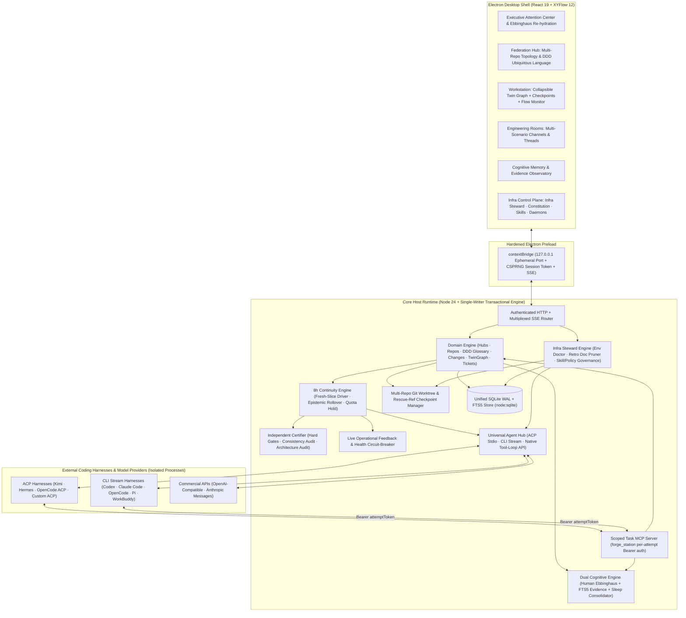

# ForgeOps — Enterprise Software Engineering Meta-Harness Specification

- **Document ID:** `FORGEOPS-SPEC-2.1`
- **Synchronized Chinese Edition:** [SPEC.zh-CN.md](file:///d:/Desktop/Courses_27/SE/Software-factory/docs/SPEC.zh-CN.md)
- **Runtime Stack:** Electron 44 (Node.js 24.22+ with built-in `node:sqlite` + FTS5) · React 19 · `@xyflow/react` 12 · TypeScript (`gts` Google Style)
- **Repository Root:** `d:/Desktop/Courses_27/SE/Software-factory`

---

## 1. Product Positioning & Core Engineering Philosophy

### 1.1 Beyond Rigid Workflows: A True ToB Software Engineering Factory
Traditional AI workflow builders wire static LLM prompt nodes in rigid, toy state graphs. Real enterprise software engineering cannot fit inside a static prompt pipeline: features span multiple interconnected repositories, domain terminology drifts across teams, code reality invalidates initial task breakdowns mid-implementation, long-running overnight jobs stall or self-certify prematurely, and engineers supervising multiple initiatives quickly run out of cognitive bandwidth.

**ForgeOps** is an enterprise-grade **Software Engineering Meta-Harness & Control Plane** desktop application. Sitting one orchestration layer above heterogeneous coding agents (`Codex`, `Claude Code`, `OpenCode`, `Pi`, `Kimi`, `Hermes`, `WorkBuddy`, custom CLIs, and commercial LLM APIs), ForgeOps governs end-to-end engineering delivery through **Domain-Driven Design (Ubiquitous Language)**, **Multi-Repository Federation Hubs**, **Living Execution Graphs**, **Physical Git Worktree Checkpoints**, **Infra Self-Governance**, and **Dual Human × Agent Cognitive Memory**.

### 1.2 Six Governing Principles
1. **Human Attention Conservation:** Every notification, panel element, and agent message costs human focus. Healthy autonomous progress occupies zero alert space. Agents interrupt an engineer **only** when a reviewable deliverable is ready, a policy boundary requires authorization, or **one concrete, structured decision question** blocks progress.
2. **Domain-Driven Ubiquitous Language First:** Every workspace establishes a canonical **Ubiquitous Language Glossary & Bounded Context Map** shared across humans, specifications, task contracts, code reviews, and refactoring gates—eliminating cross-agent and cross-service naming drift.
3. **Centralized Hub, Distributed Execution (`Federation Hub`):** A single **Master Hub Workspace** holds cross-repository architecture maps, agent-pruned documentation, shared engineering skills, and domain glossaries while orchestrating coordinated `git worktree` changes across dozens of member repositories.
4. **Execution Never Self-Certifies:** Workers never decide when a task or overnight goal is finished. Completion requires deterministic **Hard Gates** (`exitCode === 0`), **DDD & Spec Consistency Audits**, and an **Independent Read-Only Evaluator** verifying every acceptance criterion on disk.
5. **Strong Commands Weak with Live Operational Feedback:** Frontier reasoning models lead requirement grilling, cross-repo architecture, WBS/DAG compilation, and hard blocker escalation; fast, cost-efficient worker harnesses execute bounded milestone tasks, guided by lightweight real-time pass/cost/stability feedback.
6. **Infra Layer as a First-Class Governed Plane:** Platform infrastructure—shared skills, prompt constitutions, agent-facing wiki pruning, environment health, and daemon supervision—is owned by a dedicated **`Infra Steward Agent`** under strict change audit rather than ad-hoc worker mutations.

---

## 2. System Macro-Architecture



### 2.1 Architectural Layering & Single-Writer Guarantees
- **Pure Domain Core (`src/core/`):** Zero process, filesystem, or network I/O. Owns graph topology, reachability rewind sets, DDD term matching, Ebbinghaus retention curves, permission policies, and state transitions.
- **Transactional Single-Writer Store (`src/store/`):** Every state transition executes inside `Store.atomic()` (`BEGIN IMMEDIATE` on `node:sqlite` WAL). External side effects enqueue into a durable **`EffectsOutbox`** inside the same transaction and execute strictly `afterCommit`.
- **Explicit Compiler Faces:** `tsconfig.host.json` (NodeNext, Electron Main + Core) and `tsconfig.renderer.json` (DOM/Bundler, React UI), sharing only pure schemas and types in `src/shared/`.

---

## 3. Enterprise Multi-Repository Hub & DDD Ubiquitous Language Engine

### 3.1 Master Workspace Hub (`Federation Hub`) for Multi-Repo Engineering
In ToB environments, maintaining separate agent configurations, skills, and architectural context across 5–40 service repositories causes severe context fragmentation and wasted exploration tokens. ForgeOps introduces the **Federation Hub**:

1. **Hub Structure:** A Hub Workspace acts as the central control repository (storing `AGENTS.md` service routing index, `docs/agent-wiki/` pruned service contracts, `ddd/ubiquitous-language.json`, and shared `skills/`) while mounting or linking member Git repositories (`repos/<service-a>`, `repos/<service-b>`, or external paths, gitignored from the Hub repo itself).
2. **Agent-Pruned Architecture Docs (`Writing-for-Agents` Principle):** Instead of bloated human prose wikis, the Hub maintains concise, token-dense **Service Topology & Contract Maps** (entry points, public RPC/REST schemas, event topics, build/verify commands) so worker agents skip blind repository exploration on every ticket.
3. **Hub-Level Grill -> Multi-Repo Coordinated Change (`CrossRepoEpic`):**
   - Requirements are grilled **once at the Hub level** with full visibility across all interconnected repositories.
   - The Lead Architect decomposes an approved Cross-Repo Epic into dependency-ordered **Member Repo Changes** (e.g., `Change A` in `shared-contracts` $\to$ `Change B` in `order-service` $\to$ `Change C` in `merchant-portal`), each isolated in its own repository's `git worktree`!
4. **Post-Delivery `Retro` Optimization Loop:** Upon Change completion, the **Retro Engine** analyzes transcripts for wasted file searches, repeated gate failures, or cross-repo contract friction, and proposes concise updates to the Hub's `agent-wiki` and `Skills Bank` to compress future token consumption.

### 3.2 DDD Ubiquitous Language & Bounded Context Registry
To prevent semantic drift across humans and heterogeneous agents:

```typescript
export interface DomainTermEntry {
  readonly id: string;
  readonly hubId: string;
  readonly boundedContext: string;          // e.g. 'Billing', 'OrderFulfillment', 'Identity'
  readonly owningRepoIds: readonly string[];
  readonly canonicalTerm: string;           // e.g. 'SettlementBatch' (Exact code identifier)
  readonly localLabel: string;              // e.g. '结算批次'
  readonly definition: string;              // Crisp domain invariant & lifecycle meaning
  readonly forbiddenAliases: readonly string[]; // e.g. ['ClearanceGroup', 'BillPack', 'PayBundle']
  readonly schemaAnchors: readonly string[];    // e.g. ['packages/billing/src/settlement.ts']
}
```

- **Prompt & Contract Grounding:** Every Requirement Grill, Task Slice Contract, and Evaluator prompt automatically injects the relevant Bounded Context's **Ubiquitous Language Table**.
- **Terminology Drift Gate:** Deterministic lexical checks + Evaluator audits flag newly introduced exported types, routes, or database columns that use `forbiddenAliases` instead of `canonicalTerm`, and support one-click **DDD Alignment Refactoring Changes**.

---

## 4. Infra Control Plane & The `Infra Steward Agent`

Enterprise software factories require strict separation between **Platform Governance (`INFRA`)** and **Business Delivery (`Product/Service Projects`)**.

### 4.1 What the Infra Layer Owns
1. **Constitutional Rules (`Soul Constitution`):** Versioned global engineering standards, security redlines, code style mandates, and merge policies inherited by all projects.
2. **Skills Bank & Prompt Templates:** Centralized, version-controlled reusable agent skills (e.g., `grill-with-docs`, `ddd-modeler`, `cross-repo-planner`, `retro-distiller`, `safe-db-migration`) with diffable revision history.
3. **Environment & Harness Readiness (`Neural Link` / `Environment Doctor`):** Probes local toolchains (`git`, `node`, `python`, `uv`), verifies external CLI harnesses (`codex`, `claude`, `opencode`, `pi`, `kimi`, `hermes`), checks MCP loopback reachability, and cleans orphaned worktrees.
4. **Background Daemons (`Daemon Agents`):** Controls and monitors the **Continuity Watchdog**, **Sleep-Time Memory Consolidator (`DreamingDaemon`)**, and **Scheduled Patrol / Cron Tasks**.
5. **Immutable Platform `Evolution Logs` & Enterprise Audit Ledger:** Every change to platform policies, skills, templates, routing rules, or daemon actions is recorded with timestamp, actor, rationale, and version diff.

### 4.2 Role of the Dedicated `Infra Steward Agent`
The **`Infra Steward Agent`** is the specialized Platform Engineering & SRE agent bound exclusively to the **INFRA Control Plane**:
- **Retrospective Distillation & Doc Pruning:** Consumes completed Change trajectories across member repos to prune and update `docs/agent-wiki/` and extract reusable entries for the `Skills Bank`.
- **Toolchain & Harness Diagnostics:** Diagnoses `env_fault` adapter failures (broken CLI paths, expired auth sessions, conflicting port/env configs) and generates actionable remediation steps without polluting business tickets.
- **Governed Platform Self-Evolution:** When platform templates, verification scripts, or global rules require modification, the `Infra Steward Agent` executes them as tracked **`INFRA` Changes** under dual-level QA review (`Consistency Audit` + `Architecture Logic Audit`), never mutating shared governance assets silently.

---

## 5. Universal Multi-Agent Adapter Layer & Scoped `forge_station` MCP

### 5.1 Three Standardized Transports + Declarative Manifest
Any user or enterprise team can connect their preferred coding harnesses without modifying core code:

1. **`acp-stdio` (Agent Client Protocol — JSON-RPC 2.0 over `stdio`):**
   - Standard `initialize` $\to$ `session/new` (`cwd = worktreePath`, `mcpServers = [forge_station]`) $\to$ `session/prompt` $\to$ streaming `session/update` $\to$ policy-governed `session/request_permission`.
   - Natively supports **Kimi CLI** (`kimi acp`), **Hermes** (`hermes acp`), **OpenCode ACP**, and any custom ACP-compliant agent.
2. **`cli-stream` (Official Headless CLI Stream Protocol):**
   - First-class built-in presets for **Codex**, **Claude Code**, **OpenCode**, **Pi**, and **WorkBuddy**, plus a **Declarative Custom CLI Manifest** (`command`, `argsTemplate`, `mcpFlagTemplate`, `jsonlEventSelector`, `permissionFlags`) so any third-party or internal enterprise CLI plugs in via configuration.
   - Executes strictly inside vendor-sanctioned CLIs (`shell: false`), respecting vendor OAuth/credential boundaries.
3. **`native-api` (Direct Streaming Tool-Loop):**
   - Supports **OpenAI-Compatible** and **Anthropic Messages** endpoints using built-in path-confined workspace tools (`read_file`, `write_file`, `edit_file`, `search_code`, `run_command`, `git_diff`, `forge_submit`).

### 5.2 Scoped Per-Attempt `forge_station` MCP Contract
Each task slice mints an ephemeral `attemptId` + 256-bit `attemptToken` granting scoped access to `forge_station`:
- `forge_get_contract()` — Fetches slice goal, allowed file boundaries, DDD Ubiquitous Language terms, and gate commands.
- `forge_read_artifact(artifactId)` — Reads upstream specs, ADRs, or cross-repo interface contracts on demand.
- `forge_memory_search(query)` — Queries FTS5 session evidence and valid temporal semantic memories.
- `forge_report_progress(summary, touchedFiles)` — Emits structured live heartbeats to Workstation.
- `forge_ask_human(question, options, recommendedIndex, context)` — Surfaces **1 concrete structured question** to the Attention Inbox and cleanly suspends the slice (releasing its worker slot).
- `forge_propose_amendment(title, reason, insertBeforeNodeId, gateCommand)` — Proposes a dynamic **`GhostNode`** plan amendment when unforeseen code constraints emerge.
- `forge_submit(deliverable)` — Schema-validated completion handoff (`summary`, `modifiedFiles`, `dddComplianceNote`, `epistemicHandoff`).

### 5.3 Live Operational Feedback (Lightweight, Zero-Bloat Routing Signals)
Instead of a heavy standalone benchmark suite, ForgeOps passively computes real-time operational health & efficiency metrics from actual slice executions per `(adapter, model, task_kind)`:
- **`env_fault` vs. `task_failure` separation:** Distinguishes missing CLI binaries / auth expiry / network drops (`env_fault`) from code/gate failures (`task_failure`). Three consecutive `env_fault`s trip an adapter health alert and optional fallback.
- **Rolling Operational Metrics:** `first_pass_certification_rate`, `effective_cost_per_certified_slice`, `cache_hit_ratio`, and `premature_stop_rate`—displayed concisely on Agent/Model cards to guide `Strong-Commands-Weak` role assignment.

---

## 6. Living Twin-Graph Engine, Multi-Stage QA Gates & Physical Checkpoints

### 6.1 Requirement Closure (`G1`) -> Living Twin-Graph Compilation (`G2`) -> Ship (`G3`)
1. **Structured Requirement Closure (`G1`):** Moderator + Domain/Architecture/Security perspectives stress-test raw requirements against the Hub's codebase and DDD Ubiquitous Language, asking the human at most one high-impact question at a time, producing a versioned `SPEC` + executable `AcceptanceCriteria`.
2. **Synchronized Twin Graph (`WBS TaskTree` ↔ `Visual Execution Graph`):**
   - **Left WBS Panel:** Hierarchical `Phase` $\to$ `Task` $\to$ `Subtask` list (`T1.1`, `T2.1.1`...) with completion ratios, assigned agent/model badges, and live status.
   - **Right Interactive `@xyflow/react` Canvas:**
     - **Collapsible `PhaseContainer` Nodes:** Collapsed state shows compact phase progress bar (`15/15`); expanded state reveals nested child `TaskNode` cards arranged cleanly inside the container (`parentId` + `extent: 'parent'`).
     - **`VerifyNode` (`Spec & DDD Integrity Guard`):** Checks structural completeness and Ubiquitous Language compliance.
     - **`GatesNode` (`Deterministic Hard Gates`):** Host-executed `lint`, `typecheck`, build, and contract scripts (`exitCode === 0`).
     - **`SelfCheckNode` & Dual-Level `AuditNode` (`Level 1 Consistency Audit` + `Level 2 Senior Architecture/DDD Logic Review`):** Independent read-only evaluator sessions with fail-closed JSON validation.
     - **Explicit `DecisionNode` $\to$ `RestoreNode` $\to$ `CheckpointNode` Visual Topology:** Every gate/audit decision renders explicit green **`[PASS]`** edges advancing forward and red **`[FAIL]`** edges routing into a **`RestoreNode`**, which rewinds state cleanly to the target upstream **`CheckpointNode`**!
     - **Dashed `GhostNode` (`Plan Amendment`):** Visualizes proposed or auto-approved mid-flight task insertions,splits, or dependency adjustments, logged automatically in the Change's `Evolution Log`.

### 6.2 Graph-Reachability Rewind & Rescue-Backed Git Rollback
- **Exact Branch-Isolated Rewind:** Rewinding from `RestoreNode` $v_{\text{fail}}$ to `CheckpointNode` $c_{\text{target}}$ resets strictly $\text{Descendants}(c_{\text{target}}) \cap \text{AncestorsClosed}(v_{\text{fail}})$, leaving unrelated parallel branches untouched.
- **Zero-Data-Loss Physical Git Restore:** Every `CheckpointNode` commits and tags the Change's isolated `git worktree` (`forgeops/cp/<changeId>/<seq>`). Before any physical reset, the Host writes `refs/forgeops-backup/<changeId>/<timestamp>-<sha>` and attaches a structured **`FailureForensicsCard`** (exact gate stderr + rejected diff summary) so the next attempt fixes the root cause immediately.

---

## 7. Permission Tiers & 8-Hour Unattended Continuity Engine

### 7.1 Permission Governance Tiers
- **`Turbo` (Full Autopilot — Daily Power Mode):** Auto-advances gates when deterministic checks and dual-level QA audits pass; auto-allows worktree-confined tool actions (host `blockedCommands` redlines always enforced); Lead Architect auto-adjudicates bounded `GhostNode` amendments.
- **`Supervised` (Enterprise Balanced):** Human sign-off at `G1` (Spec Freeze) and `G3` (Merge/PR), plus structural `GhostNode` amendments; full autonomy inside implementation phases.
- **`Strict` (Regulated / INFRA Core Mode):** Human sign-off at `G1`, `G2`, `G3`, all `GhostNode` amendments, and external dependency mutations.

### 7.2 Five-Layer Guarantee Against 4-Hour Premature Stops
1. **Fresh-Context Per-Slice Execution:** Multi-hour initiatives execute as sequential/parallel 10–25 minute `TaskNode` slices in fresh agent sessions, keeping prompts lean and immune to 150k-token context rot.
2. **Four-Section Epistemic Rollover:** Whenever a slice rolls over context, handoff notes strictly separate:
   - `SPEC-CONFIRMED FACTS` (with direct spec/file citations)
   - `AGENT HYPOTHESES` (never promoted to confirmed truth by repetition!)
   - `OPEN CONFLICTS`
   - `UNCERTIFIED ACCEPTANCE CRITERIA`
3. **External `CompletionCertifier`:** If a worker exits claiming completion while any `TaskTree` leaf is uncertified, any `GatesNode` fails, or the independent `AuditNode` rejects an acceptance criterion, the Host blocks termination, logs a `premature_stop` event, and dispatches the continuation slice with the exact remaining checklist.
4. **Overnight Quota & Transient Fault Resilience (`CooldownHolding`):** Rate-limit `429`s, CLI rolling quota windows, and transient `5xx`/network drops enter exponential backoff (`5s` up to `30m` polling windows across an 8–12h budget, or optional failover adapter routing in `Turbo` mode) without aborting the Change.
5. **Two-Strike Escalation to Strong Lead:** If a fast worker harness fails the same slice twice, the Dispatcher escalates the slice to the Strong Lead Architect model to either patch the root obstacle or amend the DAG via `GhostNode`.

---

## 8. Engineering Rooms (Multi-Scenario Human × Multi-Agent Collaboration)

Persistent project & hub channels with threaded mandates and a **Reserved Human Priority Concurrency Slot** (guaranteeing instant chat response even when all background worker slots are saturated):

1. **`#req-grill` (Requirement & DDD Grill):** Structured multi-perspective stress-testing (`grills-with-docs`) with 1-question-at-a-time human clarification $\to$ outputs frozen `SPEC` (`G1`).
2. **`#arch-council` (Cross-Repo & DDD Design Review):** Lead Architect + Specialist Agents debate service contracts and lock **ADRs** + **Ubiquitous Language** terms.
3. **`#triage-ops` (Blocker & Plan Amendment Triage):** Automated escalation room where `FailureForensicsCard`s and `GhostNode` proposals are resolved by the Lead or surfaced to the human.
4. **`#direct-ops` (Interactive `@Agent` Command Room):** Direct `@codex`, `@claude`, `@pi`, `@kimi`, `@infra` collaboration with one-click **"Promote Thread Consensus to Change"**.
5. **`#exec-briefing` (Cross-Project Standup):** Quiet, zero-noise executive summaries across all active repositories.

---

## 9. Dual Human × Agent Ebbinghaus Cognitive Memory System

Engineered for one tech lead or architect steering **3+ active projects / multi-repo hubs** concurrently.

### 9.1 Human Cognitive Retention & Progressive Re-hydration Capsules
For each project/hub $P_k$ with elapsed human absence $\Delta t$ (hours), completed spaced reviews $n_{\text{reviews}}$, and unseen autonomous project mutation entropy:
$$\Delta_{\text{entropy}}(P_k) = 0.15 N_{\text{tasks}} + 0.35 N_{\text{amendments}} + 0.50 N_{\text{adrs}} + 0.10 \ln(1 + \text{LOC}_{\text{changed}})$$
Effective human memory stability $S_{\text{human}}(P_k)$ and retention $R_{\text{human}}(P_k) \in (0, 1]$ follow:
$$S_{\text{human}}(P_k) = \frac{S_0 \cdot (1 + 0.6 \cdot n_{\text{reviews}})^{0.8}}{1 + 0.25 \cdot \Delta_{\text{entropy}}(P_k)}, \qquad R_{\text{human}}(P_k) = \exp\!\left(-\frac{\Delta t}{S_{\text{human}}(P_k)}\right)$$

- **$R_{\text{human}} \ge 0.75$ (Warm):** Quiet mode—zero recap clutter; shows only actionable `Attention` items.
- **$0.35 \le R_{\text{human}} < 0.75$ (Context Switch):** Displays a **30-Second Delta Capsule** (your last anchor $\to$ autonomous progress delta $\to$ single next decision).
- **$R_{\text{human}} < 0.35$ (Cold / High Drift):** Displays a **Mental-Model Re-anchoring Briefing** (North Star goal, highlighted Twin-Graph diff since last visit, locked ADRs/DDD updates, and an **"Acknowledge & Anchor"** action that resets $\Delta t$ and increments $n_{\text{reviews}}$).

### 9.2 Four-Tier Agent Memory & Sleep-Time Consolidation (`DreamingDaemon`)
1. **L0 Active Slice Window:** Strictly budgeted per-slice prompt + 4-section epistemic handoff.
2. **L1 Full-Text Episodic Evidence Store (`node:sqlite` + `fts5`):** Normalized cross-harness `sessions`, `messages`, `tool_calls`, and `tool_results` indexed by `messages_fts`—queried selectively via `forge_memory_search`, never dumped wholesale into prompts.
3. **L2 Bi-Temporal Semantic Memory (`valid_from` / `valid_until` + Agent Ebbinghaus $R_{\text{agent}}$):**
   - Stores verified architectural facts, pitfall lessons, and repo conventions.
   - When code refactors invalidate an older fact, `valid_until` is stamped and linked via `superseded_by_id`—preventing stale-memory poisoning while preserving full auditability.
   - Utility stability $S_{\text{agent}}(m)$ increases whenever recalling $m$ precedes a first-pass green Gate, and decays exponentially ($R_{\text{agent}} = e^{-\Delta t / S_{\text{agent}}}$) to prune unused noise.
4. **L3 Pinned Constitutional & Domain Memory:** Non-decaying (`Soul Constitution`, `Ubiquitous Language Glossary`, active `SPEC`).
5. **Sleep-Time `DreamingDaemon`:** During idle capacity or post-checkpoint, distills "fail-then-pass" debugging trajectories into L2 pitfall rules, checks `path_anchors` against `git diff` to retire drifted facts, and pre-computes instant Human Re-hydration Capsules.

---

## 10. Unified SQLite Storage Schema & Desktop Views

### 10.1 Core SQLite WAL Schema (`SCHEMA_VERSION = 1`)
- `hubs` & `repositories`: Federation Hubs, member Git repo bindings (`infra` vs `service`), verify commands, human Ebbinghaus anchor timestamps.
- `domain_terms`: DDD Bounded Contexts, canonical terms, definitions, forbidden aliases, file anchors.
- `changes`: Per-repo or cross-repo linked Changes, isolated `worktree_path`, `git_branch`, `permission_tier`, `quality_score`, budget & hour ceilings, status.
- `graph_nodes` & `graph_edges`: Synchronized WBS + visual nodes (`phase_container`, `task`, `verify`, `gates`, `selfcheck`, `audit_jqa`, `audit_sqa`, `decision`, `restore`, `checkpoint`, `ghost`) + `pass` / `fail` / `dep` edges.
- `checkpoints`: Engine snapshot + `git_commit_sha` + `git_tag` + `rescue_ref`.
- `attention_queue`: Structured 1-question human decisions, gate sign-offs, and amendment approvals ranked by cross-project priority.
- `rooms`, `threads`, `room_messages`: Multi-scenario collaboration threads, subscriptions, and authorization mandates.
- `sessions`, `messages`, `tool_calls`, `tool_results` + `messages_fts` (`fts5`): Cross-agent execution evidence store.
- `semantic_memories` + `memories_fts` (`fts5`): Bi-temporal (`valid_from`, `valid_until`) + Ebbinghaus ($S_{\text{agent}}$) knowledge entries.
- `execution_telemetry`: Live slice pass/fail/env-fault records, token/cache usage, cost, and premature-stop counts.
- `adapters`, `models_pool`, `skills_bank`, `effects_outbox`, `audit_ledger`.

### 10.2 Six Core Desktop Workspaces
1. **`Attention & Executive Overview`:** Ranked cross-project `Needs You Now` cards, Ebbinghaus Re-hydration Capsules, active 8h Marathon status, and concurrency slot meter.
2. **`Federation Hub & Project Registry`:** `INFRA` vs `Service` repositories, cross-repo topology map, **DDD Ubiquitous Language Studio**, and Change Dashboard (`Team`, `Docs`, `Quality Gates`, scoped `Archive Change`).
3. **`Workstation (Twin Graph)`:** Left WBS hierarchy + Right collapsible `PhaseContainer` React Flow canvas (`Gates -> Audit -> Decision -> Restore -> Checkpoint` + dashed `GhostNode`s) + live streaming Flow Monitor + bottom Git SHA Checkpoints bar.
4. **`Engineering Rooms`:** `#req-grill`, `#arch-council`, `#triage-ops`, `#direct-ops`, `#exec-briefing` with Thread Mandate drawer and 1-click **Promote to Change**.
5. **`Cognitive Memory Observatory`:** Human × Agent Ebbinghaus curves, instant FTS5 evidence search, and Active vs. Superseded Temporal Memory inspector.
6. **`Infra Control Plane & Agent Factory`:** `Infra Steward Agent` console, `Soul Constitution`, `Skills Bank`, `Agents Market` (ACP/CLI/API manifests + live operational feedback badges + `Doctor` probe), masked `Models Pool`, `Daemon Agents`, and `Evolution & Audit Logs`.

---

## 11. Security & Enterprise Isolation Invariants
1. **Loopback CSPRNG Auth:** `127.0.0.1:0` dynamic port + 256-bit startup Bearer token injected strictly via Electron `contextBridge` (`contextIsolation: true`, `nodeIntegration: false`, `sandbox: true`).
2. **Write-Only Secret Vault:** Plaintext API keys never leave the Host process; UI reads receive masked status metadata only.
3. **Zero-Shell Process Confinement:** `shell: false` execution, case-insensitive secret environment scrubbing on Windows/POSIX, `fs.realpathSync` `resolveInside` worktree path lock (blocking symlink escapes and `.git/hooks` tampering), and `taskkill /T /F` process-tree teardown.
