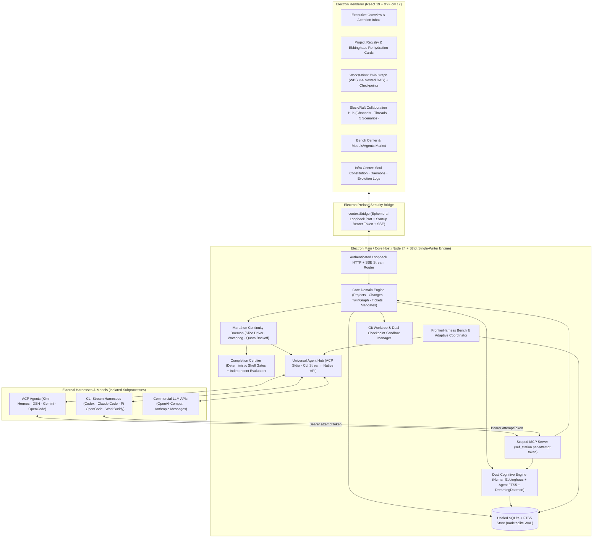
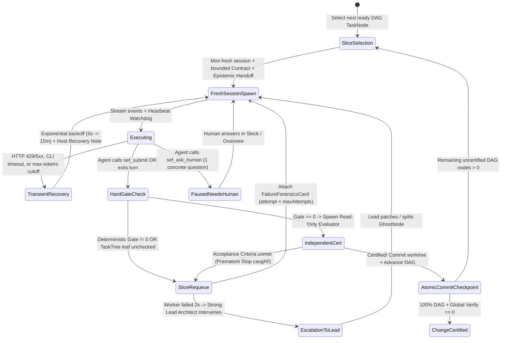

# Autonomous Software Factory (ASF v2) — Master Technical Specification

- **Document ID:** `SEF-SPEC-2.0`
- **Status:** `READY FOR REVIEW & EXECUTION`
- **Runtime Target:** Electron 44 (Node.js 24.22+ w/ native `node:sqlite` + FTS5) + React 19 + `@xyflow/react` 12 + TypeScript (`gts` strict Google Style)
- **Repository Root:** `d:/Desktop/Courses_27/SE/Software-factory`

---

## 1. Vision, Core Axioms & Architectural Positioning

### 1.1 Meta-Harness Positioning (Above Individual Agent Harnesses)
**ASF v2 (Autonomous Software Factory)** is **not** another single-model coding CLI. It is a **Meta-Orchestrator & Software Engineering Factory Desktop Shell** sitting **one layer above** external coding harnesses (`Codex`, `Claude Code`, `OpenCode`, `Pi`, `Kimi Code`, `Hermes`, `WorkBuddy`, `DeepSeek Harness / dsh`) and commercial LLM APIs.

Individual coding agents never leave their own vendor-sanctioned harnesses or OAuth boundaries. Instead, ASF v2 coordinates them as specialized engineering roles inside isolated `git worktree` sandboxes, binds them via a scoped **Model Context Protocol (`sef_station`)** and **Agent Client Protocol (`ACP`) / CLI Stream** adapters, verifies their work via deterministic **Hard Gates** and **Independent Evaluators**, and compresses human supervision overhead across **multiple concurrent software projects**.

### 1.2 Five Governing Engineering Axioms
Synthesized from `dsh-superagent`, `deepseek-harness`, `obelisk`, `frontier-harness-eval`, `Letta / Graphiti / MemoryBank`, and Professor's **ASF Console + HAMA-Loop**:

1. **Human Attention Conservation (`dsh-superagent` Axiom):**
   *"Take as little human attention as possible, and give as much value as possible."* Healthy autonomous progress takes zero visual noise. Agents speak to the human **only** when a deliverable is ready for review, a policy/gate requires authorization, or **one concrete structured question (`Attention`)** blocks a design decision.
2. **Execution ≠ Certification (Anti-4-Hour-Stop Axiom):**
   An executing agent **cannot self-certify completion**. No free-text `"I am done"` or `<promise>COMPLETE</promise>` ends a Change. Work terminates **only** when every `TaskTree` leaf, deterministic `Gate` (`exitCode === 0`), and independent `Evaluator` check passes against disk + Git state.
3. **Strong Commands Weak, Empirically Tuned (`FrontierHarness` Axiom):**
   High-reasoning Lead/Architect models (`Claude Code`, `Codex`, frontier reasoning APIs) own **Requirement Closure (HAMA-Loop)**, **WBS/DAG Planning**, **ADR Locking**, and **Hard Escalation**. Cost-effective, fast Worker harnesses (`Pi`, `OpenCode`, `Kimi`, `Hermes`, fast APIs) execute bounded `Task 2.x.y` slices along the DAG. Embedded benchmark telemetry (`effective_cost_per_pass`, `pass_rate`, `premature_stop_rate`) continuously recalibrates role routing.
4. **Dual Cognitive Memory Symmetry (Human Ebbinghaus × Agent Consolidation Axiom):**
   When one engineer steers **3+ projects** simultaneously, both human working memory and agent context windows decay—but differently. ASF v2 models **Human Ebbinghaus Retention ($R_{\text{human}}$)** to generate adaptive **Re-hydration Capsules** on context switch, and models **Agent Memory Utility + Bi-Temporal Validity ($R_{\text{agent}}$, `valid_from`/`valid_until`)** consolidated asynchronously by a sleep-time **`DreamingDaemon`**.
5. **Physical Git Truth & Zero-Trust Process Boundaries:**
   Every Change executes in an isolated `git worktree`. Every Checkpoint pairs an immutable SQLite engine state snapshot with a physical Git commit/tag SHA. Every subprocess spawns with `shell: false`, case-insensitive credential scrubbing, and path-locked workspace confinement (`resolveInside`).

---

## 2. System Macro-Architecture & Strict Dependency Layers



### 2.1 Dependency & Single-Writer Rules (Adopted from `dsh-superagent/007` & `dsh/AGENTS.md`)
- `src/core/` contains pure domain types, DAG reachability algorithms, Ebbinghaus math, policy evaluation, and state transitions. It performs **zero direct process spawning or network I/O**.
- **One writer per aggregate table** inside `Store.atomic(() => ...)` SQLite `BEGIN IMMEDIATE` transactions; side effects (spawning an agent, running a shell gate, posting to a channel) enqueue into a durable **`Effects` Outbox** inside the transaction and execute **only `afterCommit`**.
- Separate TypeScript compiler faces: `tsconfig.host.json` (NodeNext, Electron Main & Core) and `tsconfig.renderer.json` (Bundler/DOM, React UI), sharing only pure type/schema definitions in `src/shared/`.

---

## 3. Universal Multi-Agent Adapter Architecture (`AgentHub`)

Users cannot be locked into a fixed hardcoded vendor list. ASF v2 defines a **Declarative `AgentAdapterManifest`** supporting **three universal wire transports** plus a **Scoped `sef_station` MCP Server**.

### 3.1 Three Standard Transports

| Transport Kind | Wire Protocol | Out-of-the-Box Presets & Compatible Harnesses | How It Executes |
| :--- | :--- | :--- | :--- |
| **`acp-stdio`** | **Agent Client Protocol (JSON-RPC 2.0 over `stdio`)** | **Kimi Code** (`kimi acp`), **Hermes** (`hermes acp`), **DeepSeek Harness** (`dsh --profile acp`), **OpenCode ACP** (`opencode acp`), **Gemini CLI**, any custom ACP binary | `initialize` -> `session/new` (`cwd = worktreePath`, `mcpServers = [sef_station]`) -> `session/prompt` -> streams `session/update` (`agent_thought`, `agent_message_chunk`, `tool_call`, `plan`) -> handles `session/request_permission` per Permission Tier. |
| **`cli-stream`** | **Headless JSONL / Stdio App-Server Stream** | **Codex** (`codex app-server --listen stdio://`), **Claude Code** (`claude -p --output-format stream-json --verbose --strict-mcp-config`), **OpenCode** (`opencode run --format json` w/ `OPENCODE_PURE=1`), **Pi** (`pi --mode json -p`), **WorkBuddy** / **Custom CLI Template** | Spawns official vendor CLI with `shell: false` inside `worktreePath`, injects scoped `sef_station` MCP endpoint, parses streaming JSONL events into normalized `TranscriptRecord`s, enforces graceful EOF -> tree termination. |
| **`native-api`** | **HTTPS Streaming Tool-Loop** | **OpenAI-Compatible** (`DeepSeek`, `OpenAI`, `Qwen`, `Moonshot`, `vLLM`, `Ollama`) & **Anthropic Messages API** | Runs ASF's built-in tool-use loop with path-locked workspace tools (`read_file`, `write_file`, `edit_file`, `search_code`, `run_command`, `git_diff`, `sef_submit`). API keys live exclusively in host secret storage, never exposed to renderer. |

### 3.2 Extensible `AgentAdapterManifest` (Zero-Code User Onboarding)
Any user can register a new third-party harness (e.g., `WorkBuddy`, `Aider`, `Goose`, internal company CLI) from **Agents Market -> Register Custom Harness** via a JSON manifest:

```typescript
export interface AgentAdapterManifest {
  readonly id: string;                 // e.g. 'codex', 'claude-code', 'pi', 'kimi-acp', 'workbuddy'
  readonly label: string;
  readonly transport: 'acp-stdio' | 'cli-stream' | 'native-api';
  readonly command?: string;           // Binary name or absolute path (for acp-stdio / cli-stream)
  readonly baseArgs?: readonly string[];
  readonly healthProbeArgs?: readonly string[]; // e.g. ['--version']
  readonly mcpInjection?: 'acp-session' | 'claude-mcp-json' | 'codex-config-flag' | 'env-url' | 'none';
  readonly permissionFlagMap?: {
    readonly turbo: readonly string[];      // e.g. ['--dangerously-skip-permissions'] or ACP auto-allow
    readonly supervised: readonly string[];
    readonly strict: readonly string[];
  };
  readonly jsonlParser?: 'claude-stream' | 'codex-rpc' | 'opencode-json' | 'pi-json' | 'generic-jsonl';
  readonly envAllowlist?: readonly string[]; // Explicit non-secret env vars to pass through
  readonly capabilities: {
    readonly roles: readonly ('lead' | 'worker' | 'evaluator' | 'moderator' | 'specialist')[];
    readonly supportsMcp: boolean;
    readonly supportsImages: boolean;
    readonly maxConcurrentSlots: number;
  };
}
```

### 3.3 Scoped Per-Attempt MCP Bridge (`sef_station`)
Adapted and hardened from `H2/server/mcp-station.ts`:
- Before launching any task slice or collaboration turn, the Host mints an ephemeral `attemptId` + 256-bit random `attemptToken` valid **only** for the lifetime of that single run.
- External harnesses connect to `http://127.0.0.1:<port>/mcp/sef_station` with `Authorization: Bearer <attemptToken>`.
- **Tools exposed by `sef_station`:**
  1. `sef_get_contract()` — Returns exact `TaskSliceContract` (goal, file scope, upstream artifact summaries, acceptance criteria, gate commands).
  2. `sef_read_artifact(artifactId)` — Reads upstream specs, ADRs, or evaluator reports on demand without stuffing giant blobs into initial prompts.
  3. `sef_memory_query(query, scope)` — Searches L1 Episodic FTS5 + L2 Temporal Semantic Memories (`valid_until IS NULL`).
  4. `sef_report_progress(summary, touchedFiles)` — Streams structured milestone heartbeats to Workstation Flow Monitor.
  5. `sef_ask_human(question, options, recommendedIndex, blockingReason)` — Raises **one concrete structured `Attention` card** (`dsh-superagent` pattern) and suspends the slice cleanly (freeing its worker slot!).
  6. `sef_propose_ghost_node(title, reason, insertBeforeNodeId, verificationCommand)` — Proposes a runtime DAG amendment (`GhostNode`) when an unforeseen prerequisite is discovered.
  7. `sef_submit(deliverable)` — Schema-validated structured turn submission (`summary`, `filesModified`, `verificationRun`, `epistemicHandoff`).

---

## 4. Workstation, Dual-Graph Engine (`Twin Graph`) & HAMA-Loop Closure

### 4.1 Requirement Closure Engine (`HAMA-Loop` 7-Stage Pipeline)
Before code workers touch a complex Change, ASF v2 runs a configurable **Requirement Closure Pipeline** (implementing `第3组_需求闭环设计说明.pdf` + Professor's `TQLA`):

1. **S1 Seed Intake & Context Grounding:** Scans target repository layout, existing `SPEC` / `AGENTS.md`, and active L2 Semantic Memories.
2. **S2 Multi-Perspective Grill (`#req-grill` Channel):** Lead Moderator orchestrates bounded rounds among **Product Analyst**, **System Architect**, **Security/Edge-Case Auditor**, and **QA Designer** (or interactive `/grill-me` style 1-question-at-a-time interview with the human if ambiguity exceeds threshold).
3. **S3 Canonical Spec Synthesis:** Produces structured `RequirementSpec` (`functionalReqs`, `nonFunctionalReqs`, `outOfScope`, `fileBoundaries`, `acceptanceCriteria[]` with executable check commands).
4. **S4 Independent 4-Dimensional Evaluation (`TQLA`):** Four independent read-only checks score **Completeness**, **Consistency**, **Testability**, and ** Operational Risk** $\in [0, 1]$. **Fail-closed JSON schema validation**: malformed evaluator output marks the audit `retry` / `fail`, never `pass`.
5. **S5 Gate `G1` (Spec Freeze):** Auto-passes in `Turbo` mode iff composite `TQLA >= 0.85` and `criticalConflicts === 0`; pauses for 1-click human approval/rejection in `Supervised`/`Strict` modes. Rejection routes cleanly via `fail -> restore` back to **S2** with human feedback attached!
6. **S6 WBS & Twin-Graph Compilation (`G2` Architecture Gate):** Strong Lead Architect compiles the frozen Spec into synchronized **`TaskTree` (WBS)** + **`LogicGraph` (DAG)** + **Checkpoints**.
7. **S7 Execution, Independent QA & Ship Gate (`G3`):** Executes DAG slices in `git worktree`, runs deterministic gates + independent QA Evaluator, generates Diff Evidence Bundle, and merges/creates PR upon `G3`.

### 4.2 Synchronized `Twin Graph` (`TaskTree` ↔ `LogicGraph`)
Matches Professor's ASF Console `Workstation -> Twin Graph` & `Evolution Logs`:
- **Left / Top Hierarchy (`TaskTree` WBS):** `Phase 1: Foundation` -> `Task 1.1: Schema` -> `Subtask 1.1.1: Migration`. Every node carries status, assigned role/adapter, token/cost telemetry, and linked artifact IDs.
- **Right / Interactive Canvas (`LogicGraph` in `@xyflow/react` 12):**
  - **`PhaseNode` (`type: 'phaseGroup'`):** True nested React Flow parent container (`parentId: phaseNode.id`, `extent: 'parent'`) visually grouping its child `TaskNode`s, `GateNode`s, and `CheckpointNode`s.
  - **`TaskNode`:** Atomic execution unit assigned by the Lead Dispatcher either to a **single Worker harness** (default milestone execution, e.g., `Pi` or `Codex` executing `Task 2.1.1`) OR to a **bounded Multi-Agent Collaborative Cell** (e.g., `Implementer + Security Reviewer` pair) when complexity requires it.
  - **`GateNode`:** Deterministic shell/script assertion (`npm run lint`, `npm run typecheck`, `npm run verify`, custom contract script) executed directly by the Host (`shell: false`). Zero LLM hallucination permitted.
  - **`EvalNode`:** Independent Evaluator session (strictly separate session & read-only tools) auditing diff + gate logs against `AcceptanceCriteria`.
  - **`CheckpointNode`:** Dual snapshot recording `{ engineSnapshotId, gitCommitSha, gitTag, createdAt }`.
  - **`GhostNode` (Dynamic Runtime Amendment):** Rendered with dashed amber/cyan styling when a Worker or Lead discovers a missing prerequisite mid-flight. Depending on Permission Tier:
    - `Turbo`: Lead Architect validates scope alignment and auto-materializes the `GhostNode` into the active DAG, logging the mutation in **`Evolution Logs` / `CHANGELOG`**.
    - `Supervised` / `Strict`: Appears as a 1-click `Approve / Reject GhostNode` action in Attention Inbox.

### 4.3 True DAG Reachability Rewind & Safe Physical Git Rollback
Fixes the linear-array slice bug and unbacked rollback bug from the legacy prototype:
- **Graph-Theoretic Rewind Set:** When `GateNode` or `EvalNode` $v_{\text{fail}}$ routes along a `fail` edge to `CheckpointNode` $c_{\text{target}}$, the Engine computes:
  $$\text{RewindSet}(c_{\text{target}}, v_{\text{fail}}) = \text{Descendants}(c_{\text{target}}) \cap \text{AncestorsClosed}(v_{\text{fail}})$$
  Parallel unrelated branches outside $\text{Descendants}(c_{\text{target}})$ are **never** collateral-damaged!
- **Physical Git Safety Net:** Before resetting the Change's `git worktree` to `c_target.gitCommitSha`, `GitSandbox` creates an immutable rescue ref `refs/sef-backup/<changeId>/<timestamp>-<shortSha>` so zero code written by any agent can ever be permanently lost by a rollback.
- **Failure Context Injection:** Downstream re-queued nodes receive a structured `FailureForensicsCard` (exact failing gate stderr, diff summary of rejected attempt, backup ref pointer) so the next fresh-context attempt fixes the root cause instead of repeating the identical mistake!

---

## 5. Permission Tiers & 8-Hour Marathon Continuity Engine (`MarathonDaemon`)

### 5.1 Three Permission Tiers

| Dimension | `Turbo` (Full Autopilot — Daily Default) | `Supervised` (Balanced) | `Strict` (High-Assurance) |
| :--- | :--- | :--- | :--- |
| **G1 / G2 / G3 Gates** | Auto-advance when deterministic checks & `TQLA >= 0.85` pass | Human approval at `G1` (Spec) & `G3` (Ship) | Human approval at `G1`, `G2`, `G3` |
| **Worker Tool / ACP Permissions** | Auto-allow inside confined `git worktree` (`blockedCommands` still enforced by Host!) | Auto-allow file/test inside worktree; prompt for network/install/outside-scope | Explicit approval for destructive shell/dependency changes |
| **`GhostNode` DAG Amendments** | Auto-adjudicated by Lead Architect (bounded max 5 per phase) | Auto-allow minor (`<= 1` task); human approves structural changes | Always require human approval |
| **Quota / Rate-Limit Failover** | Exponential backoff + optional auto-failover to secondary ranked harness | Backoff up to 30 min, then notify Attention Inbox | Notify immediately on failure |

### 5.2 Solving the "4-Hour Premature Stop" Problem Over 8+ Hour Overnight Runs
Why existing harnesses stop at 3–4 hours claiming "done" (or dying silently), and our **5-Layer `MarathonDaemon` Guarantee**:



1. **Fresh-Context Per-Slice Isolation:** Instead of running one 8-hour monolithic conversation that rots at token 180,000, an 8-hour Change is decomposed into 15–40 atomic `TaskNode` slices (10–25 minutes each). Each slice spawns a **fresh harness session** hydrated strictly with: Soul Constitution + Canonical Spec excerpt + Upstream Artifact pointers + 4-Section Epistemic Handoff.
2. **Epistemic Rollover Fence (Adopted from `obelisk/context-window-prompt.ts`):** Whenever a single complex slice hits 70% context budget (`reminder`) or 85% (`fallback`) or `max_tokens`, the Host forces an **Epistemic Rollover** separating:
   - `SPEC-CONFIRMED REQUIREMENTS` (with file/line or user citations)
   - `AGENT INFERENCES` (explicitly tagged so the next round **never** mistakes prior guesses for user requirements!)
   - `UNRESOLVED CONFLICTS`
   - `UNVERIFIED ACCEPTANCE CRITERIA`
   Anchored to `session_id` + `message_uuid` in SQLite FTS5.
3. **External `CompletionCertifier` (Zero Self-Grading):** If an agent stops at Hour 3.5 saying *"All core features are implemented; remaining items are minor"*, the Host runs `CompletionCertifier`:
   - Checks `TaskTree`: Are 100% of non-waived leaves `certified`?
   - Runs Change-level deterministic `verifyCommand` (`exitCode === 0`)?
   - Runs an **Independent Evaluator** session against every `AcceptanceCriterion`?
   If **any** check fails, the Host increments `premature_stop_count` in telemetry, rejects the stop, and immediately dispatches the next continuation round naming the exact uncertified items!
4. **Overnight Quota & Network Resilience:** Over 8 hours, provider `429` rate limits, rolling 5-hour CLI quota windows, and transient network resets are guaranteed to happen. `MarathonDaemon` classifies errors into:
   - `transient_network` (`ECONNRESET`, `ETIMEDOUT`, `502/503/504`): retry `5s -> 15s -> 45s -> 120s`.
   - `provider_rate_limit` (`429`, CLI quota window message): enter **`CooldownHolding` state** (e.g., poll/sleep `2m -> 5m -> 15m -> 30m` up to `maxOvernightWaitMinutes = 180` without failing the Change!, or switch to a configured fallback adapter in `Turbo` mode).
   - `stalled_process` (zero stdout/MCP heartbeat for `stallTimeoutSec = 300` with no active child test job): kill process tree cleanly, inspect `git status`, and relaunch with a **Host Recovery Note**.
5. **Atomic Commit-on-Pass Invariant:** Passing slices immediately commit cleanly on the Change's `git worktree` branch (`sef/<changeId>`), so 4 hours of verified progress are physically locked into Git even if power is lost at Hour 5.

---

## 6. Slock / Raft Multi-Scenario Collaboration Hub

Modeled on `botiverse/raft-source` (`dashboard-demo.png`) + `dsh-superagent` Thread/Ticket routing, integrated directly with the Twin Graph:

### 6.1 Core Primitives
- **Channels (`#`):** Scoped per Project (plus one global `#executive-standup`).
- **Threads:** Every task escalation, HAMA-Loop grill, or `@agent` request lives in a structured Thread with `Subscriptions` and `Mandates` (`dsh-superagent` domain rules).
- **Reserved Human Concurrency Slot:** Following `dsh-superagent/003`, `ResourceBroker` reserves **1 dedicated priority execution slot** exclusively for human interactive messages in Slock channels—even when 100% of background Marathon slots are busy across 3 projects, `@lead` or `@codex` in chat responds immediately!

### 6.2 Five Built-In Collaboration Scenarios

| Scenario Mode | Default Channel | Participants | Workflow & Artifact Output |
| :--- | :--- | :--- | :--- |
| **1. Requirement Grill (`hama-grill`)** | `#req-grill` | Human + Moderator + PM + Architect + QA | Structured multi-perspective stress-test; asks human **at most 1 high-leverage question at a time**; outputs frozen `SPEC-<change>.md` (`G1`). |
| **2. Architecture Council (`arch-council`)** | `#arch-review` | Strong Lead + 2 Specialist Harnesses (e.g., `Codex` vs `Claude Code`) | Debates concrete trade-offs (schema, concurrency, security), critiques proposals, and commits a durable **ADR** into L2/L3 Memory. |
| **3. Blocker & GhostNode Triage (`blocker-triage`)** | `#triage-ops` | Blocked Worker + Lead Architect (+ Human if out-of-spec) | Worker posts `FailureForensicsCard` + `GhostNode` proposal; Lead resolves autonomously if covered by Spec, or surfaces an `Attention` card. |
| **4. Direct Ops Room (`direct-ops`)** | `#general` / `#ops` | Human + `@any-agent` (`@codex`, `@claude`, `@pi`, `@kimi`, `@hermes`) | Slock/Raft-style interactive engineering chat grounded on repo/worktree; 1-click **"Promote to Change / Ticket"** converts chat consensus into an executable DAG! |
| **5. Multi-Project Executive Standup (`exec-digest`)** | `#executive-standup` | `DreamingDaemon` + Project Leads -> Human | Quiet, zero-fluff cross-project briefing tailored to the user's Ebbinghaus retention score across all active repositories. |

---

## 7. Dual Cognitive Memory & Attention Compression System (`CognitiveEngine`)

Designed explicitly for **one human engineer simultaneously running 3+ software projects** alongside multiple long-running agents.

### 7.1 Side A: Human Ebbinghaus Retention & Progressive Re-hydration Model
Let project $P_k$ have last meaningful human interaction at $t_{\text{last}}$ (elapsed hours $\Delta t = (t_{\text{now}} - t_{\text{last}}) / 3600$).

1. **Unseen Project Mutation Entropy ($\Delta_{\text{entropy}}$):**
   $$\Delta_{\text{entropy}}(P_k) = 0.15 \cdot N_{\text{tasks\_done}} + 0.35 \cdot N_{\text{ghost\_nodes}} + 0.50 \cdot N_{\text{adr\_changes}} + 0.10 \cdot \ln(1 + \text{LOC}_{\text{changed}})$$
   *(Intuition: Even if only 3 hours passed, if Turbo agents completed 18 tasks and amended 2 GhostNodes while you worked on Project C, your mental model of Project A has drifted faster than clock time alone!)*

2. **Effective Human Memory Stability ($S_{\text{human}}$, in hours):**
   $$S_{\text{human}}(P_k) = \frac{S_0 \cdot (1 + 0.6 \cdot n_{\text{spaced\_reviews}})^{0.8}}{1 + 0.25 \cdot \Delta_{\text{entropy}}(P_k)}$$
   where base stability $S_0 = 8.0\text{ hours}$, and $n_{\text{spaced\_reviews}}$ counts completed human review anchors on the current Change (spaced repetition flattens forgetting!).

3. **Human Retention Score ($R_{\text{human}} \in (0, 1]$):**
   $$R_{\text{human}}(P_k, t_{\text{now}}) = \exp\!\left(-\frac{\Delta t}{S_{\text{human}}(P_k)}\right)$$

4. **Three-Tier Attention-Compressed Re-hydration UI:**
   - **Tier 1 — Hot Working Memory ($R_{\text{human}} \ge 0.75$):** Zero recap banner (`Quiet by Default`). Displays only active `Attention` questions (if $> 0$) and compact live status pill.
   - **Tier 2 — Context-Switch Capsule ($0.35 \le R_{\text{human}} < 0.75$):** Renders a **30-Second Delta Card** (`<= 5 bullets`):
     - *Your Last Anchor:* What you last approved/asked ($t_{\text{last}}$).
     - *Autonomous Delta:* Tasks certified, gates passed, GhostNodes added.
     - *Next Immediate Decision:* Exact single `Attention` or Gate button (if any).
   - **Tier 3 — Deep Ebbinghaus Re-anchoring ($R_{\text{human}} < 0.35$):** Renders a **Structured Mental-Model Briefing**:
     - *1-Sentence North Star Goal* + *Visual Mini-DAG Progress Diff* (highlighting nodes changed since $t_{\text{last}}$) + *Key Architectural Decisions (ADRs) Made* + **"Acknowledge & Anchor"** button (which updates $t_{\text{last}} \leftarrow t_{\text{now}}$ and increments $n_{\text{spaced\_reviews}}$, strengthening $S_{\text{human}}$!).

5. **Cross-Project Attention Priority Ranking (`Overview -> What Needs You Now`):**
   Across all projects $\{P_1, P_2, P_3, \dots\}$, pending human `Attention` / `Gate` items are sorted by:
   $$\text{PriorityScore}(item) = \frac{\text{BlockedDownstreamTasks}(item) + 2 \cdot \mathbb{I}[\text{isCriticalGate}]}{\text{EstimatedReadSeconds}(item)} \cdot \left(1 + 0.5 \cdot R_{\text{human}}(P_{\text{item}})\right)$$
   *(Quick decisions that unblock massive downstream DAG fan-out on a project still warm in your head surface first!)*

### 7.2 Side B: 4-Tier Agent Memory + Bi-Temporal Graph + `DreamingDaemon`

| Tier | Name | Storage & Indexing | Retention / Eviction Policy |
| :--- | :--- | :--- | :--- |
| **L0** | **Active Slice Surface** | Ephemeral per-slice prompt + 4-Section Epistemic Handoff | Strict token budget; `AGENT INFERENCES` isolated from `SPEC-CONFIRMED` facts; rolled over before 80% window pressure. |
| **L1** | **Episodic Evidence Store (`Obelisk` Core)** | `sessions`, `messages`, `tool_calls`, `tool_results` + **`messages_fts` (`fts5`)** in `node:sqlite` | Append-only immutable audit log; **never injected wholesale into prompts**; queried selectively via `sef_memory_query`. |
| **L2** | **Temporal Semantic Memory (`Graphiti` + `MemoryBank`)** | `semantic_memories` + **`memories_fts` (`fts5`)** with `valid_from`, `valid_until`, `superseded_by`, `path_anchors`, `stability_s`, `recall_count` | **Bi-temporal invalidation:** contradicted facts get `valid_until = now` (never deleted, never injected as current). **Agent Ebbinghaus retention:** $R_{\text{agent}}(m, t) = e^{-\Delta t_{\text{recall}} / S_{\text{agent}}(m)}$. |
| **L3** | **Constitutional & Canonical Spec** | `Soul Constitution` + `SPEC.md` + active `AcceptanceCriteria` | Pinned ($S = \infty$); versioned on every human/Lead amendment. |

#### Agent Memory Reinforcement & Sleep-Time `DreamingDaemon`
- **Utility Reinforcement:** When a Worker retrieves L2 memory $m$ and its slice **passes** `CompletionCertifier` on Attempt 1, $S_{\text{agent}}(m) \leftarrow S_{\text{agent}}(m) \cdot 1.45 + 12\text{h}$. If the files in `m.path_anchors` undergo $> 40\%$ line churn in Git without $m$ being re-verified, `stale_suspect = 1` triggers verification on next `DreamingDaemon` pass.
- **`DreamingDaemon` (Sleep-Time Compute):** Runs quietly when active worker load $< \text{maxSlots}$ (or after each Phase Checkpoint) and logs every action to **Infra Center -> Evolution Logs**:
  1. **Failure-to-Lesson Distillation:** Finds `slice_attempts` where Attempt 1 failed a Gate and Attempt 2 passed -> distills a compact L2 `pitfall_lesson` (`symptom`, `rootCause`, `fixRule`, `path_anchors`).
  2. **Contradiction & Drift Sweep:** Cross-checks active L2 memories against recent `git diff` and new ADRs; marks outdated entries `valid_until = now` with `superseded_by` links.
  3. **Ebbinghaus Pruning:** Demotes unverified low-retention L2 notes ($R_{\text{agent}} < 0.20$) to `cold` archive so active retrieval stays razor-sharp.
  4. **Pre-computed Human Capsules:** Refreshes the Tier 2 / Tier 3 Re-hydration summaries for each project in the background so switching projects in the UI takes `< 15 ms` with zero spinner wait.

---

## 8. Embedded `FrontierHarness` Bench Center & Adaptive Coordinator

Inspired directly by `frontier-harness-eval` (`normalize-results.mjs` & `benchmark.json`):

### 8.1 Unified Trial & Telemetry Schema
Both **live production task slices** (`source = 'live_factory'`) and **controlled calibration runs** (`source = 'bench_suite'`) record normalized `HarnessTrial` rows:
- `adapter_id`, `model`, `role`, `task_category` (`spec_grill | dag_plan | code_impl | bugfix | refactor | qa_eval`)
- `status`: `'success' | 'failure' | 'infra_invalid'` *(crucial `FrontierHarness` distinction: missing CLI binary, expired vendor login, or network outage is `infra_invalid` and triggers health alerts—not capability score corruption!)*
- `first_pass_certified`: `0 | 1`
- `premature_stop_attempts`: integer count of rejected self-declared stops
- `duration_sec`, `turns`, `input_tokens`, `cached_input_tokens`, `first_turn_cached_tokens`, `output_tokens`, `cost_usd`

### 8.2 Exact `FrontierHarness` Metrics Computed Per `(Adapter, Model, Category)`
1. **Valid Pass Rate:** $\text{PassRate} = \frac{N_{\text{pass}}}{N_{\text{scored}}}$ (where $N_{\text{scored}} = N_{\text{success}} + N_{\text{failure}}$).
2. **Effective Cost Per Pass (`FrontierHarness` Headline Metric):**
   $$\text{EffectiveCostPerPass} = \frac{\sum_{i \in \text{AllCanonicalAttempts}} \text{CostUSD}_i}{N_{\text{pass}}}$$
3. **Normalized Cache Hit Efficiency:**
   $$\text{CacheHitRate} = \frac{\sum \max(0, \text{cached}_i - \text{first\_turn\_cached}_i)}{\sum \text{input\_tokens}_i}$$
4. **Premature-Stop Discipline Score:**
   $$\text{Discipline} = 1 - \frac{N_{\text{premature\_stops}}}{N_{\text{total\_turns\_ended}}}$$
5. **Composite Role Fitness Score ($F \in [0, 100]$):**
   - **For `Lead / Architect / Evaluator` roles** (accuracy-dominant):
     $$F_{\text{lead}} = 100 \cdot \left(0.60 \cdot \text{PassRate} + 0.25 \cdot \text{Discipline} + 0.15 \cdot \frac{1}{1 + \text{EffectiveCostPerPass} / 5.0}\right)$$
   - **For `Worker` milestone slices** (throughput & cost-efficiency balanced):
     $$F_{\text{worker}} = 100 \cdot \left(0.45 \cdot \text{PassRate} + 0.20 \cdot \text{Discipline} + 0.20 \cdot \frac{1}{1 + \text{EffectiveCostPerPass} / 1.0} + 0.15 \cdot \frac{1}{1 + \text{MedianDurationSec} / 180}\right)$$

### 8.3 Built-in Calibration Micro-Bench Suite & Dynamic Coordinator
- **Built-in Micro-Bench Tasks (`Bench Center -> Run Calibration`):** 5 fast, deterministic tasks (< 3 min each) executed in isolated temporary `git worktree` sandboxes inside `.isolated/bench-runs/`:
  1. `bench/ts-type-narrowing-bugfix` (Code accuracy + compiler gate)
  2. `bench/multi-file-refactor-contract` (Cross-file consistency)
  3. `bench/mcp-structured-submit` (`sef_station` MCP protocol compliance)
  4. `bench/anti-premature-stop-checklist` (5-item spec endurance probe testing whether the harness stops early at item 3!)
  5. `bench/spec-to-dag-decomposition` (Lead planning quality & DAG validity)
- **Closed-Loop Dynamic Coordination:**
  - When `routingPolicy = 'adaptive'` (default in `Turbo`), the Dispatcher assigns each `TaskNode` to the highest-$F$ healthy `(adapter, model)` matching the node's category and concurrency availability.
  - If an adapter's rolling-10 `infra_invalid` count reaches 3 (e.g., `codex` session expired or API key out of credit), `HealthBoard` marks that adapter `degraded` and **reroutes queued slices automatically** to the #2 ranked healthy adapter without stalling the 8-hour run!

---

## 9. Storage Schema (`node:sqlite` + FTS5) & Artifact-on-Disk Layout

### 9.1 Hybrid Storage Strategy
- **Relational State, Indexes, FTS5 Search & Telemetry (`~/.sef-v2/factory.sqlite` or workspace-configured state dir):** Single SQLite database in `WAL` mode (`PRAGMA journal_mode = WAL; PRAGMA foreign_keys = ON; PRAGMA synchronous = NORMAL;`) using Node 24's built-in `node:sqlite` (`DatabaseSync`).
- **Large Human/Git-Readable Deliverables on Disk (`<worktree>/.sef/` or `<stateDir>/artifacts/<projectId>/<changeId>/`):** Canonical `SPEC.md`, `TASK-TREE.md`, `ADRs`, and Gate stdout/stderr logs are written as clean files on disk and referenced by SHA-256 + path in SQLite—so worker harnesses can read them natively with zero prompt bloat!

### 9.2 Core SQLite Tables (`SCHEMA_VERSION = 1`)
1. `projects`: `id, name, repo_path, default_branch, soul_constitution_override, permission_tier, routing_policy, last_human_interaction_at, spaced_review_count, archived_at, created_at`
2. `changes`: `id, project_id, code, title, summary, status ('draft'|'grilling'|'planned'|'running'|'paused_human'|'verifying'|'certified'|'archived'|'failed'), worktree_path, git_branch, base_commit_sha, permission_tier, tqla_score, verify_command, budget_usd_limit, max_overnight_hours, created_at, updated_at`
3. `task_nodes`: `id, change_id, code, parent_wbs_id, phase_node_id, kind ('phase'|'task'|'gate'|'eval'|'checkpoint'|'ghost'), title, description, file_scope_json, acceptance_json, gate_command, assigned_role, assigned_adapter_id, assigned_model, status ('pending'|'ready'|'running'|'certified'|'failed'|'blocked_human'|'rewound'|'waived'), attempt_count, max_attempts, position_x, position_y, metadata_json`
4. `dag_edges`: `id, change_id, source_node_id, target_node_id, kind ('dep'|'pass'|'fail_restore')`
5. `checkpoints`: `id, change_id, node_id, label, git_commit_sha, git_tag, backup_ref, engine_state_json, created_at`
6. `attention_items`: `id, project_id, change_id, node_id, thread_id, kind ('question'|'gate_approval'|'ghost_approval'|'system_problem'), question, options_json, recommended_index, downstream_impact_count, status ('open'|'answered'|'dismissed'), resolution_json, created_at, resolved_at`
7. `channels` & `threads` & `channel_messages`: Slock/Raft collaboration channels, scenario mode, `@mentions`, thread subscriptions, and `Mandate` metadata.
8. `sessions`, `messages`, `tool_calls`, `tool_results` + **`messages_fts` (`fts5`)**: Obelisk-compatible unified cross-harness transcript & evidence store.
9. `semantic_memories` + **`memories_fts` (`fts5`)**: `id, project_id, scope, kind ('architecture'|'pitfall_lesson'|'convention'|'adr'), title, summary, path_anchors_json, source_session_id, valid_from, valid_until, superseded_by_id, stability_s, recall_count, last_recalled_at, stale_suspect, created_at`.
10. `harness_trials`: `id, source ('live_factory'|'bench_suite'), project_id, change_id, node_id, task_key, category, adapter_id, model, role, status ('success'|'failure'|'infra_invalid'), first_pass_certified, premature_stop_count, duration_sec, turns, input_tokens, cached_input_tokens, first_turn_cached_tokens, output_tokens, cost_usd, diagnostic, created_at`.
11. `adapters` & `models_pool`: Registered `AgentAdapterManifest`s, health probe status, encrypted/host-only API provider configs, and per-1M token pricing tables.
12. `effects_outbox` & `evolution_logs`: Durable `afterCommit` side-effect queue + chronological audit feed of `DreamingDaemon`, `GhostNode`, `Checkpoint Rewind`, and `Bench Coordinator` actions.

---

## 10. Desktop UI Information Architecture (Electron Shell)

Designed with high-density dark engineering aesthetics matching Professor's **ASF Console** + **Raft/Slock** + **`dsh-superagent` Quiet-by-Default Overview**:

1. **Global Left Rail + Project Switcher Bar:**
   - Instant toggle across **All Projects (Executive Mode)** or **Project 1 / Project 2 / Project 3**, showing each project's live **Human Retention Badge ($R_{\text{human}}$)**, active Marathon pulse, and exact count of `Needs You` items.
2. **View 1 — `Executive Overview` (Default Landing — Answers `dsh-superagent`'s 3 Questions):**
   - *Block A — Needs You Now:* Ranked `Attention` questions (1-click option buttons + custom reply) & pending `G1/G2/G3` / `GhostNode` approvals. Collapses to 1 green line when empty!
   - *Block B — Cognitive Re-hydration Strip:* Per-project Ebbinghaus Delta Capsules for projects where $R_{\text{human}} < 0.75$.
   - *Block C — Overnight Marathon & Executor Load:* Active worker slots (+ reserved human slot), rate-limit cooldown timers, 24h certified tasks, and health board.
3. **View 2 — `Project Registry & Change Dashboard`:**
   - Bind real local Git repositories, configure `Permission Tier` (`Turbo` / `Supervised` / `Strict`), create Changes, view `TQLA` 4D radar/bars, Team Roster (`Strong Lead` + `Worker Pool` + `Evaluator`), Docs (`SPEC.md`, `ADRs`), and `Archive Change` (strictly scoped to the Change + safe worktree cleanup, never archiving the Project!).
4. **View 3 — `Workstation (Twin Graph + Live Flow Monitor)`:**
   - **Split / Tabbed Main Stage:**
     - **Twin Graph:** Synchronized WBS `TaskTree` sidebar + interactive `@xyflow/react` DAG canvas with nested `PhaseNode` containers, live pulsing `TaskNode`s, `GateNode` badges, dashed `GhostNode`s, and `fail_restore` edges.
     - **Flow Monitor & Inspector:** Streaming normalized transcript/tool calls from `Codex / Claude / Pi / Kimi / API`, Gate stdout/stderr, and Artifact viewer.
   - **Bottom `Checkpoints` Timeline Bar:** Physical Git SHA + timestamp pills with 1-click **Diff Inspect** and **Safe Rewind (`refs/sef-backup/...`)**.
5. **View 4 — `Slock / Raft Collaboration Hub`:**
   - Left channel list (`#req-grill`, `#arch-review`, `#triage-ops`, `#direct-ops`, `#executive-standup`) + center message stream + right collapsible **Thread & Mandate Drawer** + `@agent` autocomplete + **"Promote Thread to Change"** action.
6. **View 5 — `Memory & Cognitive Observatory`:**
   - Interactive **Human × Agent Ebbinghaus Curves** per project, instant FTS5 Evidence Search across all agent transcripts (`Obelisk` inspector), Temporal Semantic Memory browser (`Active` vs `Superseded` facts), and manual `"Trigger DreamingDaemon Pass"` button.
7. **View 6 — `Bench Center, Agents Market & Models Pool`:**
   - **Agents Market:** Manage built-in & custom `AgentAdapterManifest`s (`Codex`, `Claude Code`, `OpenCode`, `Pi`, `Kimi ACP`, `Hermes ACP`, `DSH`, `WorkBuddy`, Custom), 1-click CLI Health Probe (`doctor`), and Sovereign DNA role prompts.
   - **Models Pool:** Provider endpoints, secret key vault (write-only from UI; masked status returned), pricing table.
   - **FrontierHarness Bench:** Interactive Pareto scatter chart (`Pass Rate` vs `Effective Cost / Pass`), live telemetry leaderboard, 1-click Micro-Bench Calibration runner, and Adaptive Routing simulator.
8. **View 7 — `Infra Center`:**
   - `Soul Constitution` editor (versioned), `Daemon Agents` (`MarathonDaemon`, `DreamingDaemon`, `BenchCoordinator`) controls & intervals, and live `Evolution Logs`.

---

## 11. Security, Sandbox & Process-Safety Invariants

1. **Authenticated Loopback IPC/HTTP:** Host binds strictly to `127.0.0.1:0` (OS-assigned ephemeral port). Electron Main generates a 256-bit CSPRNG `sessionToken` at boot and injects `{ apiBaseUrl, sessionToken }` via `preload.ts` `contextBridge` (`contextIsolation: true`, `nodeIntegration: false`, `sandbox: true`). Every HTTP/SSE route requires `Authorization: Bearer <sessionToken>` + strict `Origin` check.
2. **Write-Only Secret Vault:** API keys stored in Host storage are **never** serialized back to Renderer `GET` responses (only `{ hasKey: true, maskedHint: 'sk-...9f2a' }`).
3. **Hardened Subprocess Spawning:**
   - `shell: false` everywhere (Windows `.cmd`/`.bat` shims resolved explicitly via `PATHEXT` lookup to exact executable or `cmd.exe /d /s /c` with strict argument escaping only when unavoidable, preferring direct Node/binary entrypoints).
   - **Case-Insensitive Windows Env Scrubbing:** Scrub all ambient `*KEY*`, `*TOKEN*`, `*SECRET*`, `*PASSWORD*` variables on a case-insensitive key map before layering only the target adapter's permitted environment.
   - **Process-Tree Termination:** On Windows, timeout/cancellation executes `taskkill /PID <pid> /T /F` after stdin EOF grace; on POSIX, negative process-group `kill(-pid, 'SIGTERM')` -> `'SIGKILL'`.
4. **Workspace Path Confinement (`resolveInside`):** Every native file tool and artifact writer resolves real paths (`fs.realpathSync`) and rejects any path escaping the Change's `worktreePath` (including symlink traversal) and blocks writes to `.git/hooks` or `.git/config`.
