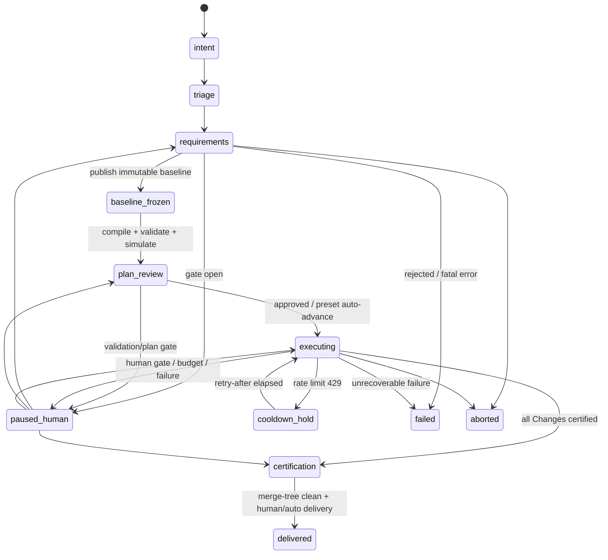

# ForgeOps v3.0 — Unified SDD Software Factory Kernel Specification

- **Document ID:** `FORGEOPS-SPEC-3.0`
- **Synchronized Chinese Edition:** [SPEC.zh-CN.md](file:///d:/Desktop/Courses_27/SE/Software-factory/docs/SPEC.zh-CN.md)
- **Runtime Stack:** Electron 44 (Node.js 24+ built-in `node:sqlite` + FTS5) · React 19 · `@xyflow/react` 12 · TypeScript (`gts` Google Style)
- **Repository Root:** `d:/Desktop/Courses_27/SE/Software-factory`

---

## 1. Product Positioning & Core SDD Axioms

### 1.1 Unified SDD-First Software Factory Kernel
**ForgeOps v3.0** unifies requirement engineering, organizational cognitive memory, multi-repository orchestration, isolated Git worktree execution, and independent verification into a single **Specification-Driven Development (SDD) Control Plane**. Rather than forcing users to manage disconnected sub-apps or configure dozens of low-level knobs before starting, ForgeOps presents one coherent **Mission** lifecycle that adapts to task risk while exposing the exact decision, explanation, and control needed at the right moment.

### 1.2 Seven Governing Engineering Axioms
1. **SDD-First Contract Authority (No Mandatory TDD):** Specifications (`Goal`, `Proposal`, `FR/NFR`, `AcceptanceCriteria`, `DomainTermEntry`, and `I/O Contracts`) are the authoritative contract. Every implementation slice, hard gate, and independent audit traces directly back to locked specification IDs. ForgeOps does not impose TDD Red-Green-Refactor cycles.
2. **Strict `live` vs `simulation` Honesty:** Execution mode (`live` | `simulation`) is explicit and immutable per Mission. In `live` mode, missing credentials, unreachable CLIs, rate limits, or unparseable auditor output NEVER silently fake success or synthesize dummy files—they surface deterministically as `setup_required`, `env_fault`, `cooldown_hold`, or `GATE_FAILED`. `simulation` mode executes deterministic offline responders in an isolated namespace without ever polluting `live` baselines, memory, or telemetry.
3. **Human Attention Conservation & Right-Time Projection:** Every control, notification, and field costs human cognitive budget. Healthy progress runs quietly; when human intervention is needed, `FocusProjection` surfaces one canonical, plain-language explanation, bound target hash, consequence previews for every option, and explicit legal runtime controls.
4. **Execution Never Self-Certifies:** Worker agents never certify completion. Certification requires deterministic host **Hard Gates** (`exitCode === 0`), **Phase-Scoped `fileScope` Containment**, **DDD Terminology Drift Gates**, and independent read-only **JQA + SQA Audits** verified against every `must` acceptance criterion.
5. **Acyclic Memory Dataflow & Authority Tiers:** Hindsight Layer 1 sources (`memory_documents`, `memory_chunks`) and Layer 2 atomic facts/observations (`memory_facts`, `memory_observations`) feed Layer 3 synthesized living docs (`memory_living_docs`) and human capsules. Layer 3 synthesized outputs NEVER re-enter `retain()` as Layer 1 documents. Authoritative facts (`L3_locked`) come strictly from verified kernel/human events; agent-emitted MCP facts are capped at `L1_observed`.
6. **Single-Writer SQLite Transactional Safety & Fencing:** Every state transition runs synchronously inside `ForgeStore.atomic()` (`BEGIN IMMEDIATE` + `PRAGMA busy_timeout = 5000`), rejecting async callbacks at both compile time and runtime. Concurrent async workers fence all mutations with `(version, executionEpoch)` CAS guards and route side effects through a leased `EffectsOutbox`.
7. **Zero-Leakage Multi-Repo Sandbox Isolation:** Repository mutations stay confined inside unique per-Change `git worktree` paths enforced by hardened `resolveInside` (blocking `.git` segments, NTFS alternate data streams, reserved device names, and `\\?\` escapes), serialized per common Git dir via `WorktreeLockManager`, and inspected via 100% read-only `diffSinceCommit` without mutating `.git/index` or `.git/config`.

---

## 2. Strictly Acyclic 5-Layer Module Architecture

Lower layers NEVER import higher layers. `src/shared/` remains 100% pure ES2022 (zero `node:*` imports, zero ES2023+ APIs such as `.findLast()` or `.toSorted()`) so both `tsconfig.json` and `tsconfig.renderer.json` compile cleanly.

```text
Layer 0 (Shared ES2022 Contracts):
  src/shared/      -> errors.ts, v3-types.ts, control-schema.ts, types.ts, api.ts, validation.ts

Layer 1 (Pure Domain Core — Zero FS/SQLite/Network I/O):
  src/core/        -> canonical-json.ts, schema-dsl.ts, glob-scope.ts, ddd.ts, cognitive.ts,
                      policy.ts, telemetry.ts, twin-graph.ts, spec-compiler.ts,
                      spec-validator.ts, trial-simulator.ts, impact-analyzer.ts

Layer 2 (Infrastructure Primitives — Depends only on Layers 0-1):
  src/sandbox/     -> contracts.ts, worktree-lock.ts, process-runner.ts, git-worktree.ts
  src/store/       -> schema.ts, mission-repo.ts, hama-repo.ts, memory-repo.ts, database.ts

Layer 3 (Subsystem Engines — Depends only on Layers 0-2; wired via callbacks):
  src/memory/      -> tokenizer.ts, embeddings.ts, hindsight-engine.ts
  src/adapters/    -> contracts.ts, resource-broker.ts, rate-limiter.ts, mcp-station.ts,
                      native-api.ts, cli-stream.ts, acp-client.ts, index.ts
  src/requirements/-> contracts.ts, markdown.ts, demo-responder.ts, hama-engine.ts

Layer 4 (Orchestration & Control Plane — Composes Layer 3):
  src/engines/     -> outbox-worker.ts, certifier.ts, continuity.ts, mission-orchestrator.ts,
                      dreaming.ts, infra-steward.ts, requirement-closure.ts

Layer 5 (Host Runtime & Loopback Server):
  src/server/      -> secret-vault.ts, rooms-service.ts, http-router.ts, runtime.ts
  src/electron/    -> main.ts, preload.ts
```

---

## 3. Unified Mission Lifecycle, Adaptive Triage & Intent Presets

### 3.1 Mission Aggregate & State Machine
Every user request enters via a unified `Mission` (`POST /api/missions`), progressing through five human-readable macro stages (`MissionStage`):
1. `understand` (`intent -> triage`)
2. `converge_spec` (`requirements -> baseline_frozen`)
3. `plan_validate` (`plan_review`)
4. `build_verify` (`executing`)
5. `certify_deliver` (`certification -> delivered`)

Cross-cutting operational states: `paused_human`, `cooldown_hold`, `failed`, `aborted`.



### 3.2 Adaptive Triage Tracks (`express | standard | full_hama`)
`triageMissionIntent()` deterministically selects the initial track from intent complexity, repository topology, and sensitivity triggers:
- **`express`**: Clear single-repo change with narrow scope. Runs fast intake + DDD/Hindsight check → concise Spec Confirmation → Compile & Build.
- **`standard`**: Medium feature touching one repo with moderate constraints. Runs Intake + Dependency Check → Targeted 2–3 role review → Consensus Proposal → Human Approval → PRD Baseline → Build.
- **`full_hama`**: Multi-repo epics, high-risk domains (`auth`, `billing`, `settlement`, `security`, `compliance`, `migration`, `payment`), multiple source documents, or ambiguous constraints. Runs the full 7-stage HAMA-Loop.
- **Pre-Baseline Escalation Only**: Post-intake deterministic auto-escalation can upgrade `express -> standard -> full_hama` while preserving already-staged `intake` and `dependency_map` artifacts. Once `baseline_frozen` is reached, `escalate_triage` is rejected; changes to frozen requirements MUST use **Baseline Evolution (`v1 -> v2`)**.

### 3.3 Intent Presets & Self-Describing Control Schema (`GET /api/schema/controls`)
Users select one of three presets instead of configuring 20 low-level parameters:
- **`autopilot`**: Maps to `permissionTier: 'turbo'`, auto-advances triage/plan/delivery when deterministic gates + quality thresholds pass (`>= 0.85`), allows up to 6 non-command-mutating GhostNode amendments, `maxParallelSlots: 3`, `budgetUsdLimit: 25`, `maxOvernightHours: 8`, `requireDualAudit: true`.
- **`guided`** (Default): Maps to `permissionTier: 'supervised'`, pauses for human confirmation at `triage_confirm` (when escalated or multi-repo), `approval` (Proposal), `confirmation` (PRD), `plan_review` (if warnings/errors), `ghost_amendment`, and `delivery_approval`, while running intermediate build waves autonomously (`maxParallelSlots: 3`, `budgetUsdLimit: 25`).
- **`strict_audit`**: Maps to `permissionTier: 'strict'`, requires explicit human sign-off at every HAMA gate, plan review, QA phase checkpoint decision, GhostNode amendment, and final delivery (`maxParallelSlots: 2`, `budgetUsdLimit: 40`).

Every control exposed by ForgeOps is self-described via `CONTROL_SCHEMA_REGISTRY`:
`{ key, group, label, plainExplanation, runtimeEffect, riskLevel, defaultByPreset, editableWhileRunning }`.
Switching preset mid-run (`switch_preset`) updates policy for **future** gates and scheduling waves only, naturally drains excess concurrency without killing active workers, NEVER silently auto-approves an already-open human gate, and NEVER mutates immutable `executionMode`.

---

## 4. Contextual Surface Engine ("Right-Time Projection")

### 4.1 `GET /api/missions/:id/focus`
Computes a pure indexed SQLite snapshot (`< 10ms`, zero synchronous `git` calls) returning:
- `stage` & `stageProgress`: Active macro stage (1–5), step checklist, active Change/node progress counts.
- `health`: `'flowing' | 'needs_you' | 'recovering' | 'completed' | 'failed' | 'aborted'`.
- `rehydration`: Ebbinghaus Human Re-hydration Capsule — **strictly `null` when $R_{\text{human}} \ge 0.75$** (zero noise when human memory is warm), `30s` delta when $0.35 \le R_{\text{human}} < 0.75$, and full re-anchor briefing when $R_{\text{human}} < 0.35$.
- `primaryAction`, `pendingActionCount`, `secondaryActions`: Surfaces ALL simultaneously open gates (e.g., parallel HAMA waves or multi-repo barriers) while highlighting the highest-priority hash-bound `MissionGateRecord`. Each option includes a human-readable `consequencePreview` explaining downstream effects.
- `availableControls`: Exact legality and impact summary for every `ControlAction` (`start`, `pause`, `resume`, `retry_node`, `rewind_checkpoint`, `amend_ghost`, `switch_preset`, `escalate_triage`, `evolve_baseline`, `abort`) computed from current Mission/Change state.
- `explainability`: Plain-language `whyHere`, `waitingReason`, active `dddTerms`, and top `recalledMemories` influencing the active step.
- `progressivePanels`: L1 (Summary & Active Decision), L2 (Twin-Graph, Diffs, Logs, Traceability), L3 (Raw Transcripts, Memory Graph, Outbox Queue, Control Schema).

### 4.2 Hash-Bound Idempotent Decisions & CAS Control Plane
- `POST /api/missions/:id/decisions` requires `{ gateId, targetId, targetHash, idempotencyKey, actor, action, feedback, scope, issueIds }`.
  - Computes canonical `payloadSha256 = sha256Canonical({ gateId, targetId, targetHash, actor, action, feedback, scope, issueIds })`.
  - If `idempotencyKey` already exists with matching `payloadSha256`, returns the stored `200` response idempotently; if `payloadSha256` differs, fails closed with `409 IDEMPOTENCY_CONFLICT`.
  - Rejects stale `targetId` / `targetHash` with `409 CONFLICT` so humans never approve out-of-date artifacts.
  - Zero substring heuristics (`includes('approve')`)—every `DecisionAction` executes an explicit typed branch.
- `POST /api/missions/:id/control` validates state preconditions and executes atomic CAS transitions (`WHERE id = ? AND version = ?`), appending a hash-chained `mission_events` record.

---

## 5. Unified HAMA-Loop Requirements Engine (`src/requirements/`)

Absorbed directly into ForgeOps's single SQLite database (`hama_runs`, `hama_artifacts`, `hama_comments`, `approved_baselines`) with zero fake document worktrees.

### 5.1 Seven-Stage Loop & Bounded Rework Algebra
1. **`intake`**: Extracts structured brief, typed evidence (`user_fact | document_fact | agent_inference | assumption`), base requirements (`REQ-*`), clarifying questions (`critical: boolean`), and `dependency_map` with cycle detection. Grounds prompts in Hub `agent-wiki`, DDD terms, and `Hindsight.recall()`.
2. **`clarify`**: Opens `clarification` gate if any question has `critical === true`.
3. **`discuss` (Parallel Independent Issue Waves + Loop A)**:
   - Moderator creates `agenda` mapping each base requirement to an `Issue` and owner role.
   - Issues with no unresolved `depends_on | prerequisite | conflict` edges between them run **parallel** waves (bounded by `ResourceSlotBroker`): each role produces an independent `propose`, then cross-`critique` against peer proposals, then Moderator `refine`.
   - Parallel workers emit isolated per-issue `proposal_drafts` and `discussion` artifacts only. A **single synchronous Transactional Board Reducer** inside `store.atomic()` merges settled wave conclusions onto `issue_board` and `dependency_map`. If a wave newly introduces a `conflict` or `depends_on` edge between two peers from that wave, the downstream peer is automatically re-opened for one reconciliation pass.
   - Unresolved issues enter Loop A (capped at `maxDiscussionRounds`), escalating blocked issues to a `discussion` human gate.
4. **`integrate`**: Consensus Agent synthesizes `Proposal` with unique reusable `scopeKey`s, `supersedesScopeKey` (when evolving from a parent baseline), non-goals, constraints, business rules, tradeoffs, and risks. DDD drift check blocks forbidden synonyms immediately.
5. **`eval-{value, feasibility, completeness, risk}` + `evaluation` (Loop B)**:
   - 4 independent read-only evaluators review the exact versioned Proposal concurrently.
   - Severity algebra: `veto | blocking | condition | uncertain | informational`. Both `condition` and `uncertain` findings MUST declare `owner` and concrete `verification`.
   - Deterministic aggregation: any `veto` → `escalation` (human gate, never averaged away); any `blocking` → `revision_required` (Loop B targets `integrate` if purely coverage without `issueIds`, else `discuss`); any `condition` or `uncertain` → `conditional_pass`; else `pass`.
6. **`approval` & `conditions`**:
   - Human reviews Proposal + 4-way evaluation. `conditional_pass` forbids raw `approve`, allowing `conditional_approve | request_changes | reject`.
   - `conditional_approve` transitions into a mandatory second **`conditions`** gate verifying release evidence via `release_conditions` before `prd` may run.
7. **`prd` -> `confirm` -> `publish` (Loop C & Immutable Baseline)**:
   - Requirements Agent generates 1:1 `scopeKey -> FR/NFR` with deterministic IDs:
     `FR-${sha256Canonical([projectId, scopeKey]).slice(0, 20)}` (or `NFR-...`) and `AC-${sha256Canonical([reqId, acKey]).slice(0, 20)}`, plus Given/When/Then acceptance criteria and full traceability.
   - Separate rework counters: `proposalReworkCount` (Loop B + proposal-level Loop C/approval) vs `prdLocalEditCount` (Loop C `scope: 'local'` wording/AC fixes, capped independently).
   - **Comment & Disposition Ledger (`hama_comments`)**: Dispositions `open | accepted | changed | rejected | deferred`. Agents CANNOT reject or defer human-authored `blocking` comments. `publish()` asserts `COUNT(open blocking comments) === 0` **inside the same `store.atomic()` transaction** that writes `approved_baselines`.
   - `approved_baselines` is protected by SQLite `BEFORE UPDATE` and `BEFORE DELETE` triggers (`RAISE(ABORT)`), bound by `canonicalJsonStringify` SHA-256.

### 5.2 Baseline Evolution (`v1 -> v2`) & Change Impact Analysis
When evolving an existing frozen baseline (`evolve_baseline`), `HamaEngine` links `parentBaselineId`, passes the prior `scopeKey` catalog to `integrate`/`prd`, and `analyzeBaselineImpact()` classifies added, modified, renamed (`supersedesScopeKey` or high token similarity), and removed FRs/ACs against active `ChangeRecord` Twin-Graphs—identifying preserved certified tasks vs invalidated nodes.

---

## 6. Hindsight × Ebbinghaus Unified Memory Engine (`src/memory/`)

All memory lives inside SQLite WAL (`execution_mode` partitioned between `'live'` and `'simulation'`).

### 6.1 Three-Layer Architecture & Four Parallel Indexes
1. **Layer 1 — Row-Immutable Sources (`BEFORE UPDATE/DELETE RAISE(ABORT)`)**:
   - `memory_documents`: Content-hashed (`UNIQUE(hub_id, execution_mode, content_sha256)`). Duplicate content attaches a `referenced_in` graph edge instead of failing or duplicating chunks.
   - `memory_chunks` + `memory_chunks_fts`: Overlapping <=800-char chunks with pre-tokenized bilingual `fts_tokens` (raw identifiers + `camelCase`/`snake_case` splits + overlapping CJK bigrams so `"活动报名"` matches natively in SQLite FTS5).
2. **Layer 2 — Claim-Immutable Facts, Living Observations & 4 Indexes**:
   - `memory_facts`: Trigger blocks `DELETE` and blocks `UPDATE` to `claim | kind | hub_id | source_document_id | event_start_at | ingested_at | execution_mode`. Allows updates ONLY to `valid_until`, `superseded_by_fact_id`, `stability_hours`, `recall_count`, `last_recalled_at`, `consolidated`.
   - `memory_observations`: Consolidated evolving beliefs (`active | contested | superseded | retired`) retaining full `history_json` of prior versions and evidence links. FTS5 triggers fire strictly `AFTER UPDATE OF title, statement, fts_tokens` (never on `recall_count` reads!).
   - **Four Retrieval Indexes**:
     1. **FTS5 Keyword**: BM25 over observations, facts, chunks using the bilingual tokenizer.
     2. **Float32 Vectors (`memory_vectors`)**: Local 128-dim signed random projection (`local-rp-128`) always available offline in `< 2ms`, plus optional `/v1/embeddings` keyed separately by `(embedding_space, dims)` so dimensions never mix. Bounded top-2000 active LRU per Hub keeps recall non-blocking.
     3. **Entity-Relation Graph (`memory_entities` + `memory_edges`)**: Canonicalized identifiers (`UNIQUE(hub_id, execution_mode, entity_type, canonical_key)`) + `aliases_json` bridging English canonical terms (`SettlementVoucher`) and Chinese labels (`结算凭证`) with 2-hop spreading activation.
     4. **Temporal Range**: Indexed `(hub_id, execution_mode, event_start_at, ingested_at)` for time-window & point-in-time queries.
3. **Layer 3 — Synthesized Living Docs (`memory_living_docs`)**:
   - Unified table covering `doc_kind: 'mental_model' | 'agent_wiki' | 'ddd_map' | 'pitfall_runbook' | 'baseline_changelog'`. Refreshed by `reflect()` via `OutboxWorker`, never looped back into `retain()`.

### 6.2 `retain`, `recall`, `reflect` & Two-Stage Consolidation
- **Authority Write Gate**:
  - `L3_locked`: Frozen baselines, human gate decisions, DDD canonical terms, constitution updates, certified checkpoints.
  - `L2_verified`: Hard gate outputs, SQA verdicts, `FailureForensicsCard` pitfalls, Retro diffs.
  - `L1_observed`: Agent-submitted `forge_memory_retain` calls (capped at `<= 5` per slice, confidence `<= 0.65`, CANNOT supersede `L2_verified` or `L3_locked` observations).
- **4-Channel RRF `recall()`**: Fuses rank lists across Vector + FTS5 + 2-Hop Entity Graph + Temporal via Reciprocal Rank Fusion ($\sum w_c / (60 + \text{rank}_c)$) weighted by Ebbinghaus retention $R(t) = \exp(-\Delta t / S)$ and Authority multiplier (`L3: 1.35`, `L2: 1.15`, `L1: 0.85`). Rejected HAMA options (`kind = 'rejected_option'`) surface explicitly flagged `REJECTED — DO NOT RE-PROPOSE`.
- **Two-Stage Outbox Consolidation**:
  - *Stage A (Deterministic)*: Single-valued functional `subject_key` namespaces (`ddd:*`, `req:*`, `repo:*`, `decision:*`, `constitution:*`) supersede conflicting lower/equal authority observations in-place while preserving both immutable facts and `history_json`. Multi-valued kinds (`pitfall`, `experience`, `world`) corroborate on high cosine similarity (`>= 0.85`) or coexist independently.
  - *Stage B (Optional LLM)*: Ambiguity-band pairs (`0.45 <= sim < 0.85`) in `live` mode classify `corroborates | refines | contradicts | unrelated`, marking stale `memory_living_docs` for background `reflect()` refresh.
- **Human Ebbinghaus Re-hydration**: Computes `computeMutationEntropy` purely from SQLite counters (certified tasks, GhostNodes, revised/contested observations, ADR updates, and incrementally persisted `lines_added + lines_deleted`).

---

## 7. Hardened SDD Parallel Orchestration, Sandbox & Certification

### 7.1 Spec Compilation, 3-Level Validator & Trial Simulator
- **`SpecCompiler`**: Translates `ApprovedRequirementsBaseline` (or Express/Standard spec) + Hub topology into ordered `ChangeBlueprint`s with `dependsOnChangeIds` (upstream schema/infra repos before downstream services), `requirementRefs`, `acceptanceRefs`, `planningRationale`, `inputContract`, `outputContract`, and non-overlapping `fileScope` globs.
- **`SpecValidator` (L1/L2/L3)**:
  - *L1 Structure*: Acyclic forward DAGs, `start -> end` reachability, orphan detection, bounded retries (`1..20`), cross-repo `dependsOnChangeIds` acyclicity via Kahn's sort.
  - *L2 Spec & DDD*: 100% `must` FR and AC task mapping, non-empty contracts/rationales, zero DDD forbidden aliases.
  - *L3 Capability & Isolation*: Healthy non-open-circuit adapters, overlapping `fileScope` warning among parallel tasks, strict-preset gate check.
- **`TrialSimulator`**: Pure static topological wave analyzer calculating parallel wave schedule, critical path length, contended file-scope task pairs, and unreachable nodes prior to burning tokens.

### 7.2 Parallel Phase-Wave Execution, Fencing & Phase-Barrier Rewind
- **Parallel Wave Scheduler (`ContinuityEngine`)**: Dispatches all ready nodes in a phase whose `fileScope` is disjoint (`!scopesOverlap`) from active nodes (empty `fileScope` requires exclusive worktree lock), capped by `ResourceSlotBroker`.
- **Single-Layer Broker Invariant**: ONLY leaf invocations inside `AgentAdapterHub.invoke()` hold `ResourceSlotBroker` slots; outer schedulers and composite stages never hold slots across awaits. Both worker and human queues honor `AbortSignal`.
- **Fencing & Atomic Deltas**: Every async worker slice, gate, and checkpoint verifies `change.executionEpoch === capturedEpoch` inside `store.atomic()`. Cost (`spent_usd`), premature stops, quality max, `GhostNode` splicing (`spliceGhostNodeAtomic`, never `DELETE FROM graph_nodes`), and append-only `change_epistemic_items` (`FailureForensicsCard` + handoff) all persist atomically.
- **Phase-Barrier Rewind**:
  - Individual task failure inside a phase retries after `revertTaskScope(worktreePath, node.fileScope)` (leaves sibling parallel tasks untouched).
  - Any `Restore` node or `manualRestoreToCheckpoint` acts as a **worktree barrier**: aborts active workers on that Change and awaits drain → increments `executionEpoch` → acquires repo common-git-dir lock → creates `refs/forgeops-backup/...` rescue ref and resets to `targetCommitSha` → rewinds ALL nodes downstream of `targetCheckpoint` (`computePhaseBarrierRewindSet`) so SQLite state never diverges from disk.
- **Cross-Repo Two-Phase Delivery & Upstream Invalidation**: Changes stay on isolated `forgeops/*` branches until ALL Mission Changes certify AND pass zero-mutation `git merge-tree --write-tree` readiness. Upstream SHA changes automatically mark downstream Changes `stale_upstream`.
- **Pre-Flight Budget Circuit Breaker**: Checks `spentUsd + reservedInFlightUsd + estimatedCallUsd <= budgetUsdLimit` inside `store.atomic()` prior to dispatching parallel waves.

### 7.3 Hardened Sandbox, Zero-Index Diff & Fail-Closed Certifier
- **Zero-Index-Mutation `diffSinceCommit`**: Uses `git -c core.quotePath=false diff` + `ls-files --others --exclude-standard -z` + pure-Node untracked unified diff generation (with NUL-byte binary skipping & bounded size) — zero `.git/index` touches, zero temp index `ENOTDIR`/`EBUSY` failures on Windows worktrees, full CJK filename support.
- **`resolveInside`**: Normalizes `\\?\`, rejects `\0`, `:`, NTFS ADS, Windows reserved device names, and any path segment stripping to `.git` (protecting worktree `.git` pointer files and submodule hooks).
- **`WorktreeLockManager` & Clean `.git/config`**: Serializes mutating git ops per canonical `git --git-common-dir`; commits pass `-c user.name=ForgeOps -c user.email=forgeops@local` instead of mutating local repo config.
- **Windows `.cmd` Shim Unwrapping & Stdin Prompt Transport**: `SandboxProcessRunner` resolves npm `.cmd` targets directly to `node.exe <script>` (`shell: false`), rejecting metacharacters on raw `.bat` fallbacks. `cli-stream` delivers prompts >2KB over `stdinText`.
- **Pure SDD Fail-Closed Certifier**: Diffs phase `selfcheck`/`gates` strictly against upstream `CP-(k-1)` using `isFileInsideScope`; sends File-Aware 32KB diff slices + randomized `<untrusted_diff nonce="...">` fences to JQA/SQA; validates strict per-AC verdicts via `schema-dsl.ts`; NEVER silently passes when `executionMode === 'live'`.
- **Hash-Chained Event Journal & Evidence Bundle**: `mission_events` maintains a cryptographic hash chain verified offline by `verifyEvidenceBundle(exportEvidenceBundle(missionId))`.

---

## 8. Database Schema (`SCHEMA_VERSION = 3`) & HTTP/SSE Endpoints

### 8.1 SQLite Tables & Idempotent Migration (`v1 -> v3`)
On startup, `ForgeStore` sets `PRAGMA journal_mode = WAL; PRAGMA synchronous = NORMAL; PRAGMA foreign_keys = ON; PRAGMA busy_timeout = 5000;`, checks `meta_kv.schema_version`:
- `0` (fresh): Creates full v3 schema (`missions`, `mission_gates`, `mission_decisions`, `mission_events`, `hama_runs`, `hama_artifacts`, `hama_comments`, `approved_baselines`, `change_epistemic_items`, `memory_documents`, `memory_chunks`, `memory_chunks_fts`, `memory_facts`, `memory_facts_fts`, `memory_observations`, `memory_observations_fts`, `memory_vectors`, `memory_entities`, `memory_edges`, `memory_living_docs`, plus upgraded v1 tables).
- `1 | 2`: Runs transactional idempotent `ALTER TABLE ADD COLUMN` (guarded by `hasColumn`), creates new tables/indexes/triggers, and backfills `semantic_memories` into `memory_documents` + `memory_facts` + `memory_observations`.
- `> 3`: Fails fast with `MIGRATION_ERROR`.

### 8.2 Control Plane & Memory Endpoints (Loopback CSPRNG Bearer Auth)
- **Missions & Contextual Surface**: `POST /api/missions`, `GET /api/missions`, `GET /api/missions/:id`, `GET /api/missions/:id/focus`, `POST /api/missions/:id/decisions`, `POST /api/missions/:id/control`, `GET /api/schema/controls`.
- **HAMA, Comments & Baselines**: `GET /api/missions/:id/hama`, `POST /api/missions/:id/comments`, `POST /api/missions/:id/comments/:commentId/disposition`, `GET /api/baselines?projectId=...`, `GET /api/baselines/:baselineId`, `POST /api/baselines/:baselineId/impact`.
- **SDD Traceability, Readiness & Audit**: `GET /api/missions/:id/traceability`, `GET /api/missions/:id/evidence`, `GET /api/missions/:id/events`, `GET /api/missions/:id/readiness`.
- **Hindsight Memory & Outbox**: `POST /api/memory/retain`, `POST /api/memory/recall`, `POST /api/memory/reflect`, `GET /api/memory/living-docs`, `GET /api/memory/observations`, `GET /api/memory/graph`, `GET /api/infra/outbox`.
- **Legacy v2.2 Routes**: All existing `/api/bootstrap`, `/api/hubs`, `/api/repositories`, `/api/domain-terms`, `/api/changes/*`, `/api/attention/*`, `/api/rooms/*`, `/api/memory/*`, `/api/infra/*`, and `/api/events` (SSE) remain operational.
