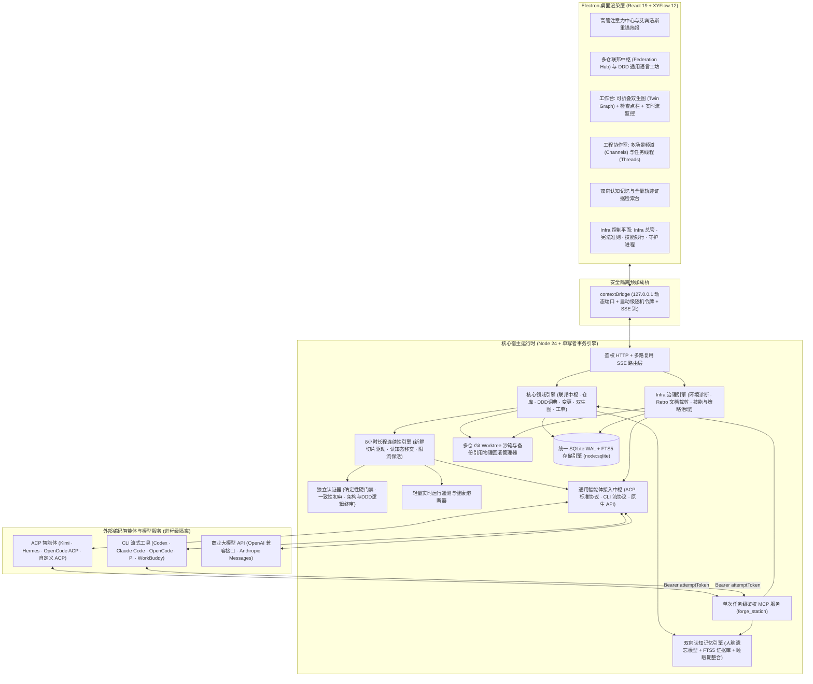

# ForgeOps — 企业级软件工程元编排工厂技术规范说明书

- **文档编号：** `FORGEOPS-SPEC-2.1-ZH`
- **英文同步版本：** [SPEC.md](file:///d:/Desktop/Courses_27/SE/Software-factory/docs/SPEC.md)
- **技术底座：** Electron 44（内置 Node.js 24.22+ 原生 `node:sqlite` + FTS5）· React 19 · `@xyflow/react` 12 · TypeScript（严格遵循 Google `gts` 代码规范）
- **仓库根目录：** `d:/Desktop/Courses_27/SE/Software-factory`

---

## 1. 产品定位与核心工程哲学

### 1.1 超越静态工作流：真正面向 ToB 复杂工程的元编排控制平面
传统的低代码 AI 工作流（类静态状态图编排）只能串联死板的提示词节点，无法应对真实的 ToB 软件工程场景：真实的企业需求往往横跨十几个相互关联的微服务仓库、团队与智能体之间的业务术语极易腐化漂移、底层代码的真实约束会在执行中途推翻初始计划、8 小时无人值守任务经常在半途幻觉“自判完成”或因限流中断，而同时推进多个项目的人类工程师精力与记忆带宽极为有限。

**ForgeOps** 是一套原生面向 ToB 工程交付的 **软件工程元编排桌面系统（Meta-Harness & Engineering Control Plane）**。它位于各类异构编码智能体（`Codex`、`Claude Code`、`OpenCode`、`Pi`、`Kimi`、`Hermes`、`WorkBuddy`、企业自研 CLI 及商业大模型 API）之上，不侵入各家工具自身的凭据沙箱，而是通过 **DDD 领域通用语言治理**、**多仓联邦主控中枢（Federation Hub）**、**动态双生执行图（Twin Graph）**、**物理级 Git Worktree 检查点回退**、**独立 Infra 治理平面** 以及 **人脑 × 智能体双向艾宾浩斯协同记忆系统**，实现工业级的软件工程闭环。

### 1.2 六大核心工程公理
1. **人类注意力守恒原则：** 每一条通知、每一个面板组件和每一次智能体提问都在消耗人类的精力预算。健康的自治推进在界面上保持零噪音；智能体**仅**在交付物就绪待审、触碰权限红线或遇到阻塞架构分叉时才允许发声，且每次只能提出 **1 个结构化单选/多选决策问题（首选推荐项置顶）**。
2. **DDD 领域通用语言先行（Ubiquitous Language）：** 每个工作区维护权威的**领域通用语言词典与限界上下文映射表**，贯穿需求拷问、架构契约、代码实现、门禁审查与重构全链路，彻底消灭多智能体协作中的概念漂移与同义词混乱。
3. **中枢集中治理、多仓分布执行（Federation Hub）：** 通过单一**主控中枢仓（Master Hub）**集中托管跨仓库服务拓扑、面向智能体裁剪的高信噪比架构文档、共享技能库与领域词典，向下联动数十个成员业务仓库各自独立的 `git worktree` 隔离变更。
4. **执行权与认证权彻底分离（严禁自证完成）：** 执行任务的 Worker 智能体绝无权力自行宣布任务完结。唯有通过宿主机直接执行的**确定性硬门禁（`exitCode === 0`）**、**DDD 与规格一致性审计**及**独立只读评估会话（Evaluator）**逐条核验通过后，节点与变更方可认证完成。
5. **强指挥弱与轻量实时运行反馈：** 高推理能力的强模型担任首席架构师/项目经理，负责需求闭环、跨仓契约拆解、DAG 规划与疑难兜底；高性价比模型按里程碑切片执行具体开发任务，并依托真实任务运行产生的通过率、单次认证有效成本与早停率信号动态调优分配。
6. **Infra 基础设施层独立自治：** 平台自身的宪法准则、共享技能库、面向智能体的架构维基裁剪、运行环境健康度与后台守护进程，由专属的 **`Infra Steward Agent`（基础设施总管智能体）** 在严格审计下统一维护，严禁普通业务项目智能体随意篡改全局基建。

---

## 2. 系统宏观架构与分层约束



### 2.1 严格依赖边界与单写者事务约束
- **纯领域核心（`src/core/`）：** 零进程调用、零文件读写、零网络依赖。纯粹承载 DAG 图可达性回退计算、DDD 术语校验逻辑、艾宾浩斯遗忘曲线公式、权限门禁策略与状态机演进。
- **单写者原子存储（`src/store/`）：** 一切状态写操作必须在 `Store.atomic()`（基于 `node:sqlite` WAL 模式的 `BEGIN IMMEDIATE` 事务）中完成；启动子进程、执行门禁脚本、推送通知等外部副作用统一写入持久化 **`EffectsOutbox` 队列**，严格在事务提交后（`afterCommit`）异步投递。
- **前后端双编译面物理隔离：** `tsconfig.host.json`（NodeNext，主进程与核心引擎）与 `tsconfig.renderer.json`（DOM/Bundler，React 桌面端）彻底分离，仅通过 `src/shared/` 共享纯类型契约与校验器。

---

## 3. 企业级多仓联邦中枢（Federation Hub）与 DDD 通用语言引擎

### 3.1 多仓库联邦主控中枢（解决微服务群协作与探索损耗）
在真实的 ToB 企业研发中，一个业务特性往往涉及网关、鉴权、订单、账单与前端控制台等十余个甚至数十个代码仓库。若在每个仓库重复维护零散的提示词与技能，不仅无法在全局视角下做需求推演，更会让智能体在每次任务开始时消耗海量 Token 盲目扫描目录。ForgeOps 原生设计 **Federation Hub（联邦主控中枢）**：

1. **主控中枢架构：** 以一个独立的 Hub 目录作为全局大脑，集中存放 `AGENTS.md` 多仓拓扑导航、面向智能体精简的高密度接口契约维基（`docs/agent-wiki/`）、`ddd/ubiquitous-language.json` 领域词典以及全局 `Skills Bank`；各成员 Git 仓库挂载于 gitignore 的子目录或外部本地路径下。
2. **面向智能体的精炼文档治理（Writing-for-Agents）：** 摒弃冗长空洞的人类叙事文档，维护精炼的服务边界、核心入口文件、RPC/HTTP 载荷契约与标准构建验证命令，将智能体的盲目探索轮次压缩到最低。
3. **中枢级全局需求拷问 $\to$ 多仓协同变更编排（Cross-Repo Epic）：**
   - 在中枢视角结合全量关联仓库文档进行一次性需求压力测试（`Grill-with-Docs`）。
   - 主架构师将定稿规格拆解为带跨仓契约先后依赖的多仓库变更单（例如：先在 `shared-proto` 仓完成契约变更并通过门禁 $\to$ 再并发启动 `billing-service` 与 `web-portal` 各自的 `git worktree` 开发切片）。
4. **交付后复盘沉淀闭环（Retro Loop）：** 每次变更归档后，复盘引擎自动扫描执行轨迹中“反复检索弯路”或“跨仓接口踩坑”片段，生成文档精简补丁与新增技能建议，持续为后续研发节省上下文预算。

### 3.2 DDD 领域驱动设计与通用语言注册中心（Ubiquitous Language）
为根治多智能体与跨团队开发中最致命的“同物异名、概念腐化”问题：

```typescript
export interface DomainTermEntry {
  readonly id: string;
  readonly hubId: string;
  readonly boundedContext: string;          // 限界上下文，如 'Billing' | 'OrderFulfillment'
  readonly owningRepoIds: readonly string[];// 归属代码仓库列表
  readonly canonicalTerm: string;           // 唯一标准代码标识符，如 'SettlementBatch'
  readonly localLabel: string;              // 业务中文标准名，如 '结算批次'
  readonly definition: string;              // 领域不变量与业务语义边界定义
  readonly forbiddenAliases: readonly string[]; // 严禁混用的同义词黑名单，如 ['ClearanceGroup', 'BillPack']
  readonly schemaAnchors: readonly string[];    // 核心代码锚点路径
}
```

- **全链路上下文注入：** 需求拷问、DAG 任务切片契约、架构评审自动按所属限界上下文挂载对应的通用语言词表。
- **术语合规门禁与重构工作流：** 门禁检查器与独立审计器自动扫描新增导出类型、接口路由与数据表字段；一旦发现使用了 `forbiddenAliases` 黑名单别名即触发拦截，并支持一键发起**“DDD 通用语言对齐重构变更”**。

---

## 4. Infra 基础设施控制平面与 `Infra Steward Agent`

真正企业级的软件工厂必须将 **平台基建治理（`INFRA` 项目层）** 与 **业务特性交付（常规服务项目层）** 严格解耦。

### 4.1 Infra 层核心职责矩阵
1. **最高工程宪法（`Soul Constitution`）：** 托管带版本历史的全局编码红线、安全合规策略、Git 提交规范与质量门禁基线。
2. **全局技能银行（`Skills Bank`）与模板库：** 统一纳管可复用的工程技能包（需求拷问、DDD 建模、多仓拆解、安全审计、复盘提炼等），支持版本对比与一键回滚。
3. **运行环境与神经链路自检（`Neural Link` / `Environment Doctor`）：** 自动探测本机工具链（`git`、`node`、`python`）、各外部智能体 CLI 可用性与登录态、MCP 回路连通性，并定期清理孤儿 `git worktree`。
4. **后台自治守护进程（`Daemon Agents`）：** 统一管控长程连续性看门狗、睡眠期记忆整合守护进程（`DreamingDaemon`）以及定时巡检任务（`Cron / Heartbeat`）。
5. **平台演进日志（`Evolution Logs`）与企业级合规审计账本（`Audit Ledger`）：** 完整记录每一次策略版本变更、技能升级、门禁放行、异常回滚与人工授权链，满足 ToB 可追溯审计要求。

### 4.2 专属基础设施总管：`Infra Steward Agent`
**`Infra Steward Agent`** 是常驻于 **Infra 控制平面** 的平台工程与 SRE 专属智能体：
- **跨项目复盘提炼与文档瘦身：** 汇总各业务仓库交付后的经验轨迹，负责裁剪维护中枢 `agent-wiki` 架构导航图，并将高频工程套路提炼入库至 `Skills Bank`。
- **工具链故障诊断：** 当实时遥测捕获外部智能体出现连续环境异常（`env_fault`，如 CLI 路径失效、鉴权过期、端口冲突）时，自动执行环境诊断并输出精准修复指引。
- **受控的平台自举演进（Governed Self-Evolution）：** 当工厂自身的规格模板、全局门禁脚本或共享技能需要升级时，由 `Infra Steward Agent` 在 `INFRA Core` 项目下发起标准受控变更，必须通过双级质量审计（一致性初审 + 架构逻辑终审）后方可生效并记入 `Evolution Logs`。

---

## 5. 通用多智能体接入中枢与单次鉴权 `forge_station` MCP

### 5.1 三大通用接入协议 + 零代码自定义清单
任何用户或企业团队均可无缝接入日常主力智能体，无需改动核心引擎源码：

1. **`acp-stdio`（Agent Client Protocol — 基于 `stdio` 的 JSON-RPC 2.0 标准协议）：**
   - 完整实现 `initialize` $\to$ `session/new`（绑定隔离 `worktree` 目录并注入 `forge_station` MCP）$\to$ `session/prompt` $\to$ 流式接收 `session/update` $\to$ 按权限档位自动或人工响应 `session/request_permission`。
   - 原生即插即用支持 **Kimi CLI**（`kimi acp`）、**Hermes**（`hermes acp`）、**OpenCode ACP** 等所有遵循 ACP 标准的智能体。
2. **`cli-stream`（官方无头 CLI 流式协议）：**
   - 内置 **Codex**、**Claude Code**、**OpenCode**、**Pi**、**WorkBuddy** 一等预设，并提供**声明式自定义 CLI 接入清单（Custom Adapter Manifest）**（配置可执行程序、参数模板、MCP 挂载参数、JSONL 事件映射与权限开关即可接入任意第三方或企业内部 CLI）。
   - 全程在官方 CLI 自有进程内运行（`shell: false`），严格遵守各厂商沙箱与认证边界。
3. **`native-api`（原生流式工具调用循环）：**
   - 原生支持 **OpenAI 兼容接口** 与 **Anthropic Messages API**，内置严格限制在当前 `worktree` 路径内的文件读写、精准编辑、代码检索、命令执行与结构化提交工具。

### 5.2 单次尝试级安全 `forge_station` MCP 桥接
每次启动任务切片时，宿主机动态签发一次性 `attemptId` 与 256 位高强度随机令牌 `attemptToken`，向智能体暴露受控 MCP 工具集：
- `forge_get_contract()` — 获取当前切片目标、允许修改的文件边界、关联的 DDD 通用语言词条与门禁命令。
- `forge_read_artifact(artifactId)` — 按需读取上游规格书、ADR 架构决议或跨仓接口契约，避免初始提示词膨胀。
- `forge_memory_search(query)` — 按需检索 FTS5 全文历史轨迹证据与当前有效的语义经验。
- `forge_report_progress(summary, touchedFiles)` — 向工作台实时上报里程碑进展心跳。
- `forge_ask_human(question, options, recommendedIndex, context)` — 提交 **1 个具体结构化决策问题** 至人类注意力收件箱，并立即优雅挂起当前切片、释放并发槽位。
- `forge_propose_amendment(title, reason, insertBeforeNodeId, gateCommand)` — 当发现底层真实代码存在未预见前置依赖时，提议动态插入 **`GhostNode`（计划变更节点）**。
- `forge_submit(deliverable)` — 经 JSON Schema 严格校验的结构化交付提交（含修改清单、DDD 术语合规说明与四段式认知移交摘要）。

### 5.3 轻量实时运行反馈与健康熔断（替代臃肿的离线跑分中心）
摒弃厚重冗余的独立离线测评套壳，直接从真实工程切片执行流中无感采集核心运行反馈指标：
- **严格剥离环境故障（`env_fault`）与任务能力失败（`task_failure`）：** CLI 未安装、登录态失效或网络中断归类为 `env_fault`，连续触发时自动熔断告警并切换健康备选通道，绝不污染模型能力画像。
- **实时运行画像：** 在智能体与模型卡片上轻量展示滚动窗口内的**一次过门禁率**、**单次认证有效成本**、**缓存命中率**与**早停拦截次数**，直接辅助主调度器执行“强指挥弱”精准派工。

---

## 6. 动态双生执行图（Twin Graph）、双级质量门禁与物理回退

### 6.1 需求闭环（`G1`）$\to$ 双生图编译（`G2`）$\to$ 认证交付（`G3`）
1. **多视角需求闭环拷问（`G1`）：** 主持人协同产品、架构、安全与测试视角，结合中枢文档与 DDD 通用语言对原始需求做边界压力测试，每次最多向人类追问 1 个关键决策点，输出冻结版 `SPEC` 与可执行验收判据。
2. **双向实时同步的 `Twin Graph`（左侧 WBS 任务树 ↔ 右侧可视化控制流图）：**
   - **左侧层级化 WBS 面板：** 展示 `Phase` $\to$ `Task` $\to$ `Subtask`（如 `T2.1.1`）树状进度、指派智能体徽章与耗时/成本指标。
   - **右侧 `@xyflow/react` 交互式画布：**
     - **可折叠 `PhaseContainer` 阶段容器节点：** 折叠态展示紧凑阶段卡片与完成进度条（如 `15/15`）；展开态在容器内部清晰排布嵌套的子任务卡片（基于 React Flow 原生 `parentId` 容器嵌套）。
     - **`VerifyNode`（规格与 DDD 完整性守卫）：** 校验产物结构完备性与通用语言术语一致性。
     - **`GatesNode`（确定性硬门禁）：** 宿主机直接执行 `lint`、`typecheck`、构建与契约校验脚本（`exitCode === 0`）。
     - **`SelfCheckNode` 与双级独立审计 `AuditNode`（一级一致性初审 `JQA` + 二级架构与 DDD 逻辑终审 `SQA`）：** 独立只读会话评估，JSON 解析采用严格 **Fail-Closed（解析失败即判不通过）** 策略。
     - **显式可视化的 `DecisionNode` $\to$ `RestoreNode` $\to$ `CheckpointNode` 闭环拓扑：** 每个门禁决策节点明确绘制绿色 **`[PASS]`** 前进连线与红色 **`[FAIL]`** 回退连线；失败路径经由醒目的 **`RestoreNode`（恢复节点）** 精准指向上游 **`CheckpointNode`（检查点节点）**！
     - **虚线高亮 `GhostNode`（动态计划修订节点）：** 直观呈现运行中途提议或自动生效的任务增补、拆分与依赖调整，并同步记入变更演进日志。

### 6.2 图论精确可达集回退与零丢码物理 Git 恢复
- **分支隔离的精确回退集：** 当从失败点 $v_{\text{fail}}$ 回退至检查点 $c_{\text{target}}$ 时，引擎严格只重置集合 $\text{Descendants}(c_{\text{target}}) \cap \text{AncestorsClosed}(v_{\text{fail}})$ 内的节点，绝不误伤无关并行分支的已完成成果。
- **带备份引用的物理 Git 回滚：** 每个 `CheckpointNode` 均在当前变更专属的 `git worktree` 中创建原子提交与标签（`forgeops/cp/<changeId>/<seq>`）。在执行任何物理重置前，沙箱自动创建救援引用 `refs/forgeops-backup/<changeId>/<timestamp>-<sha>` 确保历史代码零丢失，同时向重跑节点注入结构化**《失败取证卡》（`FailureForensicsCard`）**，防止下一轮重蹈覆辙。

---

## 7. 三档权限分级与 8 小时无人值守连续性引擎

### 7.1 权限分级体系
- **`Turbo`（全速自动驾驶 —— 日常高频主力模式）：** 确定性硬门禁与双级独立审计全部达标即自动放行；工作树沙箱内常规读写与构建免审批（宿主机高危命令黑名单依然硬拦截）；局部 `GhostNode` 计划微调由主架构师智能体自动裁决。
- **`Supervised`（企业均衡监管模式）：** 仅在 `G1`（需求冻结）、`G3`（合并交付）及重大结构变更时请求人工一键签批，中间研发阶段全自动推进。
- **`Strict`（高敏与 Infra 核心变更模式）：** `G1 / G2 / G3` 全门禁、所有计划修订及外部依赖变更均需人工显式批准。

### 7.2 根治“8 小时任务 4 小时早停”的五重工程保障
1. **按 DAG 切片的新鲜会话隔离：** 将数小时的宏大目标拆解为 10–25 分钟粒度的里程碑切片，每个切片启动全新上下文会话，彻底杜绝单会话跑满十几万 Token 后的注意力退化与幻觉。
2. **四段式认知态移交协议（Epistemic Rollover）：** 跨切片或上下文临近阈值滚动时，移交摘要强制划分为四个隔离区块：
   - `已验证规格事实（SPEC-CONFIRMED FACTS）`（必须附源文件或规格出处）
   - `智能体推演假设（AGENT HYPOTHESES）`（严禁因跨轮重复而升格为既定事实！）
   - `待裁决冲突（OPEN CONFLICTS）`
   - `未核验验收项（UNCERTIFIED ACCEPTANCE CRITERIA）`
3. **外部独立完结认证器（`CompletionCertifier`）：** 只要任务树尚有未认证叶子节点、全局验证命令返回非零、或独立审计发现未满足的验收条件，即使智能体输出“已全部完成”，宿主机也会立即拦截早停、记录早停次数并自动派发下一轮续跑指令（精确点名剩余缺口）。
4. **夜间限流保活状态机（`CooldownHolding`）：** 针对半夜必然遭遇的 API `429` 限流、CLI 5 小时滑动额度窗口或瞬时网络抖动，自动进入分级指数退避等待（`5s` 至 `30m` 轮询保活，支持在 `Turbo` 模式下平滑切流至备用适配器），绝不把限流误判为任务永久失败。
5. **连续两次受阻自动升级强模型兜底：** 当普通执行智能体在同一切片连续 2 次未通过门禁时，调度器自动唤醒高推理强模型介入攻坚或通过 `GhostNode` 重组拆解路径。

---

## 8. 工程协作室（多场景人机与多智能体群组协同）

内置持久化频道与任务线程，并配备 **1 个永久预留的人类交互高优并发槽位**（哪怕后台所有自动化槽位全部跑满，你在频道里 `@智能体` 依然秒级响应）：

1. **`#req-grill`（需求与领域边界拷问室）：** 结合多仓全局文档做多视角追问与压力测试，沉淀冻结版 `SPEC`（`G1`）。
2. **`#arch-council`（跨仓架构与 DDD 评审会）：** 主架构师协同领域/安全专家智能体博弈技术方案，锁定 **ADR 架构决议** 与 **通用语言词条**。
3. **`#triage-ops`（阻塞升级与计划修订室）：** 自动汇总门禁失败取证卡与 `GhostNode` 提议，规格内问题由主架构师自愈闭环，超纲分叉提炼为单问题卡片呈交人类。
4. **`#direct-ops`（自由指令与多智能体联合作战室）：** 支持直接 `@codex`、`@claude`、`@pi`、`@kimi`、`@infra` 实时对话协作，支持一键**“将讨论共识升级为正式变更单（Promote to Change）”**。
5. **`#exec-briefing`（多项目高管晨报/晚报室）：** 零废话汇总所有在途仓库的隔夜进展与风险摘要。

---

## 9. 人脑 × 智能体双向艾宾浩斯协同记忆系统

专为**单人同时统筹推进 3 个以上复杂软件项目或多仓联邦**而设计的双向认知减负系统。

### 9.1 人脑侧：艾宾浩斯遗忘度建模与渐进式心智重锚胶囊
针对每个项目/中枢 $P_k$，综合记录你距离上次深度交互的离开时长 $\Delta t$（小时）、已完成间隔回顾次数 $n_{\text{reviews}}$，以及你离开期间智能体自主推进产生的**未读项目变异熵**：
$$\Delta_{\text{entropy}}(P_k) = 0.15 N_{\text{tasks}} + 0.35 N_{\text{amendments}} + 0.50 N_{\text{adrs}} + 0.10 \ln(1 + \text{LOC}_{\text{changed}})$$
由此计算人脑对该项目当前状态的有效记忆稳定性 $S_{\text{human}}(P_k)$ 与保留度 $R_{\text{human}}(P_k) \in (0, 1]$：
$$S_{\text{human}}(P_k) = \frac{S_0 \cdot (1 + 0.6 \cdot n_{\text{reviews}})^{0.8}}{1 + 0.25 \cdot \Delta_{\text{entropy}}(P_k)}, \qquad R_{\text{human}}(P_k) = \exp\!\left(-\frac{\Delta t}{S_{\text{human}}(P_k)}\right)$$

- **$R_{\text{human}} \ge 0.75$（热记忆状态）：** 静默零打扰模式，不展示冗余摘要，仅呈现待办决策项。
- **$0.35 \le R_{\text{human}} < 0.75$（跨项目切换过渡态）：** 自动生成 **30 秒增量重锚胶囊**（你上次停留在哪 $\to$ 期间自主完成了哪些节点/变更 $\to$ 当前唯一需要你拍板的一件事）。
- **$R_{\text{human}} < 0.35$（深度遗忘或剧烈演进态）：** 展开**全景心智重锚简报**（一句话核心北极星目标 + 上次离开以来的双生图变更高亮对比 + 新增 ADR/DDD 词条汇总 + **“已掌握并重锚”**按钮；点击即重置 $\Delta t$ 并累加 $n_{\text{reviews}}$，按间隔重复规律拉平后续遗忘曲线）。

### 9.2 智能体侧：四层记忆架构与睡眠期后台整合（`DreamingDaemon`）
1. **L0 切片活跃工作面：** 严格受控的单切片上下文窗口 + 四段式认知移交摘要。
2. **L1 全量轨迹证据库（`node:sqlite` + `fts5` 全文检索）：** 统一归一化存储所有异构智能体的会话、消息、工具调用与输出记录，仅通过 `forge_memory_search` 按需精准调取，绝不无脑灌入提示词。
3. **L2 双时态语义经验库（`valid_from / valid_until` + 智能体效用遗忘度 $R_{\text{agent}}$）：**
   - 存放经验证的架构事实、避坑准则与仓库惯例。
   - **双时态防毒化：** 当后续重构推翻旧结构时，旧记忆自动标记 `valid_until = 当前时间` 并关联 `superseded_by_id`——既保留完整历史可追溯性，又彻底杜绝过时架构知识污染新任务。
   - **效用强化与自然遗忘：** 被智能体检索后若助推当前切片一次通过硬门禁，则记忆强度 $S_{\text{agent}}(m)$ 自动倍增；长期未命中或失去效用的边缘经验随 $R_{\text{agent}} = e^{-\Delta t / S_{\text{agent}}}$ 自然衰减归档。
4. **L3 永固宪法与领域层：** `Soul Constitution`、`DDD 通用语言词典`与当前生效的 `SPEC` 永久锁定（$S = \infty$）。
5. **睡眠期整合守护进程（`DreamingDaemon`）：** 利用系统空闲算力或阶段检查点间隙，在后台自动从“先败后胜”的调试轨迹中提炼避坑卡片、比对 `git diff` 淘汰失效锚点记忆，并预先算好各项目的人类重锚胶囊（实现界面切换零等待）。

---

## 10. 统一存储模型与六大桌面核心视图

### 10.1 核心 SQLite WAL 数据表（`SCHEMA_VERSION = 1`）
- `hubs` 与 `repositories`：多仓联邦中枢、成员仓库绑定（区分 `infra` 基建仓与 `service` 业务仓）、验证命令及人类记忆锚点时间戳。
- `domain_terms`：DDD 限界上下文、标准代码术语、业务释义、禁用同义词黑名单与代码文件锚点。
- `changes`：单仓或跨仓联动变更单、专属 `worktree_path`、分支、权限档位、质量评分、预算与时长上限。
- `graph_nodes` 与 `graph_edges`：同步支撑 WBS 树与可视化控制流图的节点（`phase_container`、`task`、`verify`、`gates`、`selfcheck`、`audit_jqa`、`audit_sqa`、`decision`、`restore`、`checkpoint`、`ghost`）及 `pass / fail / dep` 有向边。
- `checkpoints`：引擎状态快照 + `git_commit_sha` + `git_tag` + `rescue_ref` 备份引用。
- `attention_queue`：跨项目优先级排序的单问题决策卡、门禁签批与计划修订审批项。
- `rooms`、`threads`、`room_messages`：多场景工程协作频道、消息流与授权委托（`Mandate`）。
- `sessions`、`messages`、`tool_calls`、`tool_results` + `messages_fts`（`fts5`）：跨智能体全量轨迹证据库。
- `semantic_memories` + `memories_fts`（`fts5`）：双时态有效窗口 + 艾宾浩斯效用权重的结构化经验库。
- `execution_telemetry`：切片实时通过/失败/环境异常记录、Token 与缓存占比、成本及早停拦截计数。
- `adapters`、`models_pool`、`skills_bank`、`effects_outbox`、`audit_ledger`。

### 10.2 桌面端六大工作空间视图
1. **`注意力与高管总览（Attention & Executive Overview）`：** 跨项目待人工拍板事项置顶队列、艾宾浩斯心智重锚胶囊、8 小时无人值守运行大盘与并发槽位监控。
2. **`联邦中枢与项目注册表（Federation Hub & Registry）`：** 区分 `INFRA` 基建项目与业务服务仓库、多仓服务契约拓扑图、**DDD 通用语言工坊**，以及变更控制台（团队编组、规格文档、双级质量门禁配置、严格作用于单变更的归档操作）。
3. **`双生图工作台（Workstation — Twin Graph）`：** 左侧 WBS 层级进度树 + 右侧可折叠 `PhaseContainer` 嵌套画布（完整呈现 `Gates -> Audit -> Decision --[FAIL]--> Restore --> Checkpoint` 闭环及虚线 `GhostNode`）+ 实时工具输出流监控 + 底部物理 Git 检查点时间轴（一键查看差异与安全回滚）。
4. **`工程协作室（Engineering Rooms）`：** 5 大预设工程频道、右侧线程上下文抽屉、`@智能体` 实时调度与一键“升级共识为正式变更单”。
5. **`认知记忆观星台（Cognitive Observatory）`：** 人脑 × 智能体双向遗忘曲线可视化、FTS5 毫秒级历史证据检索、现行有效 vs. 已替代双时态语义记忆浏览器。
6. **`Infra 控制平面与智能体工厂（Infra & Agent Factory）`：** `Infra Steward Agent` 治理台、`Soul Constitution` 宪法编辑器、`Skills Bank` 技能银行、`Agents Market`（通用适配器接入、实时运行健康画像、一键环境自检）、掩码隔离的 `Models Pool` 模型池、守护进程开关与全量演进审计账本。

---

## 11. 安全隔离与企业级红线不变量
1. **本地回环动态鉴权：** 服务端严格绑定 `127.0.0.1:0` 动态随机端口，启动时生成 256 位密码学随机令牌，仅通过 Electron `preload` 的 `contextBridge` 注入渲染层（开启 `contextIsolation: true`、`sandbox: true`、`nodeIntegration: false`）。
2. **只写密钥保险箱（Write-Only Vault）：** 模型 API 密钥仅保存在宿主安全存储中，任何查询接口严禁向前端返回明文密钥（仅返回掩码提示与配置状态）。
3. **零 Shell 注入与严格路径囚笼：** 外部命令调用一律采用 `shell: false` 参数数组直启；跨平台大小写不敏感剔除宿主敏感环境变量；基于 `fs.realpathSync` 的 `resolveInside` 强制锁定变更工作树目录（防御符号链接逃逸并禁止篡改 `.git/hooks`）；超时或取消时在 Windows 下执行 `taskkill /T /F` 彻底清理整棵子进程树。
